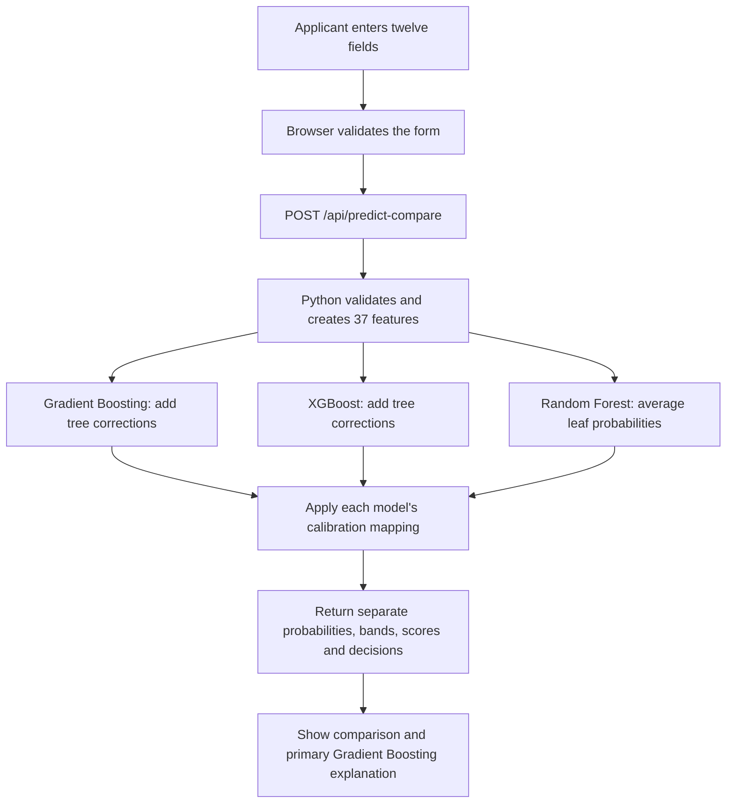

# CredoScore - Loan Default Risk Predictor

[](https://nextjs.org/)
[](https://react.dev/)
[](https://www.typescriptlang.org/)
[](https://www.python.org/)
[](https://scikit-learn.org/)
[](https://xgboost.readthedocs.io/)
[](https://tailwindcss.com/)
[](https://credoscore-gk.vercel.app)

**CredoScore estimates loan-default risk and explains how the prediction was calculated.** Enter twelve applicant details to compare calibrated results from **Gradient Boosting, XGBoost and Random Forest**. The primary Gradient Boosting result includes a risk slip, a factor-by-factor explanation and an adjustable decision cutoff.

[Live application](https://credoscore-gk.vercel.app) · [Source repository](https://github.com/gursimrannkaurr/credoscore) · [UCI dataset](https://archive.ics.uci.edu/dataset/144/statlog+german+credit+data)

This is a student learning project using historical German credit records. It demonstrates model training, evaluation, export, API scoring and an interactive interface. **It is not a validated lending system and should not be used for real credit decisions.**

## What you can do

| Page | What it shows | How to read it |
| --- | --- | --- |
| **Brief** (`/`) | Project overview, error costs, model pipeline and calibration | Start here for explanations of default probability and the dataset. |
| **Assess** (`/assess`) | Applicant form, presets, three model results, primary explanation and cutoff slider | A probability describes estimated risk; a decision is a separate policy rule applied to that probability. |
| **The book** (`/portfolio`) | Risk bands, approval thresholds, deciles and borrower segments | The book is the 1,000-row historical dataset. Charts use saved Gradient Boosting out-of-fold predictions. |
| **Methodology** (`/model`) | Benchmarks, hyperparameters, ranking metrics, calibration, feature importance and limitations | Explains what each measurement means and what it cannot establish. |

The assessment form starts with the **Typical file** preset. **Strong file** and **Stretched file** load other examples. A preset fills in input fields; the result is calculated by the live scoring API when the form is submitted.

## How a request becomes a prediction



1. **Collect inputs.** The form records applicant details, loan terms and credit-position categories.
2. **Validate twice.** Browser checks give immediate feedback. The Python handler repeats the checks because browser validation can be bypassed.
3. **Encode once.** `validate_and_extract()` checks the request; `build_vector()` puts the validated values into the numeric and one-hot-column order recorded in the model artifact.
4. **Score each model.** The API walks the exported trees. Boosting models add leaf corrections to a starting margin; Random Forest averages leaf probabilities.
5. **Calibrate.** Each model has its own fitted logistic mapping that converts its raw output into an estimated probability of default.
6. **Build the response.** The API assigns a risk band, a custom display score and a suggested decision. Boosting models also return tree-path contributions.
7. **Render results.** The workbench displays all three results. Gradient Boosting drives the main risk slip, waterfall and individual cutoff control.

The three model results are **not averaged into a fourth prediction**, and the app does not use majority voting. They share a dataset and features, so agreement is context rather than independent proof of correctness. Scoring a new applicant does not retrain a model or save the applicant's details.

## The three deployed models

| Model | How it learns and scores | Exported configuration | Role |
| --- | --- | --- | --- |
| **Gradient Boosting** | Builds trees sequentially, each learning a correction that reduces classification loss; sums the corrections | 250 trees, depth 3, learning rate 0.05, subsample 0.8, minimum 20 samples per leaf | Primary result, displayed explanation and adjustable decision cutoff |
| **XGBoost** | Uses regularised gradient boosting, with gradient and curvature information to choose useful corrections | 200 trees, depth 3, training learning rate 0.05, positive-class weight 700/300 | Additional probability, risk band, score and decision; contributions are returned by the API |
| **Random Forest** | Fits separate trees using bootstrap samples and random feature subsets, then averages predicted leaf probabilities | 300 trees, maximum depth 6, balanced class weights | Additional probability, risk band, score and decision; no contribution breakdown in its response |

XGBoost is a boosting implementation; Random Forest uses bagging. They are not large language models. Claude Code and Codex were development assistants, not the models used to score applicants.

### Why export the models as JSON?

Training uses pandas, NumPy, scikit-learn and XGBoost. Inference does not need those libraries: the fitted trees can be represented as arrays of feature indices, thresholds, child indices and leaf values. The JSON files also contain encoding information, calibration coefficients and model metadata.

The production Python functions load that representation and evaluate it with the standard library. **Dependency-free scoring refers to the Python inference code**, not to the frontend or the training environment.

Preserving numerical behaviour matters. The scorer uses `<=` for scikit-learn tree splits and strict `<` for XGBoost. XGBoost leaf corrections already include its training learning rate, so the exported runtime multiplier is 1.0. Export/parity checks compare custom scoring with the fitted library models.

## Data and preprocessing

The source is **UCI Statlog German Credit Data**, associated with 1,000 historical German credit records: 700 good-credit and 300 bad-credit outcomes. The project encodes the target as `0` for good credit and `1` for bad credit/default.

| Input group | Fields |
| --- | --- |
| Numeric | `age`, `employment_years`, `monthly_income`, `loan_amount`, `duration_months`, `existing_credits` |
| Categorical | `job_type`, `housing`, `purpose`, `credit_history`, `checking_status`, `savings_status` |

The source has twenty attributes. The project retains twelve inputs and maps category codes into readable labels. Employment-duration buckets become representative years. Monthly income is **derived from loan amount, duration and the instalment-rate bucket**; it is not an independently observed salary and inherits the source bucket's uncertainty. Amounts remain in **Deutsche Marks (DM)**.

One-hot encoding turns six categorical fields into 31 binary columns. Combined with six numeric columns, this produces a **37-column feature vector**. Tree-based models split on thresholds, so these numeric features are not standardised. Unknown categories are rejected rather than silently assigned a default.

The personal-status/sex field is excluded. This does not remove proxy discrimination or establish fairness: age, housing, income and employment can still encode sensitive differences.

## Training and evaluation

`ml/train.py` performs the offline pipeline:

1. Load and clean the source records; create the retained fields and target.
2. Benchmark logistic regression, Random Forest, Gradient Boosting and XGBoost using the same stratified five-fold splits.
3. Try 40 Gradient Boosting hyperparameter combinations with `RandomizedSearchCV`, scoring them by ROC-AUC.
4. Generate out-of-fold raw scores: each row is predicted by a base model trained on the other folds.
5. Fit Platt calibration to those raw scores and labels.
6. Refit production models on all 1,000 rows and export the three model artifacts.
7. Export `portfolio.json` with Gradient Boosting evaluation metrics, calibration groups, deciles, segments and cutoff outcomes.

**Evaluation limitation:** the base-model predictions are out of fold, but hyperparameter selection reused these folds, and the global calibrator is fitted and assessed on the same out-of-fold pairs. These are development estimates, not an untouched external test. A separate calibration/test split or nested validation would support stronger performance claims.

### Recorded calibrated out-of-fold results

| Model | ROC-AUC ↑ | PR-AUC ↑ | KS ↑ | Brier loss ↓ |
| --- | ---: | ---: | ---: | ---: |
| Gradient Boosting | 0.7928 | 0.6344 | 0.4776 | 0.1601 |
| XGBoost | 0.7869 | 0.6299 | 0.4852 | 0.1619 |
| Random Forest | 0.7833 | 0.6329 | 0.4371 | 0.1646 |

These values come from the committed model artifacts. The untuned benchmark and tuning-search score describe earlier stages, so their values differ from this table.

- **ROC-AUC** measures ranking: how often a randomly selected defaulted applicant receives a higher risk estimate than a repaid applicant. An AUC near 0.79 does not mean 79% classification accuracy.
- **PR-AUC** summarises precision and recall for the default class as the threshold changes. It helps evaluate the minority class.
- **KS** is the largest gap between cumulative score distributions for the two outcome classes.
- **Brier loss** is the mean squared difference between a predicted probability and the actual 0/1 label. Lower is better; predicting the dataset's 30% default rate for everybody gives 0.21.
- **Calibration** asks whether group-level probabilities match outcomes. Among 100 comparable applicants assigned roughly 30% risk, about 30 would be expected to default if the model is well calibrated. This is not a claim about which individual will default.

## Probability, band, display score and decision

These are separate outputs:

| Output | Definition |
| --- | --- |
| Default probability | Each model's calibrated estimate, from 0 to 1 |
| Risk band | Low below 15%; medium from 15% to below 35%; high from 35% |
| Display score | `round(850 - 550 * probability)`; a custom project scale, not an official bureau or FICO score |
| Recommendation | A rule applied to probability using the selected cutoff |

For cutoff `c`, the individual assessment uses:

```text
p < 0.6*c            -> Approve
0.6*c <= p < c       -> Approve with conditions
c <= p < 1.6*c       -> Refer for review
p >= 1.6*c           -> Decline
```

At the default cutoff of 25%, decision boundaries are 15%, 25% and 40%. These differ from the fixed risk-band boundaries. Moving the individual cutoff changes the **Gradient Boosting recommendation**, not its probability, its risk band, or the other models' displayed decisions.

The portfolio explorer is a simpler binary approval simulation. It uses twelve saved cutoffs from 5% to 60% in five-percentage-point steps. The individual slider uses one-percentage-point steps over the same range.

### Cost assumptions

The portfolio simulation assigns 5 cost units to an approved applicant who defaulted and 1 unit to a declined applicant who repaid:

```text
cost per applicant = (5 * approved defaults + repaid applicants declined) / 1000
```

These are illustrative error costs, not actual financial losses. Perfectly calibrated probabilities would give an equal-expected-cost threshold near 1/(1+5), or 16.7%, under those simplified assumptions. The app's default 25% is a separate project choice; the explorer shows the trade-off against other cutoffs.

## How explanations work

The runtime explanation follows each boosting tree's path and attributes prediction changes to the features used in its splits (a Saabas-style path decomposition). One-hot contributions are grouped back into the original fields and rescaled into probability-point changes.

The baseline plus contributions reconstructs the calculated prediction before response rounding. The comparison API rounds contribution values, so small displayed differences can remain. A +5 percentage-point contribution means a change from 30% to 35%, not a 5% relative increase.

The live explanation is **not full SHAP** and is **not causal**. It explains the model calculation, not what would necessarily happen if a person changed one input. The global importance chart is different again: it summarises impurity reduction across tree splits. Offline TreeSHAP checks in the notebook compare important factors; they do not turn these other methods into SHAP.

## Local setup

### Requirements

- A Node.js version compatible with Next.js 16 (the installed package requires Node.js 20.9 or later) and npm.
- Python 3.12 for the documented development/training workflow.
- The committed JSON files in `model/`. You do not need to retrain to run the app.

```bash
git clone https://github.com/gursimrannkaurr/credoscore.git
cd credoscore
npm ci
```

Start the actual Python handlers in one terminal:

```bash
python ml/dev_server.py
```

On Windows with the Python launcher, `py -3.12 ml/dev_server.py` selects Python 3.12 explicitly.

Start Next.js in another terminal:

```bash
npm run dev
```

Open [localhost:3000](http://localhost:3000). `next.config.ts` forwards development API requests to these local ports:

| Endpoint | Port | Purpose |
| --- | --- | --- |
| `POST /api/predict` | 8001 | Primary Gradient Boosting assessment |
| `GET /api/portfolio` | 8002 | Saved portfolio aggregates |
| `POST /api/predict-compare` | 8003 | Separate assessments from all three models |

The Python scoring handlers use the standard library, so a training-library installation is unnecessary for local inference. Start **both** processes: `npm run dev` alone does not start Python.

### Retrain the artifacts

Use an isolated Python environment and install the versions recorded in the repository:

```bash
python -m venv .venv
# Activate .venv using the command for your shell.
python -m pip install -r ml/requirements-train.txt
python ml/train.py
```

Training overwrites the cleaned data and exported model/portfolio artifacts. Review changes to `data/` and `model/` before committing. Model JSON files are required runtime assets and intentionally remain in Git.

## API contract

A valid comparison request contains the twelve fields, for example:

```json
{
  "age": 35,
  "employment_years": 4,
  "job_type": "skilled",
  "housing": "own",
  "monthly_income": 2500,
  "loan_amount": 5000,
  "duration_months": 24,
  "purpose": "car_new",
  "credit_history": "paid_duly",
  "checking_status": "0_to_200",
  "savings_status": "under_100",
  "existing_credits": 1
}
```

Save it as `applicant.json` and, from a shell with curl, send:

```bash
curl -X POST http://localhost:3000/api/predict-compare -H "Content-Type: application/json" --data-binary @applicant.json
```

In Windows PowerShell, use `curl.exe` if `curl` resolves to a PowerShell alias. This example input file is optional local test data, not a required configuration file.

The successful response has `gradient_boosting`, `xgboost`, `random_forest` and the primary `cutoff`. Each result has `probability_of_default`, `risk_band`, `score`, `decision`, `cutoff` and `model_version`. Boosting results also include `contributions` and a baseline metadata field. Random Forest has no contribution list.

The server rejects missing fields, invalid numeric types, non-finite numbers, out-of-range values and unknown categories. The cross-field sanity rule is:

```text
loan_amount / duration_months <= 4 * monthly_income
```

That rule prevents extreme inputs; it is not a real affordability assessment. Valid requests return HTTP 200. Validation failures return HTTP 400 with `error` and `message`. Browser validation improves feedback but does not replace server validation.

## Repository map

```text
app/                  Next.js routes, shared layout and global styles
components/           Form, results, charts, navigation and editorial sections
lib/                  API client, types, formatting, decision rules and portfolio calculations
api/                  Production Python handler classes and shared scoring code
model/                Three exported model files and saved portfolio aggregates
ml/                   Training pipeline, source data, requirements and local API server
data/                 Cleaned dataset
notebook.ipynb        Executable verification of the real scoring implementation
docs/                 Supporting notes on data, models, backend and deployment
report/               Editable academic document sources and generation scripts
```

`app/` pages render the explanatory content and read committed metadata. Interactive forms, sliders and charts use client components. The browser sends applicant requests to Python; it does not evaluate the tree ensembles itself.

## Checks and verification

```bash
npm run lint
npx tsc --noEmit
npm run build
```

With the Python development server running, the existing API test script exercises the real primary handler:

```bash
python report/scripts/api_tests.py
```

The notebook checks artifact integrity, scorer parity, contribution additivity, response behaviour and quality gates. With training/notebook dependencies installed, execute it using:

```bash
python -m jupyter nbconvert --to notebook --execute notebook.ipynb --output-dir report/data --output notebook-run.ipynb
```

Saved test evidence is under `report/data/`. The academic report documents 62 cases grouped across model fidelity, multi-model deployment, API validation, model quality, interface behaviour and integration. That is recorded evidence, not a claim that every test reruns automatically during a Next.js build.

When changing scoring or exports, verify library-to-JSON parity and API response behaviour. When changing copy or layout, check all four routes at desktop and mobile widths; the portfolio slider and segment tabs should still work.

## Deployment

The project is configured for Vercel. The `api/` Python files are separate file-based functions; the Next.js application is built with `npm run build`. Development rewrites are disabled when `NODE_ENV` is production.

`vercel.json` excludes training, data, docs, reports and frontend build dependencies from the Python function bundles. It explicitly includes `api/predict.py` so the comparison handler can import the shared scorer in its isolated bundle. The JSON model artifacts must be available at runtime. `npm run start` alone serves the Next.js production build; it does not reproduce Vercel's Python-function hosting locally.

## Local academic files and Git hygiene

PDF reports, covers, certificates, viva guides and reference PDFs are **local-only**. Voice recordings, generated report screenshots, charts, code images, rendered diagrams and scratch output are also ignored. Ignoring a tracked file does not remove its old history; it stops future tracking once the file is removed from the index.

Editable Markdown, styles, diagram definitions, generation scripts, brand source images and saved JSON test evidence remain available. Report-generation scripts currently contain Windows-specific Chrome/Python paths and need local cover/certificate inputs, so they are optional authoring tools rather than part of the app setup. They are not a portable report build on a fresh clone without those inputs.

Keep credentials in ignored environment files and keep required model/data/source files tracked. The technology badges above identify the stack; they do not imply a security audit, a CI pass or a production lending certification.

## Known limitations

- Only 1,000 historical records from one lending context; results may not transfer to a new population.
- Derived income and coarse source categories limit input precision.
- Tuning and calibration reuse evaluation data; stronger validation is needed before generalising the metric estimates.
- No formal fairness, disparate-impact, privacy-security or drift-monitoring audit is claimed.
- Comparing three models trained on the same data does not eliminate shared mistakes.
- The display score, error-cost units and recommendation rules are project conventions.
- No user accounts, persistent applicant history, batch-upload workflow or retraining from the interface is implemented.

## Further reading

- [Data preparation](docs/01-data.md)
- [Model training](docs/02-modelling.md)
- [Backend scoring](docs/03-backend.md)
- [Frontend structure](docs/04-frontend.md)
- [Python libraries](docs/05-python-libraries.md)
- [Testing notes](docs/06-testing.md)
- [Deployment notes](docs/07-deployment.md)
- [Limitations](docs/08-limitations.md)

The code and committed artifacts are the reference for current behaviour; some supporting notes describe earlier stages of the project.
