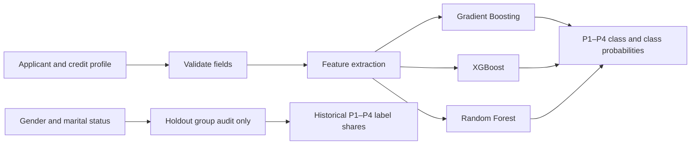

# CredoScore — Indian Credit Priority Explorer

[](https://nextjs.org/)
[](https://react.dev/)
[](https://www.typescriptlang.org/)
[](https://www.python.org/)
[](https://scikit-learn.org/)
[](https://xgboost.readthedocs.io/)
[](https://credoscore-gk.vercel.app)

CredoScore is an educational web app for comparing three machine-learning classifiers on an Indian bank and credit-bureau dataset. Enter a borrower profile to see Gradient Boosting, XGBoost, and Random Forest classify the historical bank priority label as **P1, P2, P3, or P4**. Sensitive demographic fields are available for fairness review but are excluded from model training and scoring.

> **Important target limitation:** the dataset label is `Approved_Flag`, a historical bank priority/risk tier. It is not a verified future repayment/default outcome, calibrated probability of default, or recommendation to approve or reject a real applicant. This is a student demonstration, not a lending tool.

[Live app](https://credoscore-gk.vercel.app) · [GitHub repository](https://github.com/gursimrannkaurr/credoscore) · [Dataset source repository](https://github.com/rounak97/Credit-Risk-Modelling-Using-Machine-Learning)

## What the app does

The `/` Brief explains the dataset and task. The `/assess` form collects a subset of applicant, bank-account, and credit-bureau fields, then sends them to `POST /api/predict-cibil`. The Python API validates the values, reconstructs the trained feature columns, and calls each fitted classifier. The browser shows the three predicted priority classes and class probabilities, alongside a separate view of label distributions across the held-out gender and marital-status groups.

The three models each return their own prediction. CredoScore does not average them into a fourth prediction or use a majority vote. “Class probability” is the model's score among P1–P4 classes; it is not calibrated to the real-world frequency of repayment or default.



## Dataset and target

The source is a pair of workbooks mirrored in the linked public repository:

| File | Records and fields | What it contains |
| --- | --- | --- |
| `case_study1.xlsx` | 51,336 × 26 | Internal bank account counts and activity |
| `case_study2.xlsx` | 51,336 × 62 | Credit-bureau repayment history, enquiries, account use, profile, and `Approved_Flag` |

The training script joins the workbooks one-to-one on `PROSPECTID` and checks that neither side has duplicate IDs or unmatched rows. The ID is then dropped from the feature matrix. The public source repository does not include an explicit data licence; raw workbooks are therefore excluded from this Git repository and should not be redistributed without checking the source's terms.

`Approved_Flag` has four classes, P1–P4. The dataset is imbalanced: the source has 32,199 P2 records, compared with 7,452 P3, 5,882 P4, and 5,803 P1 records. Boosting uses inverse-frequency training weights, and the Random Forest uses balanced subsampling. Evaluation reports balanced accuracy and macro F1 as well as overall accuracy so the common P2 class does not dominate the summary.

## Feature extraction, in plain terms

Feature extraction is the conversion of source values into consistent, model-ready inputs. The application does not send arbitrary spreadsheet columns to the model:

1. The join uses `PROSPECTID` to align the bank and bureau rows; the identifier is not a predictor.
2. Source placeholders of `-99999` are changed to missing values. Numeric gaps are filled with the training median; category gaps use the most frequent training value.
3. Numeric fields describe age, monthly income, employer tenure, CIBIL score, total/active/missed accounts, delinquency counts, recent payment timing, personal-loan accounts, card utilisation, enquiries, and secured/unsecured accounts.
4. Three derived features are calculated: active accounts divided by all accounts, missed payments per trade line, and unsecured accounts divided by all accounts. Denominators are protected from zero and ratios are limited to 0–1.
5. Education and first/most-recent product-enquiry categories are one-hot encoded. For example, `education=GRADUATE` becomes a set of zeros and one `GRADUATE` indicator. Unknown categories are rejected by the request validator.

The fitted pipeline uses 19 numeric columns (16 input values plus 3 derived ratios) and 3 categorical source fields. Numeric values are not standardized; tree models compare feature values with split thresholds and do not need a common scale.

### Gender, marital status, and bias review

`GENDER` and `MARITALSTATUS` are available in the source, but the training pipeline excludes them from the feature list. The Assess form keeps the values separate from the scoring features and reports each group's P1–P4 shares on the held-out sample. Changing a protected field does not change a prediction because the model cannot see that field. Group differences in the source label deserve investigation; they do not by themselves show that an individual was treated unfairly. Correlated financial fields can still carry indirect differences, so excluding the two columns is not a complete fairness audit.

## The three models

All models learn the same four labels from the same training rows and encoded features. Their parameter settings are written in [`ml/train_cibil.py`](./ml/train_cibil.py); fitted pipelines and evaluation metadata are stored under `model/cibil/`.

| Model | How it learns | Configuration in this project |
| --- | --- | --- |
| **Gradient Boosting** | Adds small decision trees in sequence; each later tree focuses on errors left by the earlier ensemble. | 220 trees, depth 3, learning rate 0.05, 20-row minimum leaf, 0.85 subsampling; inverse-frequency sample weights |
| **XGBoost** | A regularised, optimised form of gradient boosting. It adds trees sequentially and penalises overly complex trees. | 350 trees, depth 4, learning rate 0.04, row/column subsampling, L2 regularisation; inverse-frequency sample weights |
| **Random Forest** | Trains many trees on bootstrap samples and random feature subsets, then averages their class probabilities. | 400 trees, square-root feature sampling, 3-row minimum leaf, balanced bootstrap weights |

The saved holdout results are computed by the reproducible 80/20 stratified split (seed 42):

| Model | Accuracy | Balanced accuracy | Macro F1 | Log loss |
| --- | ---: | ---: | ---: | ---: |
| Gradient Boosting | 0.9944 | 0.9883 | 0.9891 | 0.0110 |
| XGBoost | 0.9942 | 0.9879 | 0.9885 | 0.0113 |
| Random Forest | 0.9866 | 0.9749 | 0.9806 | 0.1731 |

These unusually high scores mean the models reproduce the source's historical tier label on a random split of the same source. The label may be strongly determined by the included credit variables. The scores do **not** measure prediction of future default, and random-split results do not prove performance at another bank or in a later time period. A lending-grade study would need a clearly defined future repayment horizon, a time-based holdout, an external population, probability calibration, and a full fairness and governance review.

## Train the models

The raw workbooks are ignored by Git. The downloader places them under `data/cibil/`; the training script validates the join, imputes missing values, derives features, creates the holdout, fits the three models, and writes compressed model pipelines plus metrics and group audits.

```powershell
python -m pip install -r ml/requirements-cibil.txt
py ml/train_cibil.py --download
py ml/train_cibil.py
```

Do not balance the held-out test data: the holdout should preserve the source's observed class shares. Training weights address class imbalance without presenting an artificially balanced evaluation as real.

## Run locally

Install Node.js dependencies and the Python model dependencies, then start the backend and frontend in separate terminals:

```powershell
npm install
python -m pip install -r ml/requirements-cibil.txt
py ml/dev_server.py
```

```powershell
npm run dev
```

Open [http://localhost:3000](http://localhost:3000). During development, `next.config.ts` forwards `/api/predict-cibil` to the local Python handler on port 8004. The other legacy German-default endpoints remain for earlier academic artifacts; the current Assess screen calls only the CIBIL endpoint.

## API

`POST /api/predict-cibil` accepts numeric profile inputs (`age`, `monthly_income`, `employer_months`, `credit_score`, account and delinquency counts, utilisation, payment recency and enquiry counts), categorical fields (`education`, `recent_product`, and `first_product`), and audit-only `gender` and `marital_status`.

The response contains a `gradient_boosting`, `xgboost`, and `random_forest` object. Each has `priority_class` and a `class_probabilities` map for P1–P4. The `fairness` object says whether sensitive features were used and includes group-level target shares from the test split. It returns no probability of default or loan approval recommendation.

## Project map

```text
app/                    Next.js pages and shared layout
components/assess/      Indian credit-profile form and result view
api/predict-cibil.py    Validated multiclass inference endpoint
ml/train_cibil.py       CIBIL workbook preparation, feature extraction, training, evaluation
ml/dev_server.py        Local Python API handlers
model/cibil/            Compressed stdlib tree artifact and holdout metadata
data/cibil/             Ignored source spreadsheets downloaded for training
docs/09-indian-bank-cibil.md  Detailed target, feature, fairness, and evaluation notes
```
