<!-- page 1 -->

A PROJECT REPORT

ON

#### CAREERCONNECT “A WEB-BASED JOB PORTAL FOR STUDENTS AND

RECRUITERS”

Submitted in partial fulfilment of the requirements

for the award of the degree

OF

BACHELOR OF COMPUTER APPLICATIONS (BCA)

To

GURU GOBIND SINGH INDRAPRASTHA UNIVERSITY, DELHI

SUBMITTED BY:

VIDHI MAHAJAN

03290202024

UNDER THE SUPERVISION

OF

MS. RACHNA SINGH

(ASSISTANT PROFESSOR)


SRI GURU TEGH BAHADUR INSTITUTE OF MANAGEMENT AND

INFORMATION TECHNOLOGY

(24, GT Karnal Rd, Gurdwara Nanak Piao Campus, Kirpal Bagh, Gujranwala Town, New Delhi, Delhi, 110033)

(2024-2027)

<!-- page 2 -->

# CERTIFICATE

This is to certify that the Summer Training Report entitled "CareerConnect: A Web- Based Job Portal for Students and Recruiters" is a bonafide work carried out by Vidhi Mahajan, Enrollment No. 03290202024, a student of Bachelor of Computer Applications (BCA), Semester V, Section 5A, at Sri Guru Tegh Bahadur Institute of Management and Information Technology, in partial fulfilment of the requirements for the award of the degree of Bachelor of Computer Applications.

The work was carried out under my guidance during the six-week summer training, and to the best of my knowledge it is original and has not been submitted elsewhere for any degree or diploma.

____________________

Ms. Rachna Singh

Mentor / Guide

Date: ____________ Place: ____________

<!-- page 3 -->

# COMPANY'S CERTIFICATE

Certificate of Completion issued by Skill Nexis to Vidhi Mahajan for successfully completing the 6 weeks online internship program in Web Development. Date of issue: 29-07-2026. Signed by Mr. Rakesh Soni, Founder and Program Head.

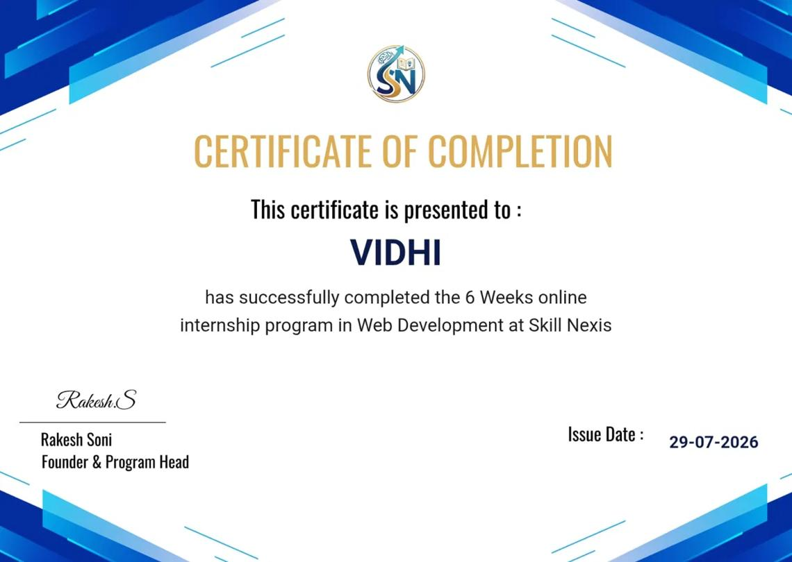

<!-- page 4 -->

# CANDIDATE'S DECLARATION

I, Vidhi Mahajan, Enrollment No. 03290202024, a student of BCA, Semester V, Section 5A, Sri Guru Tegh Bahadur Institute of Management and Information Technology, hereby declare that the Summer Training Report entitled "CareerConnect: A Web-Based Job Portal for Students and Recruiters" is my own original work, carried out during the six-week online internship in Web Development at Skill Nexis, and that it has been written in my own words.

I further declare that this report has not been copied from any book, website or another student, that wherever the work of others has been used it has been acknowledged in the references, and that this report has not been submitted to any other institute or university for the award of any degree or diploma.

Vidhi Mahajan

Enrollment No.: 03290202024

Date: ____________ Place: ____________

<!-- page 5 -->

# ACKNOWLEDGEMENT

I express my sincere gratitude to everyone who helped me in completing this Summer Training Report and the project CareerConnect.

I am thankful to Skill Nexis and Mr. Rakesh Soni, Founder and Program Head, for providing the opportunity of a six-week online internship in Web Development, which gave me the practical exposure needed to build this project.

I am grateful to my mentor, MS. RACHNA SINGH, for guiding me, reviewing the report and the working project, and giving valuable suggestions at every stage.

I thank the management and faculty of Sri Guru Tegh Bahadur Institute of Management and Information Technology for providing a good learning environment.

Vidhi Mahajan

<!-- page 6 -->

# ABSTRACT

Finding a first job or an internship is one of the biggest challenges for students and fresh graduates. Opportunities are scattered over social media groups, college notice boards and large job portals in which fresher roles are lost among thousands of unrelated listings, and candidates rarely know what happened to an application after sending it. Small companies and start-ups face the opposite problem: they have no simple and affordable tool to publish vacancies and to manage the applicants who respond.

CareerConnect is a role-based web portal developed during the six-week summer training (an online internship in Web Development at Skill Nexis) to bridge this gap. It supports three types of users. A Job Seeker can register, maintain a profile with skills and education, upload a resume, search and filter jobs by title, skills, location and job type (Full Time, Part Time, Internship), apply to a job once and track every application as Pending, Shortlisted or Rejected. A Recruiter can post, edit and delete job listings and can review the applicants of those jobs and shortlist or reject them. An Admin can view platform statistics, block, unblock or delete users and remove jobs.

The system follows a three-tier architecture. The front end is built with HTML, CSS and JavaScript and is hosted on Netlify. The back end is a REST API built with Node.js and Express, and the data is stored in MongoDB through Mongoose. Security is provided by bcrypt-hashed passwords, JSON Web Token authentication, role-based authorization and server-side ownership checks. The application was tested with 48 test cases covering authentication, job management, applications, profile, administration and access control, and the defects found were corrected before deployment.

This report describes the problem formulation, system analysis, system design including ERD, DFD and use case diagrams, testing and implementation, conclusion with limitations and future scope, and annexures containing screen snapshots and source code. The live front end of the project is available at https://careerconnect- frontend.netlify.app/.

Keywords: Job Portal, Internship, Recruitment, Node.js, Express, MongoDB, REST API, JWT, Role-Based Access Control.

<!-- page 7 -->

# LIST OF FIGURES

Figure 2.1 Project schedule of the six-week training ........................................................ 7 Figure 3.1 Three-tier architecture of CareerConnect....................................................... 12 Figure 3.2 Module hierarchy of CareerConnect .............................................................. 13 Figure 3.3 Entity Relationship Diagram of CareerConnect ............................................ 14 Figure 3.4 Context Level DFD (Level 0) ........................................................................ 16 Figure 3.5 Level 1 DFD................................................................................................... 17 Figure 3.6 Use case diagram ........................................................................................... 18 Figure 3.7 Flowchart of the login process ....................................................................... 19 Figure 3.8 Flowchart of the apply-for-job process .......................................................... 19 Figure 3.9 State diagram of an application's status ......................................................... 19 Figure 4.1 Deployment of CareerConnect ....................................................................... 30 Figure A-1 Registration form .......................................................................................... 35 Figure A-2 Login form .................................................................................................... 35 Figure A-3 Job search and filter inputs ........................................................................... 36 Figure A-4 Post job form ................................................................................................. 36 Figure A-5 Profile and resume upload ............................................................................ 37 Figure A-6 Home page .................................................................................................... 37 Figure A-7 Job listing ...................................................................................................... 38 Figure A-8 Job details ..................................................................................................... 38 Figure A-9 My applications ............................................................................................. 39 Figure A-10 Recruiter dashboard .................................................................................... 39 Figure A-11 Recruiter's jobs ............................................................................................ 40 Figure A-12 Admin dashboard ........................................................................................ 40 Figure A-13 Manage users .............................................................................................. 40

<!-- page 8 -->

# LIST OF TABLES

Table 1.1 Comparison of existing approaches and CareerConnect ................................... 3 Table 2.1 Iterations followed during development ............................................................ 7 Table 2.2 Actors and their responsibilities ........................................................................ 8 Table 2.3 Functional requirements .................................................................................... 8 Table 2.4 Role-permission matrix ..................................................................................... 9 Table 2.5 Software used .................................................................................................. 10 Table 2.6 Hardware used ................................................................................................. 11 Table 3.1 Folder and file structure .................................................................................. 13 Table 3.2 Structure of the users collection ...................................................................... 14 Table 3.3 Structure of the jobs collection ........................................................................ 15 Table 3.4 Structure of the applications collection ........................................................... 15 Table 3.5 Description of Level 1 processes ..................................................................... 17 Table 3.6 Use case description: Apply for Job ................................................................ 18 Table 3.7 Registration form ............................................................................................. 20 Table 3.8 Login form ....................................................................................................... 20 Table 3.9 Post Job / Edit Job form (Recruiter) ................................................................ 20 Table 3.10 Search and filter form .................................................................................... 20 Table 3.11 Profile and resume form ................................................................................ 21 Table 3.12 REST API endpoints ..................................................................................... 21 Table 4.1 Test cases for authentication ........................................................................... 26 Table 4.2 Test cases for job management........................................................................ 26 Table 4.3 Test cases for applications ............................................................................... 27 Table 4.4 Test cases for profile, resume and admin ........................................................ 27 Table 4.5 Test cases for front-end and API access control ............................................. 28 Table 4.6 Test summary .................................................................................................. 29 Table 4.7 Defects found and corrections made ............................................................... 29 Table 4.8 Using the system ............................................................................................. 31

<!-- page 9 -->

# LIST OF ABBREVIATIONS

| Abbreviation | Full Form |
| --- | --- |
| API | Application Programming Interface |
| BCA | Bachelor of Computer Applications |
| CORS | Cross-Origin Resource Sharing |
| CRUD | Create, Read, Update, Delete |
| CSS | Cascading Style Sheets |
| DB | Database |
| DFD | Data Flow Diagram |
| ERD | Entity Relationship Diagram |
| FK | Foreign Key |
| HTML | HyperText Markup Language |
| HTTP(S) | HyperText Transfer Protocol (Secure) |
| JSON | JavaScript Object Notation |
| JWT | JSON Web Token |
| ODM | Object Document Mapper |
| PK | Primary Key |
| REST | Representational State Transfer |
| SRS | Software Requirement Specification |
| STR | Summer Training Report |
| UI | User Interface |
| URL | Uniform Resource Locator |

<!-- page 10 -->

# C O N T E N T S

CHAPTER 1: PROBLEM FORMULATION ................................................................ 1

1.1 Introduction about the Company ............................................................................. 1 1.2 Introduction about the Problem ............................................................................... 1 1.3 Present State of the Art............................................................................................ 2 1.4 Need of Computerization ........................................................................................ 3 1.5 Proposed Software / Project .................................................................................... 4 1.6 Importance of the Work .......................................................................................... 5

CHAPTER 2: SYSTEM ANALYSIS ............................................................................... 6

2.1 Feasibility Study ...................................................................................................... 6 2.2 Analysis Methodology ............................................................................................ 7 2.3 Choice of the Platforms ......................................................................................... 10

CHAPTER 3: SYSTEM DESIGN ................................................................................. 12

3.1 Design Methodology ............................................................................................. 12 3.2 Database Design .................................................................................................... 14 3.3 Input Design .......................................................................................................... 20 3.4 Output Design ....................................................................................................... 21 3.5 Code Design and Development ............................................................................. 21

CHAPTER 4: TESTING AND IMPLEMENTATION ................................................ 25

4.1 Testing Methodology ............................................................................................ 25 4.2 Test Data & Test Cases ......................................................................................... 25 4.3 Test Reports and Debugging ................................................................................. 28 4.4 Implementation ..................................................................................................... 30

CHAPTER 5: CONCLUSION AND REFERENCES .................................................. 32

5.1 Summary of the Work Done ................................................................................. 32 5.2 Conclusion ............................................................................................................. 32 5.3 Limitations of the System ..................................................................................... 32 5.4 Future Scope for Modification .............................................................................. 33 5.5 References / Bibliography ..................................................................................... 33

CHAPTER 6: ANNEXURES ......................................................................................... 35

A-1 Sample Inputs ....................................................................................................... 35 A-2 Sample Outputs .................................................................................................... 37 A-3 Coding .................................................................................................................. 41

<!-- page 11 -->

<!-- opener -->

# CHAPTER 1

## PROBLEM FORMULATION

## Learning Objectives

- Understand the company and the training background

- Identify the problem faced by students and recruiters

- Study the present state of the art and the need for computerization

- Define the objectives, scope and importance of CareerConnect

<!-- page 12 -->

# CHAPTER 1: PROBLEM FORMULATION

## 1.1 Introduction about the Company

Skill Nexis is an organization that runs online internship programs in technology fields. The program undertaken by the trainee was the six-week online internship program in Web Development. The program is headed by Mr. Rakesh Soni, Founder and Program Head.

The compulsory six-week summer training was completed as an online internship in Web Development at Skill Nexis, and the company issued a Certificate of Completion dated 29-07-2026, signed by Mr. Rakesh Soni. A copy of this certificate is placed after the Institute's Certificate at the beginning of this report. The training was carried out under the guidance of the college mentor [MS. RACHNA SINGH, ASSISTANCE PROFESSOR]. During the internship the trainee learned the complete life cycle of a web application: requirement gathering, database design, back-end development, front- end development, testing and deployment. The project titled CareerConnect was designed and developed individually by the trainee as the training project.

## 1.2 Introduction about the Problem

Every year lakhs of students complete their diploma, graduation or post-graduation and enter the job market. The first challenge they face is not skill alone, it is finding the right opportunity. An internship or a first job is the bridge between education and a career, but the way these opportunities are advertised and discovered today is fragmented.

Students typically depend on a mix of channels: general job portals, social media groups, college notice boards, messages forwarded by seniors and company career pages. A single student may have to visit five or six places every day to find a handful of relevant listings. The listings on large portals are mixed with experienced-level positions, sponsored posts and advertisements, so a fresher has to scroll through a large number of irrelevant results. Basic information such as the job type (full-time, part-time or internship), the location, the salary and the skills required is often missing or hidden behind a login or a paid plan.

On the other side of the market, small companies, start-ups and local recruiters face a different set of problems. They want to hire interns and freshers, but they do not have

<!-- page 13 -->

a recruitment team or a paid applicant tracking system. They post a requirement in a social media group and receive applications through email, direct messages and phone calls. There is no central place where the resumes, the names of applicants and the status of every candidate are kept together. As a result, good candidates are missed, replies are delayed and the same effort is repeated for every vacancy.

Once an application is sent, the candidate usually hears nothing. A student cannot tell whether the application was seen, shortlisted or rejected. This lack of feedback is demotivating and also leads to repeated applications and follow-up calls that waste the time of both sides.

The problem can therefore be summarised in one statement: there is no simple, focused and free web platform on which students can discover relevant jobs and internships, apply with a stored profile and resume, and track their applications, while recruiters can post vacancies and manage applicants from one place, under the supervision of an administrator who keeps the platform clean and safe.

## 1.3 Present State of the Art

The online recruitment domain is mature and several large platforms exist. Platforms such as LinkedIn, Naukri, Indeed and Foundit serve millions of users and offer advanced features like resume parsing, recommendation engines, company reviews, premium subscriptions and employer branding. Internshala and similar sites focus on internships and fresher jobs. Many colleges also run their own placement portals for campus recruitment.

These systems are powerful, but a study of their usage from a fresher's and a small recruiter's point of view shows some gaps:

- General purpose portals are crowded. Fresher and internship roles are a small part of the content, and the user must apply many filters to reach them.

- Many useful features, such as seeing applicants, boosting a post or contacting candidates, are available only in paid plans, which small recruiters cannot always afford.

- The interface of large portals is heavy and contains advertisements, notifications and recommendations that distract from the main task.

<!-- page 14 -->

- Campus placement portals are limited to one institution and normally do not allow outside recruiters to post openings directly.

- Informal channels (social media groups, email, messaging apps) have no search, no filter, no tracking and no record.

A comparison of the existing approaches with the proposed system is given in Table 1.1.

**Table 1.1 Comparison of existing approaches and CareerConnect**

| Feature | Informal channels | Large job portals | Campus portals | CareerConnect |
| --- | --- | --- | --- | --- |
| Focus on freshers<br>/ internships | Partial | Low | High | High |
| Filter by location<br>and type | No | Yes | Limited | Yes |
| Free for recruiters<br>to post | Yes | Often paid | Institute only | Yes |
| Applicant tracking | No | Paid /<br>complex | Limited | Yes (Pending,<br>Shortlisted,<br>Rejected) |
| Status visible to<br>applicant | No | Partial | Limited | Yes |
| Admin<br>moderation | No | Yes | Yes | Yes |
| Simple, ad-free<br>interface | Varies | No | Yes | Yes |

The above table shows that there is room for a lightweight platform that keeps only the essential workflow, namely post, search, apply, review and track, and does it well. CareerConnect is designed to fill this space.

## 1.4 Need of Computerization

A computerised and centralised system is required because the manual and informal methods suffer from the following drawbacks:

- Information is scattered and cannot be searched. A student cannot ask the question 'show me internships in Noida' on a notice board.

<!-- page 15 -->

- There is no permanent record of vacancies, applicants and decisions, so the same work is repeated and mistakes happen.

- Applicants do not know the outcome of their application and recruiters cannot easily communicate decisions.

- There is no access control. Anyone can post anything, which creates scope for fake or duplicate postings.

- Resumes are exchanged as email attachments or chat files, which are difficult to organise and easy to lose.

- Data cannot be analysed. The administrator cannot know how many users, jobs and applications exist at any time.

A web-based system removes these drawbacks. It is available twenty-four hours a day from any device with a browser, keeps all data in one database, protects every operation through authentication and role-based authorization, and provides instant statistics to the administrator.

## 1.5 Proposed Software / Project

CareerConnect is a role-based job and internship portal. It is a three-tier web application consisting of a browser-based front end built with HTML, CSS and JavaScript, a REST API built with Node.js and Express, and a MongoDB database accessed through Mongoose. The live front end of the project is available at https://careerconnect- frontend.netlify.app/.

### 1.5.1 Objectives of the Project

1. To provide a single, free platform where students can discover jobs and internships relevant to them.

1. To let job seekers create an account, maintain a profile (phone, skills, education), upload a resume and apply to jobs.

1. To let job seekers see every application and its current status (Pending, Shortlisted or Rejected).

1. To let recruiters post, edit and delete their own job listings and to review and shortlist or reject applicants.

1. To provide an administrator with the power to view platform statistics, block or unblock users, delete users and delete inappropriate jobs.

<!-- page 16 -->

1. To secure the system using encrypted passwords, token-based authentication and role-based access control with ownership checks.

1. To deploy the system on free cloud services so that it can be accessed publicly through a web link.

### 1.5.2 Scope of the Project

The scope of the project covers the following:

The following are outside the present scope: online payment, video interviews, chat between users, automated resume parsing and email or SMS notifications. These are listed as future enhancements in Chapter 5.

- Three types of users: Job Seeker, Recruiter and Admin, each with a separate dashboard and permissions.

- Job management: create, read, update and delete jobs, with title, company, description, location, salary, job type and required skills.

- Job discovery: search by job title or skills and filter by location (Noida, Delhi, Gurgaon) and job type (Full Time, Part Time, Internship).

- Application management: apply once to a job, view own applications, view applicants for own jobs, update status.

- Profile and resume management: edit profile details and upload a resume file up to 5 MB.

- Administration: platform overview, user blocking and deletion, job deletion.

## 1.6 Importance of the Work

The work is important for three reasons. First, it addresses a real, everyday problem of the student community to which the developer belongs, so the requirements were understood first-hand and not guessed. Second, the project is original and is built from scratch; it is not a copy of an existing application and it has real-life value because it can be used as a base for a college placement cell or a small recruitment agency with very little modification. Third, it provided practical exposure to modern full-stack development: designing a database, writing secure REST APIs, handling authentication and file upload, building a responsive interface, testing, debugging and deploying to the cloud.

<!-- page 17 -->

The project also demonstrates professional practices that are expected from a software developer, such as keeping secrets in environment variables, never storing plain-text passwords, validating input on both the client and the server, and checking authorization on the server instead of trusting the browser.

<!-- page 18 -->

<!-- opener -->

# CHAPTER 2

## SYSTEM ANALYSIS

## Learning Objectives

- Assess the feasibility of the project

- Describe the analysis methodology and the requirements

- Identify actors and permissions

- Justify the choice of software and hardware

<!-- page 19 -->

# CHAPTER 2: SYSTEM ANALYSIS

## 2.1 Feasibility Study

Before development began, a feasibility study was carried out to check whether the proposed system can be built within the available time, money and skills, and whether it will be useful in practice.

#### Technical Feasibility

All the technologies chosen are open source, well documented and widely used: JavaScript on both the browser and the server, Node.js with the Express framework, and MongoDB as the database. The trainee had the required background in JavaScript and web technologies and received guidance during the training for Node.js and MongoDB. Free cloud services (MongoDB Atlas, Render and Netlify) are available for the database, the API server and the front end respectively. The project is therefore technically feasible.

#### Economic Feasibility

The cost of the system is almost zero. No licensed software is needed, development was done on an ordinary laptop, and all hosting services used are available on free plans. Operating cost for a small number of users is also negligible. The benefits, in the form of saved time for students and recruiters and a centralised record, outweigh the cost, so the project is economically feasible.

#### Operational Feasibility

The interface is simple and follows the pattern of normal websites: a navigation bar, forms, cards and buttons. A user does not need any training to register, search and apply. Recruiters and administrators get their own dashboards with only the options they need. The system fits naturally into the way students and recruiters already work, so operational acceptance is expected to be high.

#### Schedule Feasibility

The training period was six weeks. The work was divided into small modules that could be developed and tested one after another (Figure 2.1). The schedule was realistic and the project was completed within the training period.

<!-- page 20 -->

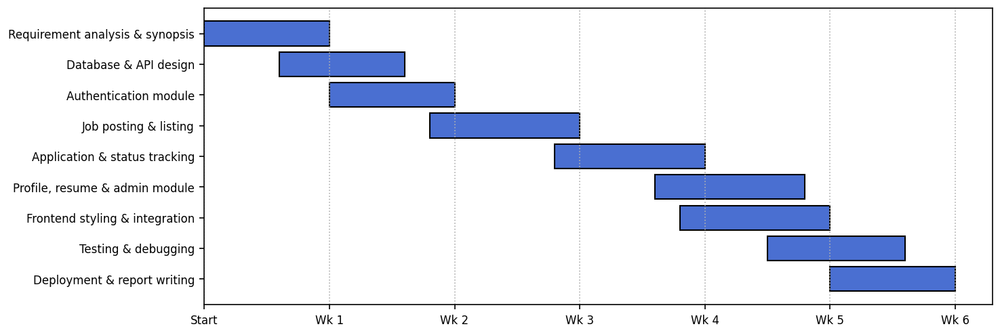

**Figure 2.1 Project schedule of the six-week training**

#### Legal and Security Feasibility

The system stores personal information (name, email, phone, education, resume), so it must protect it. Passwords are stored only as bcrypt hashes, protected API calls require a signed token, and a user can edit only his or her own data. The system uses only open- source libraries with permissive licences.

## 2.2 Analysis Methodology

An iterative and incremental (Agile) approach was followed because the requirements became clearer as the prototype was shown to the guide. Instead of attempting the whole system at once, the work was divided into small iterations. Each iteration produced a working module that was tested and then improved before the next module was started.

**Table 2.1 Iterations followed during development**

| Iteration | Module built | Result |
| --- | --- | --- |
| 1 | User registration, login,<br>password hashing, JWT | Users of two roles can register and<br>log in |
| 2 | Job model, post job, list jobs,<br>job details | Recruiters publish jobs; everyone<br>can browse |
| 3 | Application model, apply, my<br>applications | Job seekers apply once and track<br>status |
| 4 | Recruiter dashboard, status<br>update | Recruiters shortlist or reject<br>applicants |
| 5 | Profile, resume upload, admin<br>module | Profile, resume, block / delete,<br>overview |
| 6 | Security review, UI polish,<br>deployment | Auth middleware, ownership<br>checks, cloud deployment |

<!-- page 21 -->

### 2.2.1 Requirement Gathering

Requirements were collected by studying existing job portals, by discussing the needs of students and small recruiters with classmates and with the trainer, and by preparing a requirement document which was reviewed by the guide before design started. The main outcome was the list of functional and non-functional requirements below.

### 2.2.2 Users of the System

**Table 2.2 Actors and their responsibilities**

| Actor | Responsibility |
| --- | --- |
| Job Seeker | Registers, logs in, edits profile, uploads resume, searches and<br>filters jobs, views job details, applies for jobs, views own<br>applications and their status. |
| Recruiter | Registers, logs in, posts jobs, edits or deletes own jobs, views<br>applicants for own jobs, shortlists or rejects applicants. |
| Admin | Logs in with a seeded account, views platform overview, lists<br>users, blocks or unblocks users, deletes users, deletes or edits any<br>job. |

### 2.2.3 Functional Requirements

**Table 2.3 Functional requirements**

| ID | Requirement | Actor |
| --- | --- | --- |
| FR1 | The system shall allow registration with<br>name, email, password and role (Job<br>Seeker or Recruiter). Duplicate emails are<br>rejected. | Job Seeker, Recruiter |
| FR2 | The system shall authenticate users by<br>email and password and issue a token<br>valid for one day. | All |
| FR3 | The system shall refuse login to blocked<br>accounts. | All |
| FR4 | The system shall allow a recruiter to create<br>a job with title, company, description,<br>location, job type, salary and skills. | Recruiter |
| FR5 | The system shall list all jobs and allow<br>search by title or skills and filter by<br>location and job type. | All |
| FR6 | The system shall show complete details of<br>a selected job. | All |

<!-- page 22 -->

| ID | Requirement | Actor |
| --- | --- | --- |
| FR7 | The system shall allow a job seeker to<br>apply to a job only once. | Job Seeker |
| FR8 | The system shall show a job seeker all of<br>his or her applications with current status. | Job Seeker |
| FR9 | The system shall show a recruiter the<br>applicants of his or her jobs. | Recruiter |
| FR10 | The system shall allow a recruiter to mark<br>an application as Pending, Shortlisted or<br>Rejected. | Recruiter, Admin |
| FR11 | The system shall allow a recruiter to edit<br>or delete only his or her own jobs. | Recruiter |
| FR12 | The system shall allow a user to edit own<br>profile and upload a resume (maximum 5<br>MB). | All |
| FR13 | The system shall allow the admin to view<br>totals of users, jobs, applications, job<br>seekers and recruiters. | Admin |
| FR14 | The system shall allow the admin to block,<br>unblock and delete users and to delete<br>jobs. | Admin |

### 2.2.4 Non-Functional Requirements

- Security: passwords hashed with bcrypt, JWT-based authentication, role-based authorization and ownership checks on the server, secrets kept in environment variables.

- Usability: simple navigation, clear messages for success and failure, role- specific dashboards.

- Performance: pages should load and respond within a few seconds on a normal connection.

- Reliability: invalid input must never crash the server; every API returns a meaningful status code and message.

- Portability: the front end works in all modern browsers and on mobile screens.

- Maintainability: code is split into models, routes and middleware so that changes remain local.

<!-- page 23 -->

### 2.2.5 Role-Permission Matrix

**Table 2.4 Role-permission matrix**

| Operation | Job Seeker | Recruiter | Admin |
| --- | --- | --- | --- |
| Register / Login | Yes | Yes | Login only |
| View jobs and job details | Yes | Yes | Yes |
| Apply to a job | Yes | No | No |
| View own applications | Yes | No | No |
| Post a job | No | Yes | No |
| Edit / delete a job | No | Own jobs | Any job |
| View applicants | No | Own jobs | Any recruiter |
| Update application status | No | Own jobs | Any |
| Edit profile / upload resume | Own | Own | Any |
| List / block / unblock / delete<br>users | No | No | Yes |
| View platform overview | No | No | Yes |

## 2.3 Choice of the Platforms

The technologies were selected after comparing the alternatives against four criteria: cost, learning curve, community support and suitability for a JSON-based REST application.

### 2.3.1 S/W used

**Table 2.5 Software used**

| Component | Technology | Reason for choice |
| --- | --- | --- |
| Front end | HTML5, CSS3,<br>JavaScript (ES6),<br>Fetch API | No build tool needed; runs in every<br>browser; easy to host as static files. |
| Back-end runtime | Node.js | Same language on client and server;<br>non-blocking I/O suits API<br>workloads. |
| Web framework | Express.js 5 | Minimal, flexible framework with<br>simple routing and middleware. |
| Database | MongoDB (Atlas<br>cloud) | Document model maps naturally to<br>JSON; free cloud tier. |

<!-- page 24 -->

| Component | Technology | Reason for choice |
| --- | --- | --- |
| ODM | Mongoose 9 | Schemas, validation, references and<br>population for MongoDB. |
| Authentication | jsonwebtoken (JWT) | Stateless token-based authentication. |
| Password security | bcryptjs | Salted one-way hashing of passwords. |
| File upload | Multer | Handles multipart/form-data for<br>resume upload with size limit. |
| Cross-origin access | cors | Allows the Netlify front end to call<br>the API. |
| Configuration | dotenv | Loads secrets from the .env file. |
| Hosting | Netlify (front end),<br>Render (API),<br>MongoDB Atlas (DB) | Free, GitHub-based deployment. |
| Tools | Visual Studio Code,<br>Postman, Git and<br>GitHub, Chrome<br>DevTools | Development, API testing, version<br>control, debugging. |
| Operating system | Windows 10 / 11 | Development environment. |

### 2.3.2 H/W used

**Table 2.6 Hardware used**

| Component | Specification |
| --- | --- |
| Processor | Intel Core i3 / i5 or equivalent (or higher) |
| RAM | 4 GB minimum, 8 GB recommended |
| Storage | 256 GB HDD / SSD, at least 2 GB free |
| Display | Standard laptop or desktop monitor (1366 x 768 or<br>higher) |
| Network | Broadband internet connection |
| Client device (end user) | Any computer, tablet or smartphone with a modern web<br>browser |

### 2.3.3 Software Requirement Summary

To run the project locally, Node.js (version 18 or above), npm, a MongoDB Atlas connection string and a code editor are needed. The front end can be opened with any static server such as the Live Server extension of Visual Studio Code. For the end user, only a browser and an internet connection are required.

<!-- page 25 -->

<!-- opener -->

# CHAPTER 3

## SYSTEM DESIGN

## Learning Objectives

- Explain the architecture and the module structure

- Design the database with ERD and table structures

- Draw DFD, use case, flowchart and state diagrams

- Describe input, output, API and security design

<!-- page 26 -->

# CHAPTER 3: SYSTEM DESIGN

## 3.1 Design Methodology

The system was designed using a top-down, modular approach. The overall structure was decided first, then the data, then the processes and finally the screens. Structured analysis and design tools were used: Entity Relationship Diagram for data, Data Flow Diagrams for the movement of data, use case diagram for the interaction between users and system, and flowcharts and a state diagram for important processes.

### 3.1.1 System Architecture

CareerConnect follows a three-tier client-server architecture (Figure 3.1). The browser never talks to the database directly. Every request goes to the REST API, which first checks the token and the role through middleware and only then touches the database. This separation keeps the data safe and allows the front end and back end to be deployed and changed independently.

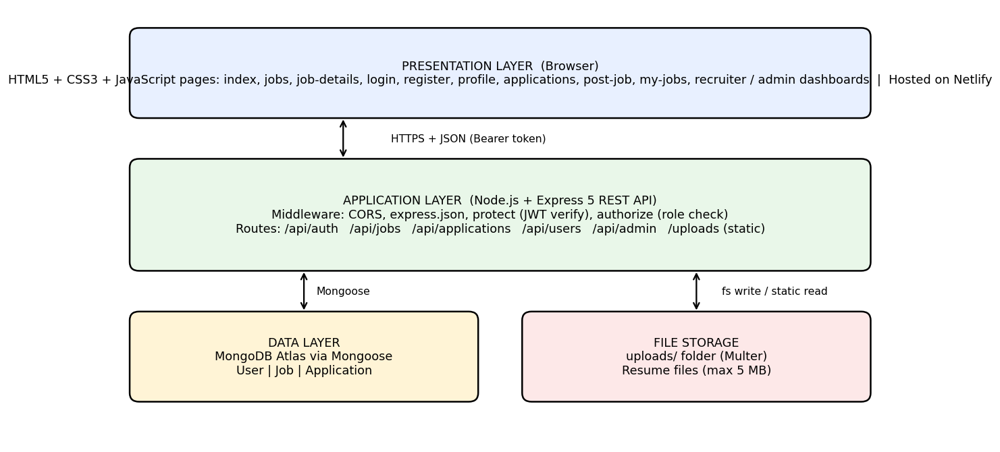

**Figure 3.1 Three-tier architecture of CareerConnect**

- Presentation layer: static HTML pages styled with one shared stylesheet and driven by JavaScript using the Fetch API. A shared script (script.js) holds the common helpers: API base URL, getToken, getUser, authHeader, requireRole and logout.

- Application layer: an Express server with five route groups (auth, jobs, applications, users, admin) and two middleware functions (protect and authorize).

<!-- page 27 -->

- Data layer: MongoDB collections accessed through Mongoose models, and a local uploads folder for resume files.

### 3.1.2 Module Hierarchy

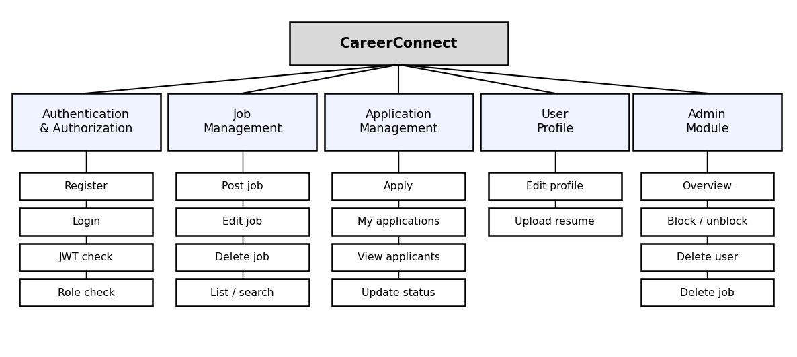

**Figure 3.2 Module hierarchy of CareerConnect**

### 3.1.3 Project Structure

**Table 3.1 Folder and file structure**

| File / Folder | Purpose |
| --- | --- |
| backend/server.js | Creates the Express app, configures CORS<br>and JSON parsing, mounts all routes, serves<br>/uploads and starts the server. |
| backend/config/db.js | Connects to MongoDB using MONGO URI.<br>_ |
| backend/middleware/auth.js | protect (verify JWT, load user, reject blocked<br>users) and authorize (role check). |
| backend/models/user.js, Job.js,<br>Application.js | Mongoose schemas of the three collections. |
| backend/routes/authRoutes.js | Register and login. |
| backend/routes/jobRoutes.js | Create, list, view, update, delete jobs. |
| backend/routes/applicationRoutes.js | Apply, my applications, recruiter's applicants,<br>status update. |
| backend/routes/userRoutes.js | Admin user management, profile update,<br>resume upload (Multer). |
| backend/routes/adminRoutes.js | Platform overview statistics. |
| backend/seedAdmin.js | One-time script that creates the admin<br>account. |
| backend/uploads/ | Uploaded resume files. |

<!-- page 28 -->

| File / Folder | Purpose |
| --- | --- |
| frontend/*.html | index, jobs, job-details, login, register,<br>dashboard, profile, applications, post-job, my-<br>jobs, edit-job, recruiter-dashboard, admin-<br>dashboard, admin-users, admin-jobs. |
| frontend/style.css, script.js | Common styling and shared JavaScript<br>helpers. |

## 3.2 Database Design

MongoDB, a document database, was chosen. Data is stored in three collections: users, jobs and applications. Relationships are maintained through ObjectId references (the equivalent of foreign keys), and Mongoose populate() is used to join the documents when needed.

### 3.2.1 ERD

One user (a recruiter) can post many jobs; one user (a job seeker) can submit many applications; one job can receive many applications. Hence both relationships of USERS and the relationship of JOBS with APPLICATIONS are one-to-many. The ERD is shown in Figure 3.3.

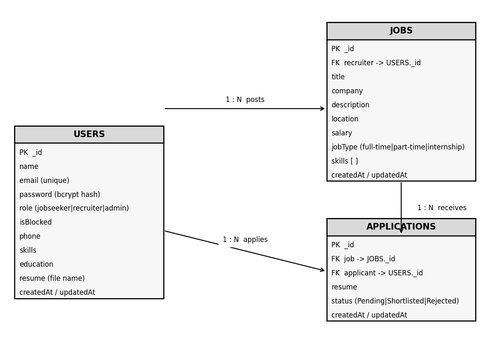

**Figure 3.3 Entity Relationship Diagram of CareerConnect**

<!-- page 29 -->

#### Collection Structure

**Table 3.2 Structure of the users collection**

| Field | Type | Constraint / Description |
| --- | --- | --- |
| id<br>_ | ObjectId | Primary key, generated by MongoDB |
| name | String | Required |
| email | String | Required, unique |
| password | String | Required; stores the bcrypt hash only |
| role | String | Required; enum: jobseeker, recruiter, admin |
| isBlocked | Boolean | Default false; true prevents login and API<br>access |
| phone | String | Optional profile field |
| skills | String | Optional profile field |
| education | String | Optional profile field |
| resume | String | Name of uploaded resume file |
| createdAt,<br>updatedAt | Date | Added automatically (timestamps) |

**Table 3.3 Structure of the jobs collection**

| Field | Type | Constraint / Description |
| --- | --- | --- |
| id<br>_ | ObjectId | Primary key |
| title | String | Required |
| company | String | Required |
| description | String | Required |
| location | String | Required |
| salary | String | Optional (free text such as a range) |
| jobType | String | Required; enum: full-time, part-time,<br>internship |
| skills | Array of String | Optional list of required skills |
| recruiter | ObjectId | Required; reference to users. id; set from the<br>_<br>verified token |
| createdAt,<br>updatedAt | Date | Added automatically |

<!-- page 30 -->

**Table 3.4 Structure of the applications collection**

| Field | Type | Constraint / Description |
| --- | --- | --- |
| id<br>_ | ObjectId | Primary key |
| job | ObjectId | Required; reference to jobs. id<br>_ |
| applicant | ObjectId | Required; reference to users. id; set from the<br>_<br>verified token |
| resume | String | Resume file name submitted with the<br>application |
| status | String | Enum: Pending, Shortlisted, Rejected;<br>default Pending |
| createdAt,<br>updatedAt | Date | Added automatically |

#### Validations, Verifications and Normalization

- Schema level: required fields and enum lists are enforced by Mongoose; the email field has a unique index so that two accounts with the same email cannot exist.

- Business rule: before an application is created the API looks for an existing document with the same job and applicant and rejects a duplicate.

- Referential integrity: job.recruiter and application.applicant are taken from req.user (the verified token), never from the request body, so records cannot be created in another person's name.

- Normalization: every fact is stored once. Recruiter details are not copied into jobs, and job or applicant details are not copied into applications; only their ids are stored. This corresponds to Third Normal Form. Since MongoDB has no joins, populate() is used to fetch the name, email, title or company at display time.

- Security of data: the password field is never returned by any API (select('- password')) and the profile route updates only whitelisted fields (name, email, phone, skills, education).

<!-- page 31 -->

### 3.2.2 DFD

Data flow diagrams show how data moves between the external entities, the processes and the data stores. The context-level diagram (Level 0) treats the whole system as a single process; Level 1 breaks it into six main processes.

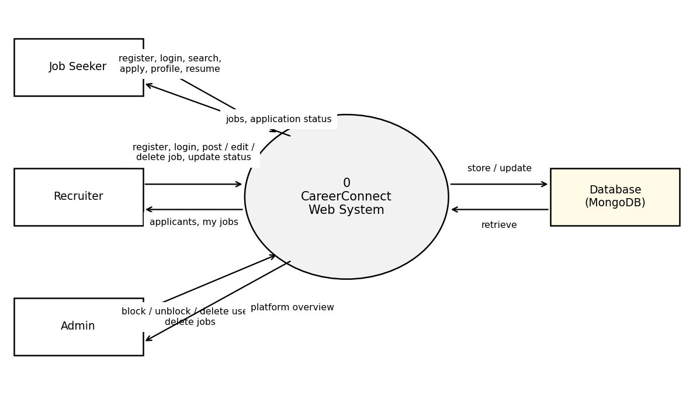

**Figure 3.4 Context Level DFD (Level 0)**

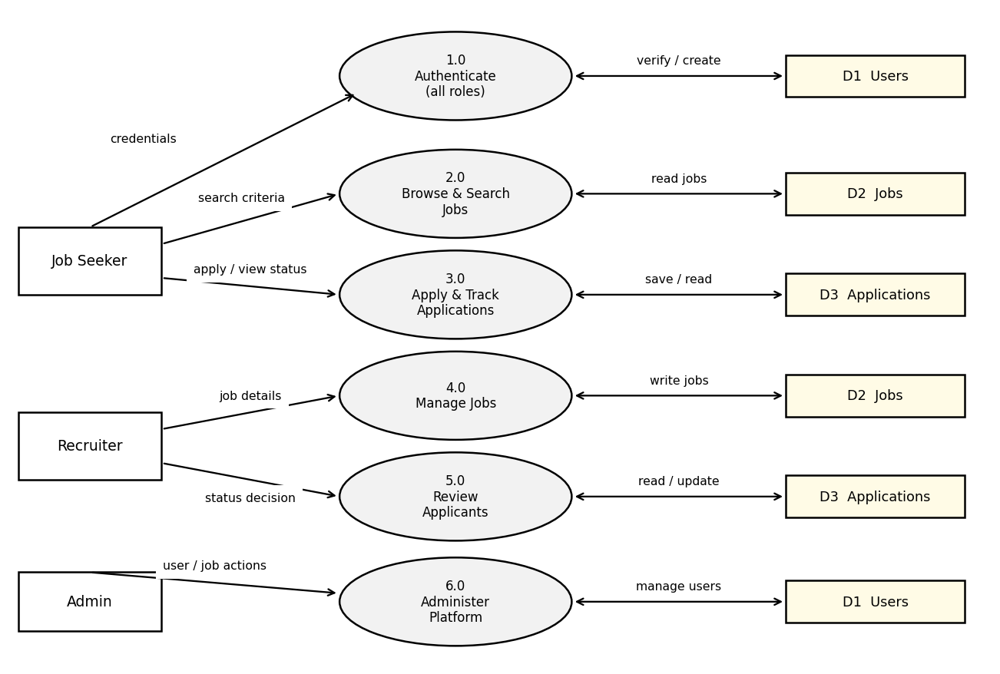

**Figure 3.5 Level 1 DFD**

<!-- page 32 -->

**Table 3.5 Description of Level 1 processes**

| No. | Process | Description |
| --- | --- | --- |
| 1.0 | Authenticate | Validates registration data, hashes the password<br>and creates the user; on login compares the hash,<br>rejects blocked users and issues a JWT. |
| 2.0 | Browse and Search<br>Jobs | Reads jobs from the jobs store and applies search<br>text, location and job type filters. |
| 3.0 | Apply and Track | Creates an application (status Pending) after<br>duplicate check; lists a user's applications with<br>job details. |
| 4.0 | Manage Jobs | Creates, updates and deletes jobs after verifying<br>role and ownership. |
| 5.0 | Review Applicants | Lists applications for the recruiter's jobs and<br>updates the status. |
| 6.0 | Administer Platform | Computes overview counts; blocks, unblocks or<br>deletes users; deletes jobs. |

#### Use Case Diagram

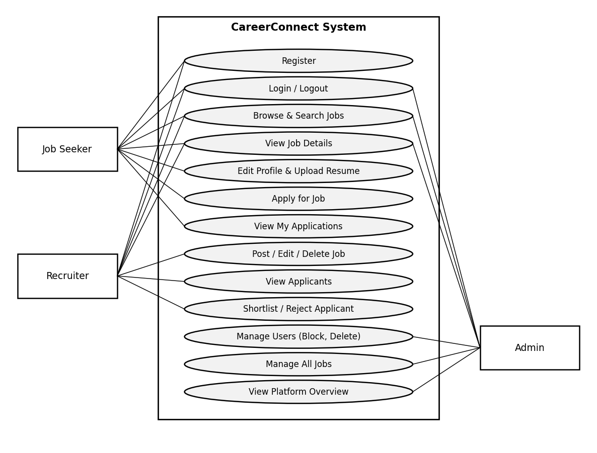

**Figure 3.6 Use case diagram**

<!-- page 33 -->

**Table 3.6 Use case description: Apply for Job**

| Item | Description |
| --- | --- |
| Actor | Job Seeker |
| Pre-condition | User is logged in with the role jobseeker and has opened a<br>job's detail page. |
| Main flow | 1. User presses Apply Now. 2. Browser sends the job id and<br>the token. 3. Server verifies token and role. 4. Server checks<br>that no earlier application exists. 5. Server saves the<br>application with status Pending. 6. Success message is<br>shown. |
| Alternate flow | Not logged in: user is asked to log in. Recruiter or admin: the<br>button is disabled. Already applied: error message shown. |
| Post-condition | A new application is visible in My Applications and in the<br>recruiter's applicant list. |

#### Process Flowcharts

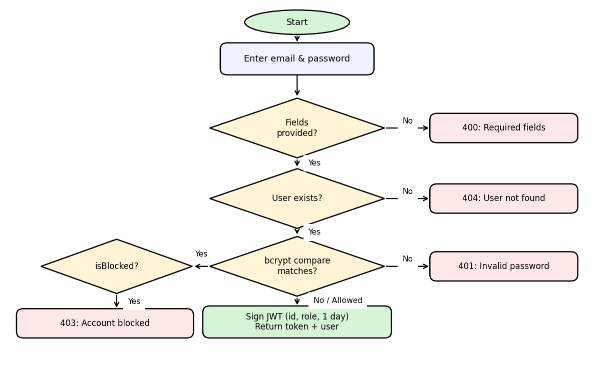

**Figure 3.7 Flowchart of the login process**

<!-- page 34 -->

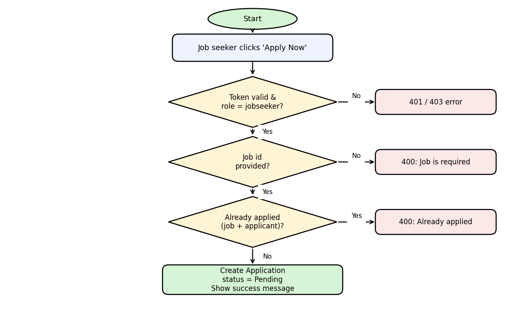

**Figure 3.8  Flowchart of the apply-for-job process**

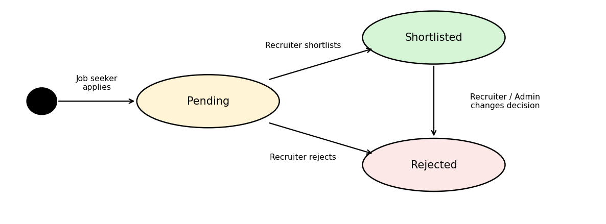

**Figure 3.9 State diagram of an application's status**

## 3.3 Input Design

All data enters the system through HTML forms. The aim of input design is to make entry easy, reduce errors and reject invalid data early. Required attributes and drop- down lists are used in the browser for quick feedback, and the same rules are checked again on the server because browser checks can be bypassed.

**Table 3.7 Registration form**

| Field | Control | Validation |
| --- | --- | --- |
| Full Name | Text box | Required |
| Email | Email box | Required; valid format; must be unique<br>(server) |
| Password | Password box | Required; stored only as a bcrypt hash |
| Register As | Drop-down | Required; Job Seeker or Recruiter only |

<!-- page 35 -->

**Table 3.8 Login form**

| Field | Control | Validation |
| --- | --- | --- |
| Email | Email box | Required |
| Password | Password box | Required; compared with stored hash;<br>account must not be blocked |

**Table 3.9 Post Job / Edit Job form (Recruiter)**

| Field | Control | Validation |
| --- | --- | --- |
| Job Title | Text box | Required |
| Company | Text box | Required |
| Description | Text area | Required |
| Location | Text box / list | Required |
| Salary | Text box | Optional |
| Job Type | Drop-down | Required; full-time, part-time or internship |
| Skills | Text box | Optional; comma separated, stored as an<br>array |

**Table 3.10 Search and filter form**

| Field | Control | Values |
| --- | --- | --- |
| Search | Text box | Job title or skills |
| Location | Drop-down | All Locations, Noida, Delhi, Gurgaon |
| Job Type | Drop-down | All Job Types, Full Time, Part Time,<br>Internship |

**Table 3.11 Profile and resume form**

| Field | Control | Validation |
| --- | --- | --- |
| Name, Email,<br>Phone, Skills,<br>Education | Text boxes | Only these fields can be updated; only by the<br>owner or an admin |
| Resume | File chooser | One file; maximum 5 MB; a clear message is<br>shown when the limit is crossed |

## 3.4 Output Design

Output is presented in a clean, card-based layout. Important outputs of the system are described below, and the corresponding screenshots are attached in Annexure A-2.

<!-- page 36 -->

- Job cards on the Jobs page showing title, company, location, salary, job type and skills, with a View Details button.

- Job details page showing the complete description and the Apply Now button, whose label and state change according to the role of the logged-in user.

- My Applications page for the job seeker, listing every job applied for with a colour-coded status badge (amber for Pending, green for Shortlisted, red for Rejected).

- Recruiter dashboard listing applicants for the recruiter's jobs with Shortlist and Reject buttons and the current status.

- My Jobs page for the recruiter with Edit and Delete options for each job.

- Admin dashboard with platform overview cards (total users, jobs, applications, job seekers and recruiters) and links to Manage Users and Manage Jobs.

- Success and error messages for every operation, for example 'You have already applied for this job' or 'Resume file must be smaller than 5 MB'.

## 3.5 Code Design and Development

### 3.5.1 REST API Design

**Table 3.12 REST API endpoints**

| Verb | Endpoint | Access | Purpose |
| --- | --- | --- | --- |
| POST | /api/auth/register | Public | Register a user |
| POST | /api/auth/login | Public | Login, receive token |
| GET | /api/jobs/all | Public | List all jobs |
| GET | /api/jobs/:id | Public | Single job |
| POST | /api/jobs | Recruiter | Create job |
| GET | /api/jobs/recruiter/:id | Recruiter,<br>Admin | Jobs of a recruiter |
| PUT | /api/jobs/:id | Recruiter<br>(own),<br>Admin | Update job |
| DELETE | /api/jobs/:id | Recruiter<br>(own),<br>Admin | Delete job |
| POST | /api/applications | Job Seeker | Apply for job |

<!-- page 37 -->

| Verb | Endpoint | Access | Purpose |
| --- | --- | --- | --- |
| GET | /api/applications/my/:id | Job Seeker<br>(own) | My applications |
| GET | /api/applications/recruiter/:id | Recruiter<br>(own),<br>Admin | Applicants of a recruiter's<br>jobs |
| PUT | /api/applications/status/:id | Recruiter<br>(own),<br>Admin | Update status |
| PUT | /api/users/:id/profile | Owner,<br>Admin | Update profile |
| PUT | /api/users/:id/resume | Owner,<br>Admin | Upload resume |
| GET | /api/users | Admin | List users |
| PUT | /api/users/:id/block, /unblock | Admin | Block or unblock |
| DELETE | /api/users/:id | Admin | Delete user |
| GET | /api/admin/overview | Admin | Platform statistics |

### 3.5.2 Security Design

Security was treated as a design requirement and not as an afterthought. The following mechanisms are used:

- Password hashing: passwords are hashed with bcrypt (10 salt rounds) before saving. The original password is never stored and cannot be recovered.

- Token authentication: after a successful login the server signs a JWT that contains the user id and role and expires in one day. The browser sends it in the Authorization: Bearer header.

- protect middleware: verifies the token, loads the user from the database, rejects the request if the user no longer exists or is blocked, and attaches the user to req.user.

- authorize middleware: allows a route only for the listed roles, for example authorize('recruiter').

- Ownership checks: even when the role is correct, a recruiter can modify only the jobs and applications that belong to him. These checks are done on the

<!-- page 38 -->

server, so changing the browser's JavaScript or calling the API directly does not help an attacker.

- Secrets: the database connection string and the JWT secret are stored in the .env file, which is excluded from version control, and are set as environment variables on the hosting platform.

- CORS: only localhost and the configured front-end origin are permitted to call the API from a browser.

### 3.5.3 Important Code Segments

Authentication middleware (middleware/auth.js). It extracts the token, verifies it, loads the user and blocks unauthorised or blocked users:

```
const protect = async (req, res, next) => {
try {
const authHeader = req.headers.authorization;
if (!authHeader || !authHeader.startsWith("Bearer ")) {
return res.status(401).json({ message: "Not authorized, no token
provided" });
}
const token = authHeader.split(" ")[1];
const decoded = jwt.verify(token, process.env.JWT_SECRET);
const user = await User.findById(decoded.id).select("-password");
if (!user) return res.status(401).json({ message: "Not authorized,
user no longer exists" });
if (user.isBlocked) return res.status(403).json({ message: "Your
account has been blocked" });
req.user = user;
next();
} catch (error) {
return res.status(401).json({ message: "Not authorized, invalid or
expired token" });
}
};
```

Applying for a job (routes/applicationRoutes.js). The applicant always comes from the token and a duplicate application is rejected:

```
router.post("/", protect, authorize("jobseeker"), async (req, res) =>
{
const { job, resume } = req.body;
const applicant = req.user._id;
if (!job) return res.status(400).json({ message: "Job is required"
});
const existing = await Application.findOne({ job, applicant });
if (existing) {
return res.status(400).json({ message: "You have already applied
for this job" });
}
const application = await Application.create({ job, applicant,
resume });
res.status(201).json({ message: "Application submitted
successfully", application });
});
```

<!-- page 39 -->

Front-end helper (script.js). The API address switches automatically between local development and the deployed server, and requireRole protects every private page:

```
const API_BASE = (() => {
const isLocal = ["localhost",
"127.0.0.1"].includes(window.location.hostname);
return isLocal ? "http://localhost:5000/api" : "https://<backend-
host>/api";
})();
function authHeader() {
const token = getToken();
return token ? { Authorization: `Bearer ${token}` } : {};
}
```

More code, including the models and the registration and login routes, is given in Annexure A-3.

<!-- page 40 -->

<!-- opener -->

# CHAPTER 4

## TESTING AND IMPLEMENTATION

## Learning Objectives

- Explain the testing methodology

- Present test data, test cases and test reports

- Describe how debugging was performed

- Explain setup, deployment and maintenance

<!-- page 41 -->

# CHAPTER 4: TESTING AND IMPLEMENTATION

## 4.1 Testing Methodology

Testing was planned so that every module was verified at the time it was built and the complete system was verified before deployment. The following levels and techniques were used.

- Unit testing: individual API endpoints and functions were tested one by one using Postman, by sending valid and invalid requests and checking the status code and the message returned.

- Integration testing: the flow from the browser form to the API and then to the database and back to the screen was tested, for example register, login, post job, view job, apply, shortlist.

- Black-box (functional) testing: test cases were prepared from the requirements without looking at the code; the tester provides input and compares the output with the expected result.

- White-box testing: the branches of important functions, such as the protect middleware and the apply route, were exercised so that every decision (valid, invalid, missing token, blocked user, duplicate) was covered.

- Security testing: protected APIs were called without a token, with a wrong role and with another user's id to confirm that access is refused.

- System and user acceptance testing: the complete application was used as a job seeker, a recruiter and an admin on desktop and mobile browsers, first locally and then on the deployed links.

#### Test Environment

| Item | Detail |
| --- | --- |
| Operating system | Windows 10 / 11 |
| Browser | Google Chrome (latest), Microsoft Edge, mobile Chrome |
| Server | Node.js, started with npm start on port 5000 |
| Database | MongoDB Atlas cluster |
| Tools | Postman for API calls, Chrome DevTools (Console and<br>Network tab) for debugging |

<!-- page 42 -->

## 4.2 Test Data & Test Cases

The test cases below were designed for each module. Each case lists the test data, the expected result and the outcome recorded after execution (Tables 4.1 to 4.5).

**Table 4.1 Test cases for authentication**

| ID | Test case | Test data | Expected result | Status |
| --- | --- | --- | --- | --- |
| T1 | Register with valid<br>data | Name, new email,<br>password, role<br>jobseeker | 201; user created | Pass |
| T2 | Register with an<br>existing email | Email already in<br>database | 400; User already<br>exists | Pass |
| T3 | Register with a<br>missing field | Password left blank | 400; All fields are<br>required | Pass |
| T4 | Login with valid<br>credentials | Registered email and<br>password | 200; token and user<br>returned | Pass |
| T5 | Login with wrong<br>password | Correct email, wrong<br>password | 401; Invalid password | Pass |
| T6 | Login with unknown<br>email | Email not registered | 404; User not found | Pass |
| T7 | Login with blank<br>fields | No email or password | 400; Email and<br>password are required | Pass |
| T8 | Login by a blocked<br>user | Account with<br>isBlocked = true | 403; account blocked | Pass |
| T9 | Stored password<br>check | Look at the users<br>collection | Only bcrypt hash<br>visible | Pass |

**Table 4.2 Test cases for job management**

| ID | Test case | Test data | Expected result | Status |
| --- | --- | --- | --- | --- |
| T10 | Recruiter creates a<br>job | All required fields,<br>recruiter token | 201; job saved with<br>recruiter id | Pass |
| T11 | Create job with<br>missing field | Title left blank | 400; Required fields<br>are missing | Pass |
| T12 | Job seeker tries to<br>create a job | Job seeker token | 403; role not<br>permitted | Pass |
| T13 | Create job without<br>token | No Authorization<br>header | 401; no token<br>provided | Pass |
| T14 | View all jobs | Open Jobs page | All jobs listed as<br>cards | Pass |

<!-- page 43 -->

| ID | Test case | Test data | Expected result | Status |
| --- | --- | --- | --- | --- |
| T15 | Filter by location | Location = Noida | Only Noida jobs<br>shown | Pass |
| T16 | Filter by job type | Type = Internship | Only internships<br>shown | Pass |
| T17 | Search by skill | Text = a skill present<br>in a job | Matching jobs shown | Pass |
| T18 | View job details | Click View Details | Full details displayed | Pass |
| T19 | Recruiter edits own<br>job | Change title | 200; job updated | Pass |
| T20 | Recruiter edits<br>another's job | Other recruiter's job<br>id | 403; only own<br>listings | Pass |
| T21 | Recruiter deletes own<br>job | Delete button | 200; job removed | Pass |
| T22 | Admin deletes any<br>job | Admin token | 200; job removed | Pass |

**Table 4.3 Test cases for applications**

| ID | Test case | Test data | Expected result | Status |
| --- | --- | --- | --- | --- |
| T23 | Job seeker applies to<br>a job | Valid job id, job<br>seeker token | 201; status Pending | Pass |
| T24 | Apply twice to the<br>same job | Same job again | 400; already applied | Pass |
| T25 | Recruiter tries to<br>apply | Recruiter token | 403; role not<br>permitted | Pass |
| T26 | Apply button when<br>logged out | Open job details<br>without login | Button shows 'Log in<br>to apply' | Pass |
| T27 | View my applications | Job seeker token and<br>own id | List with job title,<br>company, status | Pass |
| T28 | View another user's<br>applications | Another user's id | 403; own applications<br>only | Pass |
| T29 | Recruiter views<br>applicants | Own recruiter id | Applicants of own<br>jobs only | Pass |
| T30 | Recruiter shortlists<br>applicant | Status = Shortlisted | 200; status updated,<br>green badge | Pass |
| T31 | Recruiter rejects<br>applicant | Status = Rejected | 200; status updated,<br>red badge | Pass |
| T32 | Invalid status value | Status = Hired | 400; Invalid status | Pass |

<!-- page 44 -->

| ID | Test case | Test data | Expected result | Status |
| --- | --- | --- | --- | --- |
| T33 | Update status of<br>another recruiter's<br>applicant | Foreign application id | 403; own listings<br>only | Pass |

**Table 4.4 Test cases for profile, resume and admin**

| ID | Test case | Test data | Expected result | Status |
| --- | --- | --- | --- | --- |
| T34 | Update own profile | Phone, skills,<br>education | 200; profile updated | Pass |
| T35 | Update someone<br>else's profile | Other user's id | 403; own profile only | Pass |
| T36 | Upload resume within<br>limit | PDF below 5 MB | 200; file saved, name<br>stored | Pass |
| T37 | Upload resume above<br>limit | File above 5 MB | 400; must be smaller<br>than 5 MB | Pass |
| T38 | Upload without<br>choosing a file | Empty form | 400; Please select a<br>resume | Pass |
| T39 | Admin views<br>overview | Admin token | Counts of users, jobs,<br>applications | Pass |
| T40 | Non-admin opens<br>users list | Job seeker token | 403; role not<br>permitted | Pass |
| T41 | Admin blocks a user | Block button | User cannot log in<br>afterwards | Pass |
| T42 | Admin unblocks a<br>user | Unblock button | User can log in again | Pass |
| T43 | Admin deletes a user | Delete button | User removed | Pass |

**Table 4.5 Test cases for front-end and API access control**

| ID | Test case | Test data | Expected result | Status |
| --- | --- | --- | --- | --- |
| T44 | Open admin page<br>without login | Type admin-<br>dashboard.html in<br>browser | Redirected to login<br>page | Pass |
| T45 | Job seeker opens<br>recruiter page | post-job.html as job<br>seeker | Alert and redirect to<br>home | Pass |
| T46 | Logout | Click Logout, press<br>Back | Session cleared; login<br>required again | Pass |
| T47 | Responsive layout | Open site on a mobile<br>screen | Content fits, no<br>horizontal scroll | Pass |

<!-- page 45 -->

| ID | Test case | Test data | Expected result | Status |
| --- | --- | --- | --- | --- |
| T48 | Create an admin<br>account through the<br>register API | POST<br>/api/auth/register with<br>role = admin | 400; Invalid role; no<br>account created | Pass |

## 4.3 Test Reports and Debugging

### 4.3.1 Test Report

A total of 48 test cases were prepared and executed. The summary is shown in Table 4.6. Failures found in the early rounds were corrected and the failing cases were run again until all of them passed.

**Table 4.6 Test summary**

| Module Module | Test cases | Passed | Failed after correction |
| --- | --- | --- | --- |
| Authentication | 9 | 9 | 0 |
| Job management | 13 | 13 | 0 |
| Applications | 11 | 11 | 0 |
| Profile, resume, admin | 10 | 10 | 0 |
| Front-end and API access<br>control | 5 | 5 | 0 |
| Total | 48 | 48 | 0 |

### 4.3.2 Defects Found and Debugging

Debugging was done on the basis of the test report. For every failed case the Network tab and Console of the browser and the server log were used to find where the request failed, the code was corrected and the test case was executed again. The important defects and their corrections are given in Table 4.7.

**Table 4.7 Defects found and corrections made**

| No. | Defect observed | Cause | Correction |
| --- | --- | --- | --- |
| 1 | Protected data could be<br>read or changed by calling<br>the API directly without<br>logging in | No token verification on<br>several routes | Added protect and<br>authorize middleware<br>to all private routes |

<!-- page 46 -->

| No. | Defect observed | Cause | Correction |
| --- | --- | --- | --- |
| 2 | Every admin page could be<br>opened by typing its<br>address | No login check on<br>admin pages | Added<br>requireRole(['admin'])<br>on the pages and an<br>admin role with a<br>seed script |
| 3 | The app always acted as<br>one fixed test user | Test user ids were hard-<br>coded in six pages | Pages now read the<br>real logged-in user<br>from the shared<br>script.js helper |
| 4 | A blocked user could still<br>log in | isBlocked was not<br>checked at login | Login and protect<br>now reject blocked<br>users |
| 5 | A recruiter could edit or<br>delete another recruiter's<br>job | Role was checked but<br>ownership was not | Added ownership<br>checks in job and<br>application routes |
| 6 | Logout did not end the<br>session | Link only changed the<br>page | logout() now clears<br>token and user before<br>redirecting |
| 7 | Shortlisted and Rejected<br>statuses looked like plain<br>text | CSS classes missing | Added colour-coded<br>status badge styles |
| 8 | Job list was loaded twice<br>on My Jobs page | displayJobs() called<br>twice | Duplicate call<br>removed |
| 9 | User list exposed to<br>everyone | Route had no<br>authorization | Restricted /api/users<br>to admin; password<br>excluded from results |
| 10 | Anyone could create an<br>admin account by calling<br>the register API with role =<br>admin | Role was accepted from<br>the request body and the<br>schema allows admin | Register route now<br>accepts only<br>jobseeker and<br>recruiter; anything<br>else returns 400<br>Invalid role |

## 4.4 Implementation

### 4.4.1 Local Setup Steps

1. Install Node.js and create a free MongoDB Atlas cluster.

1. In the backend folder create the .env file with MONGO_URI, JWT_SECRET and PORT (a template is given in .env.example).

<!-- page 47 -->

1. Run npm install to install the dependencies.

1. Run node seedAdmin.js once to create the administrator account, then npm start to start the server on port 5000.

1. Open the frontend folder with a static server (for example Live Server) and use index.html as the starting page.

### 4.4.2 Deployment

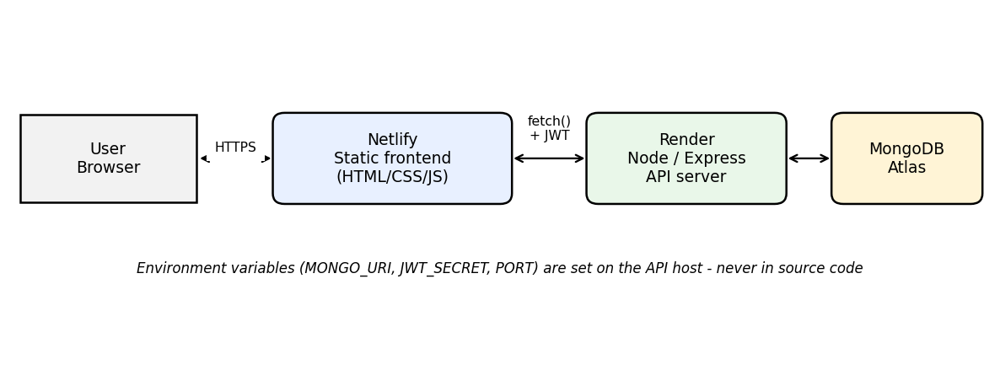

**Figure 4.1 Deployment of CareerConnect**

- The source code is stored in a GitHub repository (the .env file is excluded using .gitignore).

- The back end is deployed as a web service on Render with the root directory set to backend, build command npm install and start command npm start. MONGO_URI and JWT_SECRET are entered as environment variables. In MongoDB Atlas, network access is opened so that Render can connect.

- The front end is deployed on Netlify with the base directory set to frontend. The live link is https://careerconnect-frontend.netlify.app/.

- The deployed API address is placed in API_BASE in script.js, and the Netlify address is added to the allowed origins in server.js so that the browser is permitted to call the API.

- After deployment the main test cases (registration, login, search, apply, shortlist) were repeated on the live links.

<!-- page 48 -->

### 4.4.3 User Manual (Brief)

**Table 4.8 Using the system**

| User | Steps |
| --- | --- |
| Job Seeker | Register as Job Seeker, login, update profile and upload resume,<br>open Jobs, search or filter, open a job, press Apply Now, open<br>My Applications to follow the status. |
| Recruiter | Register as Recruiter, login, open Post Job and fill the form, use<br>My Jobs to edit or delete, open the Recruiter Dashboard to view<br>applicants and press Shortlist or Reject. |
| Admin | Login with the seeded account, open the Admin Dashboard to see<br>the overview, use Manage Users to block, unblock or delete and<br>Manage Jobs to remove jobs. |

### 4.4.4 Maintenance

The system is easy to maintain because routes, models and middleware are separate files. New fields can be added in a schema and the corresponding form, new roles can be added to the role list and authorize middleware, and the API base URL can be changed in a single place. Regular maintenance tasks include rotating the JWT secret and database password, taking database backups and removing old resume files.

<!-- page 49 -->

<!-- opener -->

# CHAPTER 5

## CONCLUSION AND REFERENCES

## Learning Objectives

- Summarise the work and conclude

- State the limitations of the system

- Suggest future scope for modification

- List references and bibliography

<!-- page 50 -->

# CHAPTER 5: CONCLUSION AND REFERENCES

## 5.1 Summary of the Work Done

During the six-week summer training the trainee studied the problem of job and internship discovery for students, prepared a requirement document, designed the database and the system, and developed CareerConnect, a role-based web application. The work included design of three collections, development of five groups of REST APIs, fifteen front-end pages, authentication and authorization, resume upload, an administrator module, testing with 48 test cases, correction of defects and deployment of the front end and back end on free cloud services.

## 5.2 Conclusion

CareerConnect achieves the objectives set at the beginning of the project. Students get one place to search and filter jobs and internships, apply with a stored profile and resume and see the status of every application. Recruiters get a simple tool to post vacancies and handle applicants without paying for a heavy system, and the administrator can monitor and control the platform. Security was given importance through hashed passwords, signed tokens, role-based authorization and ownership checks on the server.

The project gave valuable practical experience. The trainee learned how a real application is planned and built end to end, how to design a document database, how to write and test REST APIs, how to protect an application against misuse, how to find and correct defects systematically, and how to deploy an application so that others can use it. The experience also showed that a security review during development is necessary: several important gaps were discovered during testing and were corrected before the final version.

## 5.3 Limitations of the System

- There are no email or SMS notifications, so users must open the site to see the change in the status of an application.

- Search and filters are simple. Location options are limited to a fixed list of cities and there is no pagination for large numbers of jobs.

<!-- page 51 -->

- Uploaded resumes are stored in the server's file system. On free hosting the file system may be reset, so a cloud storage service would be required for permanent storage. File type is not yet checked, only the size, and the uploads folder can be opened without login by anyone who knows the file name.

- There is no password reset or email verification feature, and the number of login attempts is not limited.

- The authentication token is kept in the browser's local storage, which is simple but less secure than an HTTP-only cookie.

- Recruiters cannot view the resume of an applicant in a built-in viewer and cannot send messages to candidates.

- Text entered by users (for example job title, company and user name) is inserted into some pages using innerHTML without escaping. Output encoding (or textContent) should be added to prevent script injection.

- Login error messages differ for an unknown email and a wrong password, which reveals whether an email is registered.

- The free hosting plan of the API may take some time to wake up after a period of inactivity.

## 5.4 Future Scope for Modification

- Email and in-app notifications for application status changes and for new jobs matching a student's skills.

- Password reset, email verification, rate limiting for login, escaping of all user- entered text on output, and storage of the token in secure cookies.

- Resume storage on a cloud service with file type validation and an in-page resume viewer for recruiters.

- Advanced search with pagination, sorting, salary range, experience level and a saved-jobs list.

- Skill-based job recommendations and resume parsing using artificial intelligence.

- Interview scheduling, chat between recruiter and candidate, and company profile pages.

<!-- page 52 -->

- Analytics dashboard for the administrator with charts of users, jobs and applications over time.

- A mobile application or a progressive web app using the same REST API.

## 5.5 References / Bibliography

1. MDN Web Docs. HTML, CSS, JavaScript and Fetch API documentation. https://developer.mozilla.org

1. Node.js Foundation. Node.js Documentation. https://nodejs.org/en/docs

1. Express.js. Express Web Framework Documentation. https://expressjs.com

1. MongoDB Inc. MongoDB Manual and Atlas Documentation. https://www.mongodb.com/docs

1. Mongoose. Mongoose ODM Documentation. https://mongoosejs.com/docs

1. JSON Web Token. Introduction to JSON Web Tokens. https://jwt.io/introduction

1. bcryptjs and Multer package documentation. https://www.npmjs.com

1. Postman. Postman Learning Center. https://learning.postman.com

1. Netlify and Render Documentation. https://docs.netlify.com and https://render.com/docs

1. Pressman, R. S. and Maxim, B. R. Software Engineering: A Practitioner's Approach. McGraw-Hill Education.

1. Sommerville, I. Software Engineering. Pearson Education.

<!-- page 53 -->

<!-- opener -->

# CHAPTER 6

## ANNEXURES

## Learning Objectives

- Attach sample inputs and screen snapshots

- Attach sample outputs and screen snapshots

- Attach important source code

<!-- page 54 -->

# CHAPTER 6: ANNEXURES

## A-1 Sample Inputs

The following screens show the sample inputs given to the system.

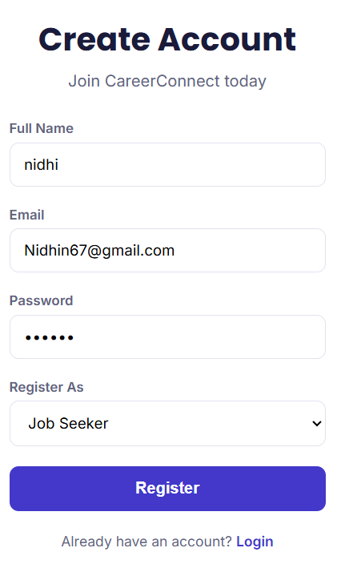

Figure A-1 Registration form

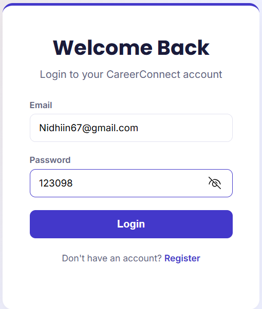

Figure A-2 Login form

<!-- page 55 -->

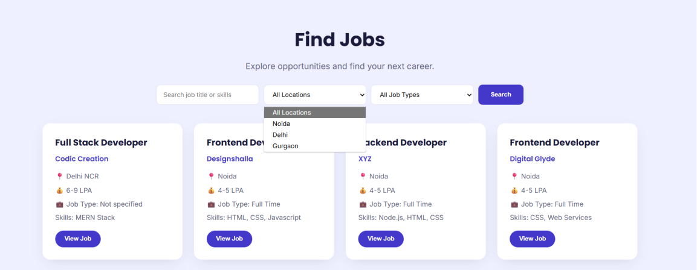

Figure A-3 Job search and filter inputs

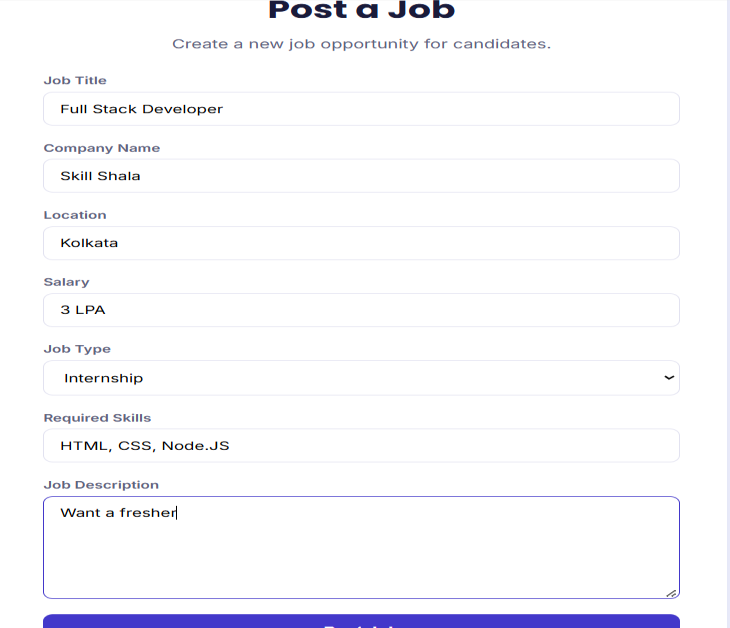

Figure A-4 Post job form

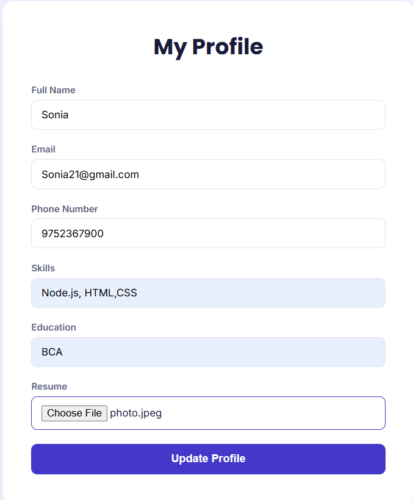

Figure A-5 Profile and resume upload

<!-- page 56 -->

## A-2 Sample Outputs

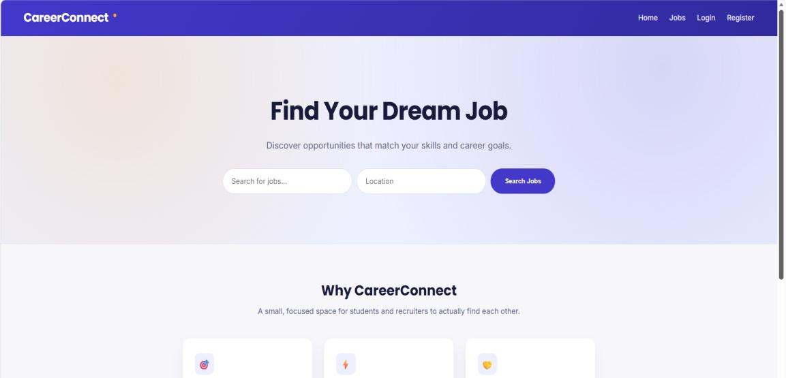

Figure A-6 Home page

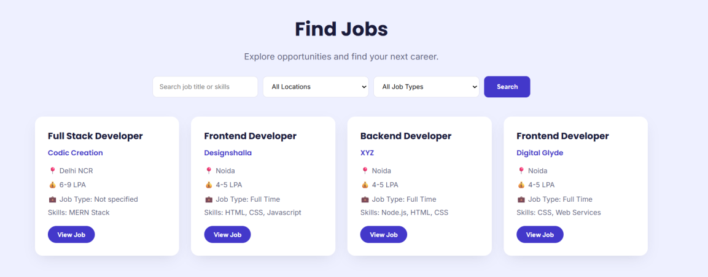

Figure A-7 Job listing

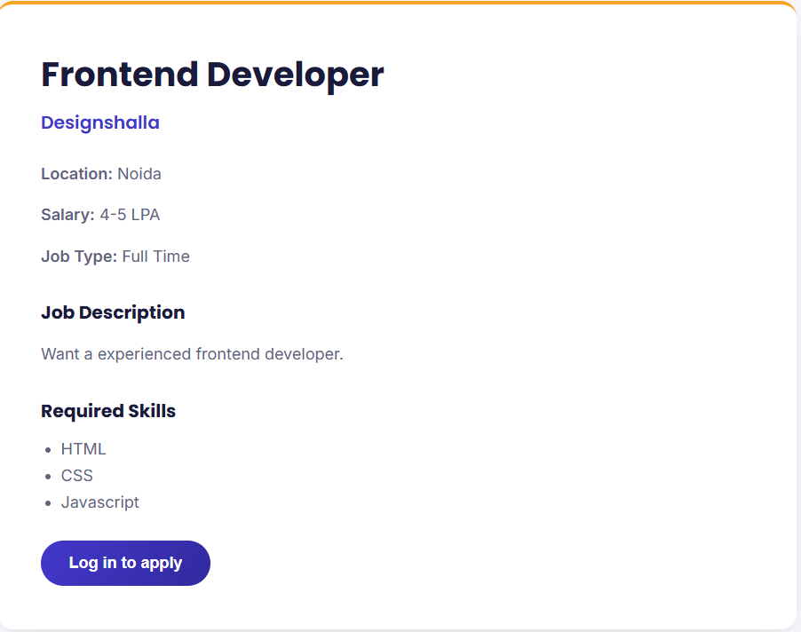

Figure A-8 Job details

<!-- page 57 -->

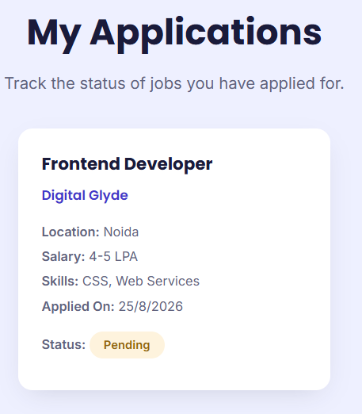

Figure A-9 My applications

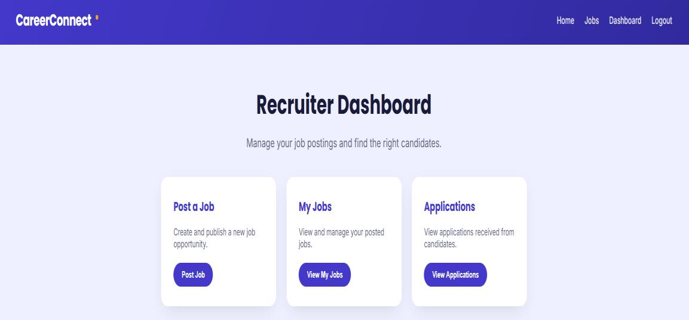

Figure A-10 Recruiter dashboard

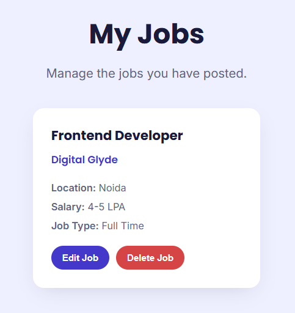

Figure A-11 Recruiter's jobs

<!-- page 58 -->

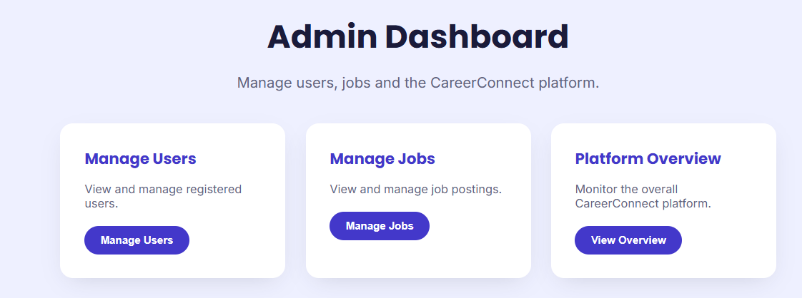

Figure A-12 Admin dashboard

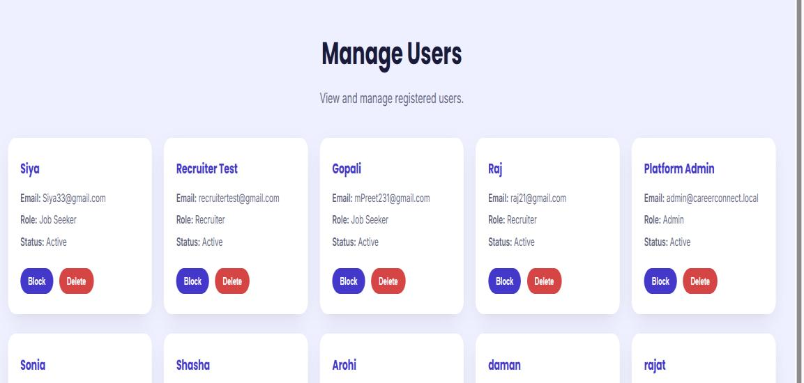

Figure A-13 Manage users

Selected source code of the back end is given below.

## A-3 Coding

#### A-3.1 models/user.js

```
const userSchema = new mongoose.Schema({
name:      { type: String, required: true },
email:     { type: String, required: true, unique: true },
password:  { type: String, required: true },
role:      { type: String, enum: ["jobseeker", "recruiter",
"admin"], required: true },
isBlocked: { type: Boolean, default: false },
phone:     { type: String },
skills:    { type: String },
education: { type: String },
resume:    { type: String }
}, { timestamps: true });
module.exports = mongoose.model("User", userSchema);
```

<!-- page 59 -->

#### A-3.2 models/Job.js

```
const jobSchema = new mongoose.Schema({
title:       { type: String, required: true },
company:     { type: String, required: true },
description: { type: String, required: true },
location:    { type: String, required: true },
salary:      { type: String },
jobType:     { type: String, enum: ["full-time", "part-time",
"internship"], required: true },
skills:      { type: [String] },
recruiter:   { type: mongoose.Schema.Types.ObjectId, ref: "User",
required: true }
}, { timestamps: true });
```

#### A-3.3 models/Application.js

```
const applicationSchema = new mongoose.Schema({
job:       { type: mongoose.Schema.Types.ObjectId, ref: "Job",
required: true },
applicant: { type: mongoose.Schema.Types.ObjectId, ref: "User",
required: true },
resume:    { type: String },
status:    { type: String, enum: ["Pending", "Shortlisted",
"Rejected"], default: "Pending" }
}, { timestamps: true });
```

#### A-3.4 routes/authRoutes.js (registration and login)

```
router.post("/register", async (req, res) => {
const { name, email, password, role } = req.body;
if (!name || !email || !password || !role)
return res.status(400).json({ message: "All fields are required"
});
const existingUser = await User.findOne({ email });
if (existingUser) return res.status(400).json({ message: "User
already exists" });
const hashedPassword = await bcrypt.hash(password, 10);
const user = await User.create({ name, email, password:
hashedPassword, role });
res.status(201).json({ message: "User registered successfully",
user: { id: user._id, name: user.name, email: user.email, role:
user.role } });
});
router.post("/login", async (req, res) => {
const { email, password } = req.body;
const user = await User.findOne({ email });
if (!user) return res.status(404).json({ message: "User not found"
});
const ok = await bcrypt.compare(password, user.password);
if (!ok) return res.status(401).json({ message: "Invalid password"
});
if (user.isBlocked) return res.status(403).json({ message: "Your
account has been blocked." });
const token = jwt.sign({ id: user._id, role: user.role },
process.env.JWT_SECRET, { expiresIn: "1d" });
res.status(200).json({ message: "Login successful", token,
user: { id: user._id, name: user.name, email: user.email, role:
user.role } });
});
```

<!-- page 60 -->

#### A-3.5 routes/jobRoutes.js (update with ownership check)

```
router.put("/:id", protect, authorize("recruiter", "admin"), async
(req, res) => {
const existingJob = await Job.findById(req.params.id);
if (!existingJob) return res.status(404).json({ message: "Job not
found" });
if (req.user.role === "recruiter" &&
existingJob.recruiter.toString() !== req.user._id.toString()) {
return res.status(403).json({ message: "You can only edit your own
job listings" });
}
const job = await Job.findByIdAndUpdate(req.params.id,
{ title, company, description, location, salary, jobType, skills
},
{ new: true, runValidators: true });
res.status(200).json({ message: "Job updated successfully", job });
});
```

#### A-3.6 routes/applicationRoutes.js (status update)

```
router.put("/status/:applicationId", protect, authorize("recruiter",
"admin"), async (req, res) => {
const { status } = req.body;
if (!["Pending", "Shortlisted", "Rejected"].includes(status))
return res.status(400).json({ message: "Invalid status" });
const existing = await
Application.findById(req.params.applicationId).populate("job");
if (!existing) return res.status(404).json({ message: "Application
not found" });
if (req.user.role === "recruiter" &&
existing.job.recruiter.toString() !== req.user._id.toString())
return res.status(403).json({ message: "You can only manage
applicants to your own job listings" });
const application = await Application.findByIdAndUpdate(
req.params.applicationId, { status }, { new: true });
res.status(200).json({ message: "Application status updated
successfully", application });
});
```

#### A-3.7 routes/adminRoutes.js (platform overview)

```
router.get("/overview", protect, authorize("admin"), async (req, res)
=> {
const totalUsers        = await User.countDocuments();
const totalJobs         = await Job.countDocuments();
const totalApplications = await Application.countDocuments();
const totalJobSeekers   = await User.countDocuments({ role:
"jobseeker" });
const totalRecruiters   = await User.countDocuments({ role:
"recruiter" });
res.json({ message: "Platform overview fetched successfully",
overview: { totalUsers, totalJobs, totalApplications,
totalJobSeekers, totalRecruiters }
```
