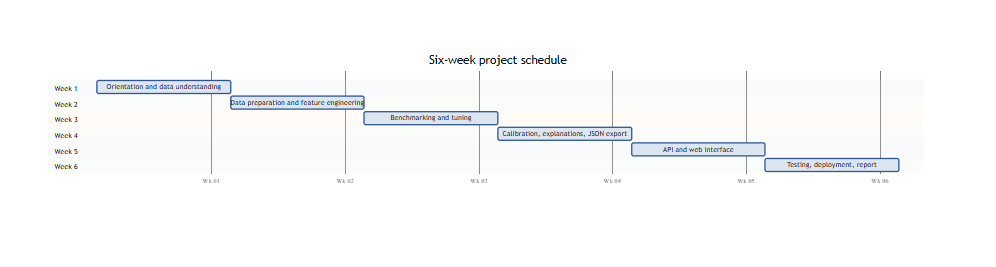

<section class="chapter-opener">

CHAPTER 2

SYSTEM ANALYSIS

Learning Objectives

- Assess the feasibility of the project
- Describe the analysis methodology and the requirements
- Identify actors and permissions
- Justify the choice of software and hardware

</section>

# CHAPTER 2: SYSTEM ANALYSIS

## 2.1 Feasibility Study

Before development began, a feasibility study checked whether the proposed system could be built within the available time and skills, and whether it would be useful in practice.

#### Technical Feasibility

All the technologies chosen are open source, well documented and widely used: Next.js and React for the front end, Python's standard library for the scoring functions, and pandas, scikit-learn and XGBoost for training. The trainee had the required background in JavaScript, TypeScript and Python, and received guidance for the modelling and calibration steps. The German Credit dataset trains in under a minute on an ordinary laptop, and Vercel's free tier auto-detects Next.js and deploys Python functions alongside it. The project is therefore technically feasible.

#### Economic Feasibility

The cost of the system is effectively zero: the dataset is CC BY 4.0, every library used is open source, development ran on an ordinary laptop, and Vercel's free tier is sufficient for a project of this size. The benefit, a faster and more consistent credit decision, outweighs this negligible cost.

#### Operational Feasibility

The interface follows the pattern of an ordinary web form: labelled fields, a submit button, a results panel. A loan officer needs no training to fill in twelve fields or read a probability, a band and a recommendation, and a risk analyst reads the portfolio pages like any dashboard, so operational acceptance is expected to be high.

#### Schedule Feasibility

The six-week training period was divided into six weekly iterations, developed and tested one after another, as shown in Figure 2.1. The schedule was realistic and the project was completed within it.

#### Legal and Security Feasibility

The UCI Statlog German Credit Data is licensed CC BY 4.0 and attributed to Professor Hans Hofmann of Universität Hamburg, so its use here is legally clear. The personal-status-and-sex attribute is excluded as a protected characteristic, and the deployed application stores no applicant data; every request is stateless. The report and the application state throughout that the tool is a student project, not meant for real lending decisions.

## 2.2 Analysis Methodology

An iterative, CRISP-DM-style approach was followed, in which data understanding, preparation, modelling, evaluation and deployment were revisited in successive iterations rather than attempted once end to end. Each iteration produced a working piece of the system, tested before the next began, as summarised in Table 2.1.

Table 2.1 Iterations followed during development

| Iteration | Work carried out | Result |
| --- | --- | --- |
| 1 | Orientation and data understanding | The German Credit dataset, its attributes and its licence were studied, and the attributes to exclude were decided |
| 2 | Data preparation and feature engineering | Employment buckets, derived monthly income and one-hot encoding of categorical fields were implemented |
| 3 | Benchmarking and tuning | Four candidate models were compared under five-fold cross-validation and the gradient boosting model was tuned by randomized search |
| 4 | Calibration, explanation and export | Platt scaling, the Saabas contribution rescaling and the model.json / portfolio.json export were implemented |
| 5 | API and web interface | The Python scoring and portfolio functions and the Next.js front end were built |
| 6 | Testing, deployment and report | Notebook, API and interface tests were run, the application was deployed, and this report was written |

### 2.2.1 Requirement Gathering

Requirements were gathered by studying how credit scorecards and bureau scores are used in practice, working through the UCI dataset's own documentation to see what information is realistically available at the point of application, and reviewing the requirement with the training mentor before design started.

### 2.2.2 Users of the System

The system is used by three actors, whose responsibilities are set out in Table 2.2.

Table 2.2 Actors and their responsibilities

| Actor | Responsibility |
| --- | --- |
| Loan officer | Enters an applicant's details or loads a sample file, reads the probability of default, the score and the recommendation, reviews the factor-by-factor explanation, and moves the what-if cutoff for an individual applicant. |
| Risk analyst | Reads the portfolio-level analytics (band split, cutoff trade-off, deciles, segments) and the methodology page to judge whether the deployed cutoff and the model remain appropriate. |
| Model maintainer | Retrains the model on updated data, keeps the exported model.json and portfolio.json artifacts in sync with the decision thresholds in decision.ts, and is responsible for the model's version number. |

### 2.2.3 Functional Requirements

The requirements gathered from the dataset, the training mentor and the trainee's own study of credit scoring were consolidated into the fourteen functional requirements listed in Table 2.3.

Table 2.3 Functional requirements

<table class="dense">
<colgroup><col style="width:9%"><col style="width:58%"><col style="width:33%"></colgroup>
<thead>
<tr><th>ID</th><th>Requirement</th><th>Actor</th></tr>
</thead>
<tbody>
<tr><td>FR1</td><td>The system shall capture the twelve required applicant, loan and credit-position fields, with client-side and server-side validation of numeric bounds, known categories and the instalment cross-field rule.</td><td>Loan officer</td></tr>
<tr><td>FR2</td><td>The system shall allow a sample applicant file to be loaded to pre-fill the form.</td><td>Loan officer</td></tr>
<tr><td>FR3</td><td>The system shall return, for every submitted applicant, a probability of default, a risk band, a credit-style score and a lending recommendation.</td><td>Loan officer</td></tr>
<tr><td>FR4</td><td>The system shall show a factor-by-factor contribution waterfall whose values sum exactly to the predicted probability of default.</td><td>Loan officer</td></tr>
<tr><td>FR5</td><td>The system shall allow the approval cutoff to be moved in a what-if control and shall recompute the band, score and decision accordingly.</td><td>Loan officer</td></tr>
<tr><td>FR6</td><td>The system shall show a portfolio-level split of applicants by risk band.</td><td>Risk analyst</td></tr>
<tr><td>FR7</td><td>The system shall let the user explore the approval rate, the bad rate among approved applicants and the expected cost across a grid of cutoffs.</td><td>Risk analyst</td></tr>
<tr><td>FR8</td><td>The system shall show the model's decile-wise observed default rate against its predicted rate.</td><td>Risk analyst</td></tr>
<tr><td>FR9</td><td>The system shall show the default rate across applicant segments.</td><td>Risk analyst</td></tr>
<tr><td>FR10</td><td>The system shall provide a methodology page describing the model, its benchmark against other candidate models, its calibration and its known limitations.</td><td>Risk analyst</td></tr>
<tr><td>FR11</td><td>The system shall allow the model maintainer to retrain the model and export it as a versioned JSON artifact.</td><td>Model maintainer</td></tr>
<tr><td>FR12</td><td>The system shall show field-level validation errors on the form, with <code>aria-invalid</code> attributes and focus moved to the first invalid field.</td><td>Loan officer</td></tr>
<tr><td>FR13</td><td>The system shall expose the scoring and portfolio functionality through a JSON REST API with CORS enabled, usable independently of the web interface.</td><td>Model maintainer</td></tr>
<tr><td>FR14</td><td>The system shall provide a light and dark theme, selectable by the user, and a layout usable from 360px of viewport width upward.</td><td>Loan officer</td></tr>
</tbody>
</table>

### 2.2.4 Non-Functional Requirements

- Security: strict server-side validation of every field, no stack traces returned to the client, a stateless API that stores no applicant data.
- Usability: field-level error messages, sample files to try the system quickly, a layout that works on a phone screen.
- Performance: the scoring function returns a result in well under a second; the underlying tree-walk and explanation computation measured a mean latency of 0.729 ms and a p95 of 0.907 ms over 1,000 calls.
- Reliability: invalid input must never crash the scoring function; every request returns a 2xx or a 400 response with a clear message, and there are no 500 errors.
- Portability: the front end works in every modern browser and on mobile screens, and the scoring function has no runtime dependency beyond the Python standard library.
- Maintainability: the decision thresholds are kept in one place on each side (decision.ts on the front end, predict.py on the back end) so that a change to the cutoff logic can be made and checked in both places together.
- Accessibility: labelled form fields, visible focus states, aria-invalid on failed fields, and colours for the risk bands chosen to be distinct from the brand colour and from each other.

### 2.2.5 Role-Permission Matrix

The permissions granted to each actor over every operation are set out in Table 2.4.

Table 2.4 Role-permission matrix

| Operation | Loan officer | Risk analyst | Model maintainer |
| --- | --- | --- | --- |
| Submit an applicant for scoring | Yes | Yes | Yes |
| View the score and the factor explanation | Yes | Yes | Yes |
| Adjust the what-if cutoff | Yes | Yes | Yes |
| View portfolio analytics | View only | Yes | Yes |
| View the methodology and limitations page | View only | Yes | Yes |
| Call the JSON API directly | No | No | Yes |
| Retrain and export the model | No | No | Yes |
| Change the decision thresholds | No | No | Yes |

## 2.3 Choice of the Platforms

The technologies were selected after comparing the alternatives against four criteria: cost, suitability for a small tabular dataset and an explainable model, fit with a stateless serverless deployment, and community support.

### 2.3.1 S/W used

The software stack chosen for the training pipeline, the API and the web interface is listed in Table 2.5.

Table 2.5 Software used

<table class="dense">
<colgroup><col style="width:22%"><col style="width:33%"><col style="width:45%"></colgroup>
<thead><tr><th>Component</th><th>Technology</th><th>Reason for choice</th></tr></thead>
<tbody>
<tr><td>Front-end framework</td><td>Next.js 16.3.5 (App Router, Turbopack)</td><td>Server-rendered React, file-based routing, fast dev server.</td></tr>
<tr><td>UI library</td><td>React 19.2.8</td><td>Component model shared by the client islands.</td></tr>
<tr><td>Language</td><td>TypeScript 5</td><td>Static typing catches shape errors in the scoring pipeline early.</td></tr>
<tr><td>Styling</td><td>Tailwind CSS 4</td><td>Utility classes keep the editorial theme consistent.</td></tr>
<tr><td>UI primitives</td><td>Radix UI</td><td>Accessible, unstyled primitives for forms and overlays.</td></tr>
<tr><td>Charting</td><td>Recharts 3</td><td>Declarative charts for the waterfall, band split and cutoff explorer.</td></tr>
<tr><td>Motion</td><td>Framer Motion</td><td>Restrained reveal and staircase-bar animations.</td></tr>
<tr><td>Icons</td><td>lucide-react</td><td>A consistent icon set for the navigation and form.</td></tr>
<tr><td>Scoring runtime</td><td>Python standard library (api/*.py)</td><td>Dependency-free handlers avoid shipping scikit-learn.</td></tr>
<tr><td>Data handling (training)</td><td>pandas 2.2.3, numpy 2.1.3</td><td>Data loading and array computation during training.</td></tr>
<tr><td>Modelling (training)</td><td>scikit-learn 1.9.1, xgboost 2.1.3</td><td>Candidate models under cross-validation; three refit and deployed.</td></tr>
<tr><td>Explanation cross-check</td><td>shap 0.46.0</td><td>Independent check of the Saabas contributions used in production.</td></tr>
<tr><td>Training reporting</td><td>matplotlib 3.9.2, jupyter</td><td>Benchmarking, evaluation charts and test documentation.</td></tr>
<tr><td>Hosting</td><td>Vercel</td><td>Auto-detects Next.js, deploys api/*.py as Python functions.</td></tr>
</tbody>
</table>

### 2.3.2 H/W used

The hardware used for development, and the minimum hardware expected at the client end, is listed in Table 2.6.

Table 2.6 Hardware used

<table class="dense">
<colgroup><col style="width:30%"><col style="width:70%"></colgroup>
<thead><tr><th>Component</th><th>Specification</th></tr></thead>
<tbody>
<tr><td>Processor</td><td>Intel Core i5 or equivalent (or higher)</td></tr>
<tr><td>RAM</td><td>8 GB minimum, 16 GB recommended</td></tr>
<tr><td>Storage</td><td>256 GB SSD, at least 2 GB free</td></tr>
<tr><td>Display</td><td>Standard laptop or desktop monitor (1366 x 768 or higher)</td></tr>
<tr><td>Network</td><td>Broadband internet connection</td></tr>
<tr><td>Client device (end user)</td><td>Any computer, tablet or smartphone with a modern web browser</td></tr>
</tbody>
</table>

### 2.3.3 Software Requirement Summary

To run the project locally, Node.js, Python 3.12, npm and a code editor are needed, with the training dependencies (pandas, numpy, scikit-learn, xgboost, shap, matplotlib, jupyter) if the model is to be retrained. Development runs three local Python servers alongside the Next.js application, which rewrites requests to them in development only. For the end user, only a browser and an internet connection are required.

