<section class="chapter-opener">
<p class="op-num">CHAPTER 3</p>
<p class="op-title">SYSTEM DESIGN</p>
<p class="op-lo">Learning Objectives</p>

- Explain the system's architecture, module hierarchy and project structure
- Design the data structures and process models: ERD, DFD, use case diagram and flowcharts
- Describe the input design, the output design, the REST API and the security design
- Describe how the scoring model was selected, tuned, calibrated, evaluated and explained

</section>

# CHAPTER 3: SYSTEM DESIGN

## 3.1 Design Methodology

The system was designed top-down: architecture first, then module boundaries, then folder structure, then data design, then screens. Structured design tools were used throughout: an ERD for the data the system reads and writes, DFDs for the movement of a request through the scoring pipeline, a use case diagram for actor-system interaction, and flowcharts and a state diagram for training and scoring.

### 3.1.1 System Architecture

The Loan Default Risk Predictor follows a three-tier architecture, shown in Figure 3.1. The browser never evaluates the model itself; every scoring request is sent to a server-side function, and every reusable number used to build a page is read from a JSON artifact at build time.

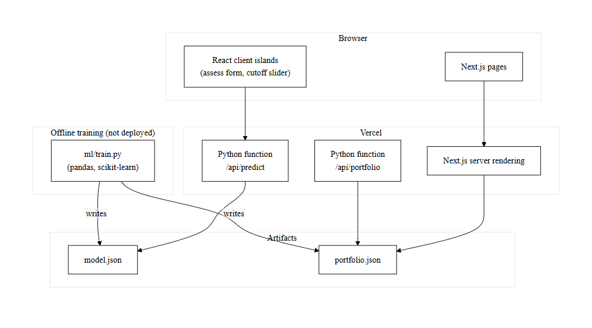

- **Presentation layer.** Next.js 16 App Router pages (Brief, Assess, The book, Methodology) rendered on the server and hydrated as React 19 client islands only where interaction is required, for example the applicant form and the cutoff slider.
- **Application layer.** Vercel hosts both the Next.js server, which renders pages and serves static assets, and two standard-library Python functions, `api/predict.py` and `api/portfolio.py`, which are the only parts of the system the browser calls over the network at runtime.
- **Data layer.** Two JSON artifacts, `model/model.json` and `model/portfolio.json`, hold the fitted ensemble and the precomputed portfolio aggregates respectively. A separate offline path, `ml/train.py`, reads the raw dataset with pandas and scikit-learn and writes both artifacts; it never runs in production.

### 3.1.2 Module Hierarchy

The system divides into four modules, shown in Figure 3.2: the training pipeline, the scoring API, the web interface and the test suite. The training pipeline prepares data, benchmarks candidate models, tunes and calibrates the winner and exports the two artifacts. The scoring API validates a request, walks the tree ensemble, calibrates and bands the result, explains it and serves the portfolio analytics. The web interface covers the four pages reachable from the navigation bar. The test suite is the notebook's model tests together with the API and UI test scripts described in Chapter 4.

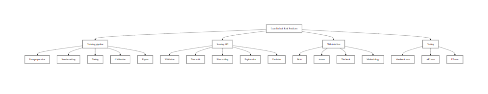

### 3.1.3 Project Structure

The repository's folder and file structure is summarised in Table 3.1, verified against the project tree after the user interface was rebuilt.

<p class="table-caption">Table 3.1 Folder and file structure</p>

| File / Folder | Purpose |
| --- | --- |
| `app/layout.tsx`, `app/page.tsx`, `app/globals.css` | Root layout, Brief landing page, global stylesheet. |
| `app/assess/`, `app/portfolio/`, `app/model/` | The Assess, The book and Methodology pages. |
| `app/error.tsx`, `app/not-found.tsx` | Route-level error and 404 screens. |
| `components/assess/` | Applicant form, workbench, contribution waterfall, cutoff control, PD meter, verdict stamp, sample-file presets. |
| `components/portfolio/` | Risk-band split, cutoff explorer, decile chart/table, segment explorer. |
| `components/model/` | Benchmark table, calibration chart, cutoff table, importance bars, ROC chart. |
| `components/landing/` | Calibration miniature, cost-asymmetry panel, decile staircase, decision pipeline diagram. |
| `components/site/`, `components/editorial/` | Nav, footer, theme toggle; and shared layout primitives (section, stat, figure, reveal). |
| `components/ui/`, `components/charts/chart-kit.tsx` | Radix-based primitives and the shared Recharts configuration. |
| `lib/types.ts`, `lib/format.ts`, `lib/utils.ts` | Shared types, label/number formatters, the `cn()` helper. |
| `lib/decision.ts`, `lib/portfolio.ts`, `lib/model-meta.ts` | Client decision mirror, portfolio reader, server-only model metadata reader. |
| `lib/api.ts` | The typed `predict()` client for `/api/predict`. |
| `api/predict.py`, `api/portfolio.py` | The two Python functions deployed as Vercel serverless functions. |
| `ml/train.py`, `ml/dev_server.py` | Offline training pipeline; local dev server mirroring the two functions on ports 8001/8002. |
| `model/model.json`, `model/portfolio.json` | Exported ensemble and precomputed portfolio aggregates. |
| `data/german_credit.csv` | The cleaned, re-labelled training dataset. |
| `notebook.ipynb` | Reproducibility and quality-gate tests (Chapter 4). |
| `docs/` | Internal engineering notes (architecture, data, model, testing, deployment, limitations). |
| `vercel.json`, `next.config.ts` | Function bundling config and the local rewrite to the two Python servers. |

## 3.2 Database Design

The system has no transactional database. Its data design covers the training dataset and the two JSON artifacts the API reads.

### 3.2.1 ERD

An applicant submits one loan application, which carries exactly one credit position and receives exactly one prediction from the deployed model artifact; a prediction is explained by one or more per-factor contributions. The relationships are drawn in Figure 3.3.

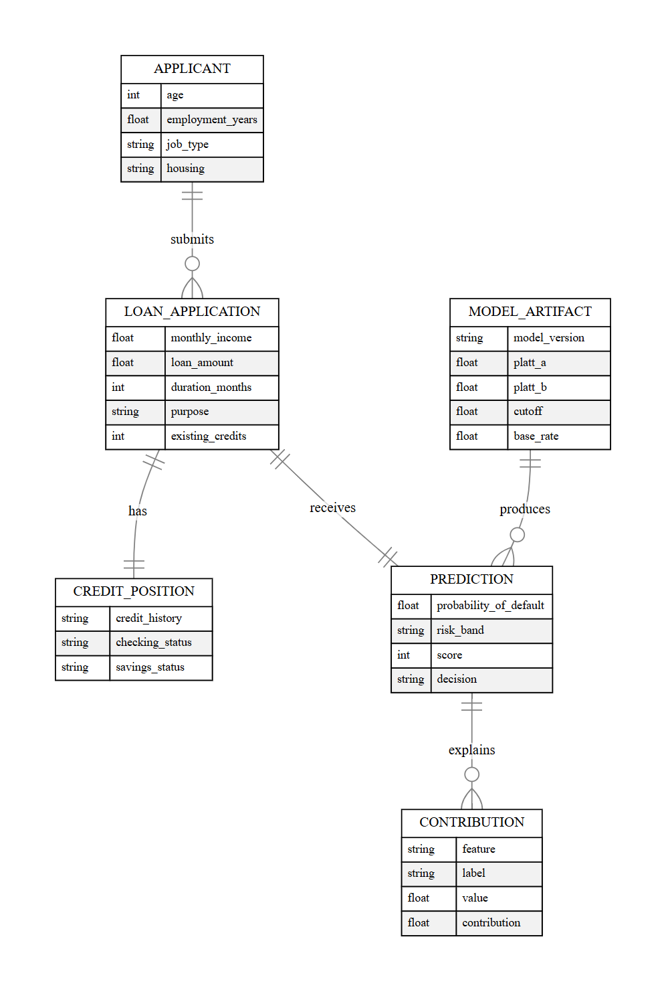

#### Collection Structure

The training dataset's twelve retained fields are structured as shown in Table 3.2.

<p class="table-caption">Table 3.2 Structure of the training dataset (fields used)</p>

| Field | Type | Values / range | Source attribute |
| --- | --- | --- | --- |
| age | Numeric | 18–100 years | Attribute 13 |
| employment_years | Numeric | 0, 0.5, 2.5, 5.5, 10 (bucket midpoints) | Attribute 7 (A71–A75) |
| monthly_income | Numeric | 1–1,000,000 DM | Engineered from Attributes 2, 5 and 8 |
| loan_amount | Numeric | 1–1,000,000 DM | Attribute 5 |
| duration_months | Numeric | 1–120 months | Attribute 2 |
| existing_credits | Numeric | 0–20 | Attribute 16 |
| job_type | Categorical | management, skilled, unskilled_nonresident, unskilled_resident | Attribute 17 |
| housing | Categorical | free, own, rent | Attribute 15 |
| purpose | Categorical | business, car_new, car_used, domestic_appliances, education, furniture_equipment, other, radio_tv, repairs, retraining | Attribute 4 |
| credit_history | Categorical | all_paid, critical, delayed_past, no_credits, paid_duly | Attribute 3 |
| checking_status | Categorical | 0_to_200, 200_or_more, less_than_0, none | Attribute 1 |
| savings_status | Categorical | 100_to_500, 500_to_1000, none, over_1000, under_100 | Attribute 6 |

monthly_income does not exist as a UCI attribute. It is engineered at load time as `(loan_amount / duration_months) / (installment_rate / 100)`, so that a 1,169 DM loan over 6 months at an installment rate of 4% implies a monthly income of 4,870.83 DM. Attribute 9 (personal status and sex) is excluded as a protected attribute, and Attributes 10, 11, 12, 14, 18, 19 and 20 are excluded to keep the applicant form short.

Each of the six categorical fields is one-hot encoded; Table 3.3 gives the resulting column counts.

<p class="table-caption">Table 3.3 Encoding of categorical fields</p>

| Field | Categories | One-hot columns |
| --- | --- | --- |
| job_type | 4 | 4 |
| housing | 3 | 3 |
| purpose | 10 | 10 |
| credit_history | 5 | 5 |
| checking_status | 4 | 4 |
| savings_status | 5 | 5 |

The six numeric fields pass through unscaled, so the full feature vector that the ensemble sees has 6 + 31 = 37 columns. The A47 vacation purpose code is absent from the data entirely, and A48 (retraining) is present in only 9 of the 1,000 rows.

`model/model.json`, the deployed artifact, is structured as shown in Table 3.4.

<p class="table-caption">Table 3.4 Structure of model.json</p>

| Key | Type | Description |
| --- | --- | --- |
| model_version | String | Semantic version of the exported artifact ("1.0.0"). |
| model_type | String | "gradient_boosting". |
| trained_on_rows | Integer | 1,000. |
| numeric_features, categorical_features | Array of String | The six numeric and six categorical field names, in vector order. |
| categories | Object | Category list per categorical field, in encoding order. |
| learning_rate | Number | 0.05. |
| base_value | Number | The ensemble's starting log-odds, ln(0.3 / 0.7). |
| platt_a, platt_b | Number | The Platt scaling coefficients fitted on out-of-fold margins. |
| trees | Array of Object | 250 trees, each with left, right, feature, threshold and value arrays. |
| base_rate | Number | 0.30, the dataset's observed default rate. |
| cutoff | Number | 0.25, the deployed approval cutoff. |
| metrics, benchmark | Object | Out-of-fold evaluation metrics and the cross-validated model comparison. |
| hyperparameters | Object | The selected values from the randomised search. |

#### Validations, Verifications and Normalization

- Field-level validation: the API checks that all twelve fields are present, that the six numeric fields are finite numbers within their documented bounds, and that the six categorical fields hold a value from the trained category list; any failure is rejected before scoring.
- Cross-field validation: the implied monthly instalment, loan_amount divided by duration_months, may not exceed four times monthly_income.
- Parity check: at export time, the hand-written tree walk in `api/predict.py` is compared against the fitted scikit-learn pipeline's output, and the exported artifact is accepted only when the maximum difference across the training rows is below 1e-9.
- Additivity check: the per-factor contributions produced during explanation are summed and compared against the probability minus the base rate; the notebook asserts this difference stays below 1e-14.
- Encoding normalisation: an unseen category in the request is rejected outright rather than silently mapped to a default, since the one-hot scheme has no "unknown" column.
- Privacy: the protected attribute (personal status and sex) is excluded from training altogether, and no applicant's input or output is persisted anywhere; the API is stateless.

### 3.2.2 DFD

Figure 3.4 is the context-level diagram (Level 0), which treats scoring and analytics as a single process bounded by three external entities. Figure 3.5 breaks that process into six processes at Level 1.

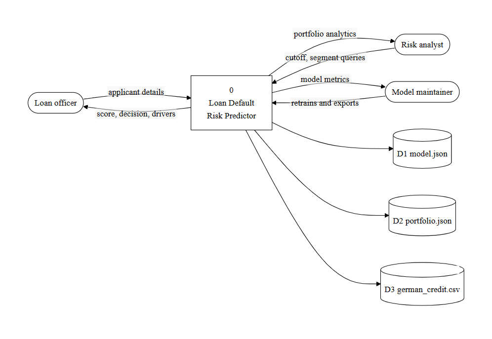

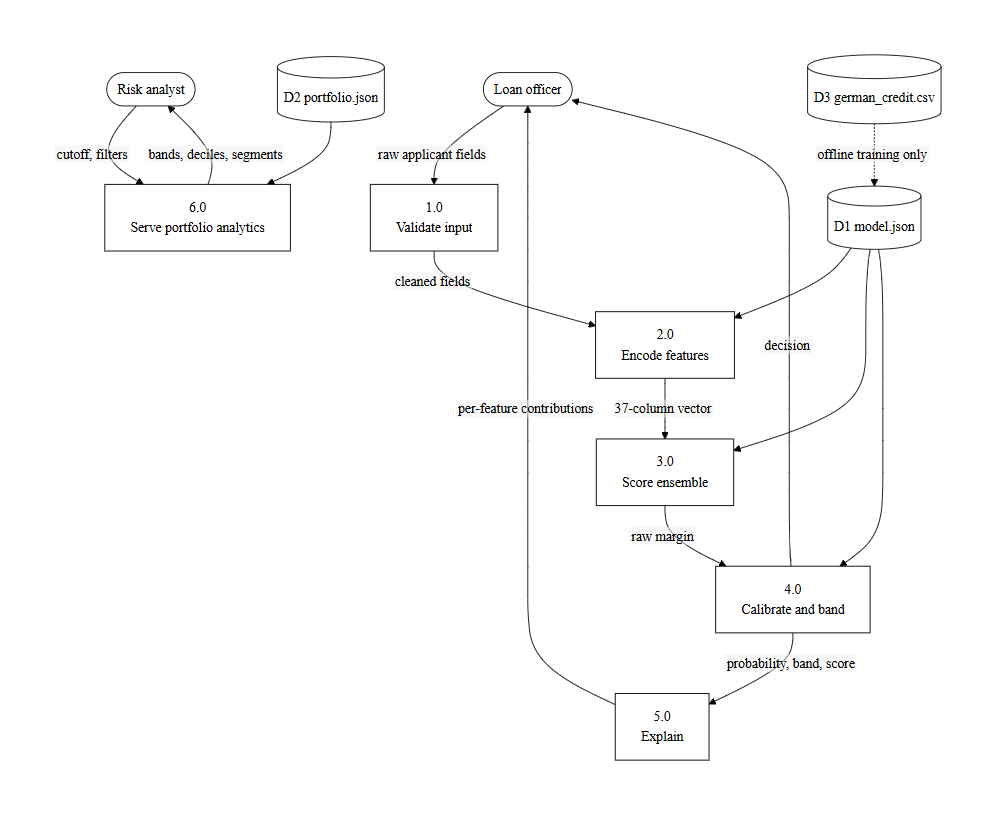

<p class="table-caption">Table 3.5 Description of Level 1 processes</p>

| No. | Process | Description |
| --- | --- | --- |
| 1.0 | Validate input | Checks that all twelve fields are present, numeric fields are in bounds, categorical fields are known, and the instalment-to-income rule holds; rejects with a field-level 400 otherwise. |
| 2.0 | Encode features | Builds the 37-column vector from the validated fields, in the exact numeric-then-categorical order recorded in D1. |
| 3.0 | Score ensemble | Walks all 250 trees of the gradient boosting ensemble, accumulating a raw log-odds margin and a per-feature path contribution. |
| 4.0 | Calibrate & band | Applies Platt scaling to the raw margin to obtain a probability of default, then assigns a risk band and a decision using the stored cutoff. |
| 5.0 | Explain | Groups the per-feature contributions by source field and rescales them so they sum exactly to the probability minus the base rate. |
| 6.0 | Serve portfolio analytics | Reads D2 and returns the precomputed cutoff curve, deciles, calibration bins, feature importance and segments without any further computation. |

Data stores: D1 model.json (the fitted ensemble and its metadata), D2 portfolio.json (the precomputed, out-of-fold portfolio aggregates), and D3 german_credit.csv (the training dataset, read only by the offline training pipeline).

#### Use Case Diagram

Three actors use the system: a loan officer, who scores individual applicants; a risk analyst, who studies the portfolio-level analytics; and a model maintainer, who retrains and redeploys the artifact. Their use cases are shown in Figure 3.6.

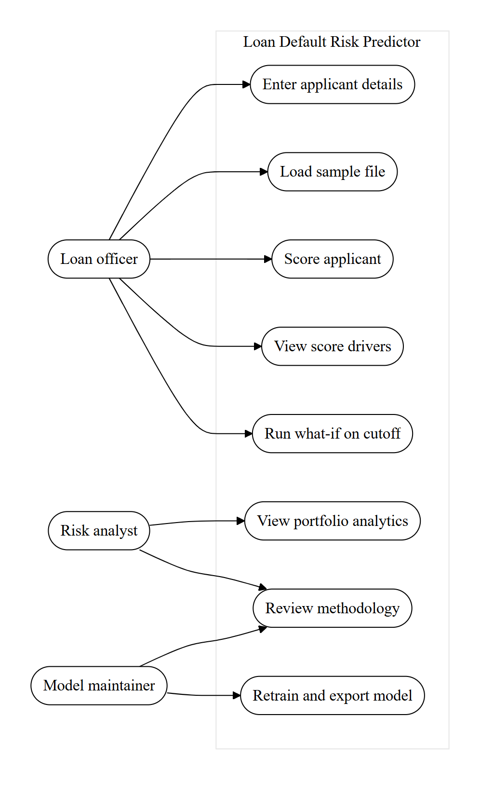

<p class="table-caption">Table 3.6 Use case description: Assess an applicant</p>

| Item | Description |
| --- | --- |
| Actor | Loan officer |
| Pre-condition | The officer has opened the Assess page and has the applicant's twelve field values, or chooses a sample file instead. |
| Main flow | 1. The officer fills in the applicant form, or loads a sample file. 2. The officer submits the form. 3. The browser posts the twelve fields to `/api/predict`. 4. The server validates, scores, calibrates and explains the result. 5. The server returns the probability of default, the risk band, the score, the recommended decision and the per-factor contributions. 6. The browser renders the risk slip, the PD meter and the contribution waterfall. |
| Alternate flow | Validation fails: the offending field is highlighted with an inline message and focus moves to it, and nothing is submitted. Scoring service unreachable: a friendly error replaces the result panel and the form stays filled in so the officer can retry. |
| Post-condition | A risk slip with the probability of default, the band, the score and the decision is shown, and the officer may move the what-if cutoff slider to see how the recommendation would change. |

#### Process Flowcharts

Figure 3.7 is the flowchart of the offline training pipeline. Figure 3.8 is the flowchart of a single scoring request. Figure 3.9 is a state diagram of the decision an applicant's probability of default is mapped onto at the deployed cutoff.

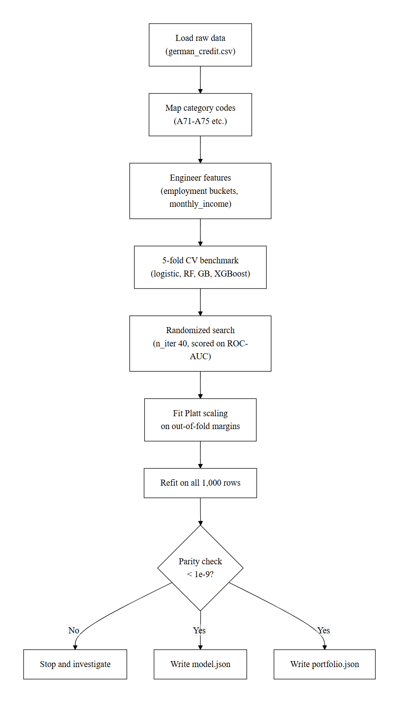

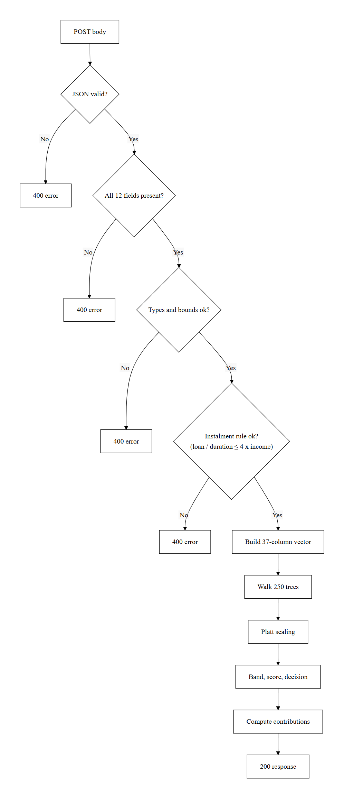

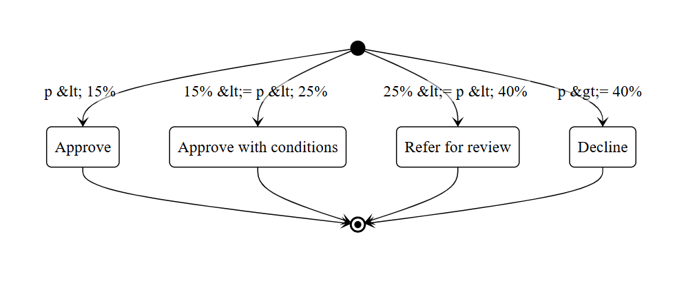

## 3.3 Input Design

All data enters the system through the applicant form on the Assess page, which is divided into three sections. Required fields and bounded number inputs give the officer quick feedback in the browser, and every rule is checked again on the server, since the browser's checks can be bypassed by calling the API directly.

<p class="table-caption">Table 3.7 Applicant, loan and credit position sections</p>

| Section | Field | Control | Validation |
| --- | --- | --- | --- |
| Applicant | Age | Number box (years) | Required; 18–100 |
| Applicant | Years employed | Number box (years, 0.5 step) | Required; 0–50 |
| Applicant | Job type | Drop-down | Required; one of four trained categories |
| Applicant | Housing | Drop-down | Required; one of three trained categories |
| Applicant | Monthly income | Number box (DM) | Required; 1–1,000,000 |
| Loan | Amount | Number box (DM) | Required; 1–1,000,000 |
| Loan | Duration | Number box (months) | Required; 1–120 |
| Loan | Purpose | Drop-down | Required; one of ten trained categories |
| Credit position | Credit history | Drop-down | Required; one of five trained categories |
| Credit position | Checking account | Drop-down | Required; one of four trained categories |
| Credit position | Savings account | Drop-down | Required; one of five trained categories |
| Credit position | Existing credit lines | Number box | Required; 0–20 |

A cross-field rule runs after the four sections: the implied monthly instalment (amount divided by duration) may not exceed four times the monthly income, and the error is attached to the amount field when it does.

<p class="table-caption">Table 3.8 Sample files and what-if controls</p>

| Field | Control | Values |
| --- | --- | --- |
| Sample file | Toggle buttons | Typical file, Strong file, Stretched file; each loads a complete, realistic set of the twelve fields |
| What-if cutoff | Slider | 5%–60%, 1-point steps, starting at the deployed cutoff (25%) |

## 3.4 Output Design

Output is presented as a risk slip and a set of linked charts rather than a single number. The following outputs are described below, and the corresponding screenshots are attached in Annexure A-2.

- The risk slip: the probability of default, the risk band, the 300–850 score and the recommended decision (approve, approve with conditions, refer for review, decline), shown together as soon as a score comes back.
- The PD meter: the probability of default drawn on a 0–100% scale against the low/medium/high band edges.
- The decision stamp: the recommended decision rendered in the band's colour, never in the brand green, so that "approved" and "on-brand" are never confused.
- The contribution waterfall: the twelve factors' contributions to the probability, drawn on a diverging percentage-point scale so that factors pushing the score down and up are both legible.
- The what-if cutoff control: moves the approval cutoff and recomputes only the decision label, leaving the probability of default untouched.
- The risk-band split, the cutoff explorer, the decile chart and table, and the segment explorer, all on the portfolio page, each reading the precomputed aggregates in `model/portfolio.json`.
- The methodology page's benchmark table, ROC chart, calibration chart and importance bars, each explained in §3.6.
- Error messages, shown inline next to the offending field or as a form-level banner, for example "Enter a value from 18 to 100." and "The monthly instalment (amount ÷ months) can't be more than four times monthly income."

## 3.5 Code Design and Development

### 3.5.1 REST API Design

The system exposes two read endpoints, each implemented as a standard-library Python function, listed in Table 3.9.

<p class="table-caption">Table 3.9 REST API endpoints</p>

| Verb | Endpoint | Access | Purpose |
| --- | --- | --- | --- |
| POST | /api/predict | Public | Score one applicant and return the probability, band, score, decision and contributions |
| OPTIONS | /api/predict | Public | CORS preflight; returns 204 |
| GET | /api/portfolio | Public | Return the precomputed portfolio aggregates, cached for one hour |
| OPTIONS | /api/portfolio | Public | CORS preflight; returns 204 |

The prediction response's fields are listed in Table 3.10.

<p class="table-caption">Table 3.10 Prediction response fields</p>

| Field | Type | Description |
| --- | --- | --- |
| probability_of_default | Number | The calibrated probability, rounded to four decimal places. |
| risk_band | String | "low", "medium" or "high". |
| score | Integer | 850 minus 550 times the probability, rounded. |
| decision | String | "approve", "approve_with_conditions", "refer_for_review" or "decline". |
| cutoff | Number | The deployed approval cutoff used for the decision. |
| contributions | Array of Object | One entry per source field: feature, label, value and contribution, sorted by the size of the contribution. |
| base_rate | Number | The dataset's observed default rate (0.30). |
| model_version | String | The deployed artifact's version. |

### 3.5.2 Security Design

Security was treated as a design requirement from the start, even though the system holds no user accounts and no personal data:

- Strict input validation: every field is checked for presence, type and range before anything else runs, and an unseen category is rejected rather than coerced.
- A single error shape: every rejected request returns HTTP 400 with `{error, message}` and no stack trace; there are no 500 responses for bad input, since the handler guards the whole request body in a try/except.
- Statelessness: nothing an applicant submits is written anywhere; each request is scored and forgotten, which removes an entire class of data-breach risk.
- No secrets: the deployed functions need no API key, database password or signing secret, so there is nothing to leak.
- Open CORS by design: `Access-Control-Allow-Origin: *` is set on both endpoints. This is acceptable only because both endpoints are read-only, stateless and free of personal data; a mutating or authenticated endpoint would need a narrower origin policy.
- The protected attribute (personal status and sex) is excluded from the model, so it cannot leak into a decision even indirectly through the API's output.
- Deployment hygiene: `vercel.json`'s `excludeFiles` keeps the training dataset, the notebook and the documentation out of the deployed function bundle, so the raw data never reaches the public internet through the API's code.
- Validation is mirrored, not shared: the same twelve bounds and the same instalment rule are enforced independently in `assess-form.tsx` and in `api/predict.py`, so a request can never bypass the rule by skipping the browser.

### 3.5.3 Important Code Segments

Scoring loop (api/predict.py). Each tree's path contribution is attributed from a virtual root value of 0, not the tree's real root value, which is what makes the contributions exactly additive across the whole ensemble:

```python
contributions: dict[int, float] = {}
raw = model["base_value"]

for tree in model["trees"]:
    node = 0
    attributed_value = 0.0
    while tree["left"][node] != -1:
        feature_idx = tree["feature"][node]
        threshold = tree["threshold"][node]
        go_left = vector[feature_idx] <= threshold
        next_node = tree["left"][node] if go_left else tree["right"][node]
        next_value = tree["value"][next_node]

        delta = (next_value - attributed_value) * model["learning_rate"]
        contributions[feature_idx] = contributions.get(feature_idx, 0.0) + delta

        node = next_node
        attributed_value = next_value

    raw += attributed_value * model["learning_rate"]

return raw, contributions
```

Platt calibration and the decision rule (api/predict.py). The raw margin is passed through a logistic sigmoid with the fitted A and B coefficients, and the calibrated probability is compared against the cutoff at three multipliers to choose a decision:

```python
def decision_for(probability: float, cutoff: float) -> str:
    if probability < cutoff * 0.6:
        return "approve"
    if probability < cutoff:
        return "approve_with_conditions"
    if probability < cutoff * 1.6:
        return "refer_for_review"
    return "decline"


def score_to_display(probability: float) -> int:
    return round(850 - probability * (850 - 300))
```

The raw, log-odds-space contributions are rescaled afterwards into probability space so they sum exactly to the probability minus the base-rate probability, and the same bounds and instalment rule are checked a second time in the browser, in `components/assess/assess-form.tsx`, so the officer sees an inline error instead of waiting on a round trip. Both excerpts, along with the training pipeline's tree export and the Platt fit, are given in Annexure A-3.

## 3.6 Model Design and Development

### 3.6.1 Data Preparation

The training pipeline, `ml/train.py`, loads the raw UCI Statlog (German Credit Data) file, 1,000 rows with 700 good and 300 bad accounts, and keeps twelve of its twenty attributes, dropping personal status and sex as a protected attribute and six further attributes to keep the applicant form short. The employment attribute's five coded buckets (A71–A75) are mapped to numeric midpoints (0, 0.5, 2.5, 5.5 and 10 years), and monthly income is engineered from the loan amount, the duration and the instalment rate, since the dataset carries no income field of its own. The twelve retained fields are then split into six numeric columns, passed through unscaled, and six categorical columns, one-hot encoded into 31 columns, for a 37-column feature vector overall.

### 3.6.2 Model Selection

Four candidate models were benchmarked with five-fold stratified cross-validation, using identical folds (`StratifiedKFold(5, shuffle=True, random_state=42)`) for every model so the comparison is fair. A manual per-fold loop was used instead of scikit-learn's scoring helpers, because the XGBoost scikit-learn wrapper raised a shape error against scikit-learn 1.9's string-named scorers. The results are given in Table 3.11 and plotted in Figure 3.10.

<p class="table-caption">Table 3.11 Cross-validated benchmark of candidate models</p>

| Model | ROC-AUC (± std) | PR-AUC |
| --- | --- | --- |
| Logistic regression | 0.7737 ± 0.0212 | 0.5757 |
| Random forest (300 trees, depth 6) | 0.7883 ± 0.0277 | 0.6329 |
| Gradient boosting (150 trees, depth 3, lr 0.05) | 0.7859 ± 0.0188 | 0.6243 |
| XGBoost (200 trees, depth 3, lr 0.05, scale_pos_weight 700/300) | 0.7893 ± 0.0193 | 0.6299 |
| Gradient boosting, tuned | 0.7965 | n/a |

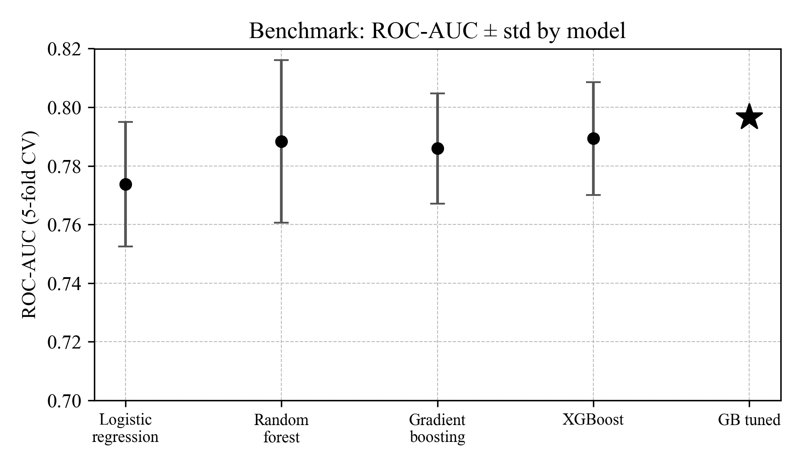

Gradient boosting was chosen over the marginally stronger untuned XGBoost and random forest results because, once tuned, it outperformed every other candidate, it needs no third-party package at inference time (the exported trees are walked by hand in pure Python), and that absence of a runtime dependency is what lets the scoring function deploy on Vercel without scikit-learn's roughly 100 MB footprint.

### 3.6.3 Hyperparameter Tuning

The chosen model was tuned with `RandomizedSearchCV`, 40 iterations, scored on ROC-AUC over the same five folds. Table 3.12 gives the search space and the values selected.

<p class="table-caption">Table 3.12 Search space and selected values</p>

| Hyperparameter | Search space | Selected value |
| --- | --- | --- |
| n_estimators | 80, 120, 150, 200, 250, 300 | 250 |
| max_depth | 2–5 | 3 |
| learning_rate | 0.01, 0.03, 0.05, 0.08, 0.1, 0.15 | 0.05 |
| subsample | 0.7–1.0 | 0.8 |
| min_samples_leaf | 5, 10, 20, 30 | 20 |

### 3.6.4 Probability Calibration

A gradient boosting ensemble's raw margin is a log-odds score, not a probability, and an uncalibrated score tends to be overconfident at the extremes. Platt scaling was fitted on the out-of-fold margins produced by `cross_val_predict`, giving P = σ(A·raw + B) with A = 0.796129 and B = −0.113198. At the ensemble's own starting log-odds, base_value = ln(0.3 / 0.7) = −0.847298, this gives a model baseline probability of default of σ(A·base_value + B) ≈ 0.3126, close to the dataset's own 0.30 base rate, as Figure 3.11 confirms across the full probability range.

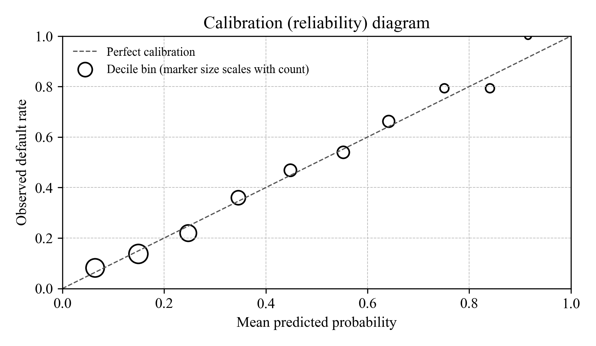

### 3.6.5 Evaluation

Every metric below is computed out-of-fold, so no applicant's score is evaluated on a model that was trained on that applicant's row. The headline metrics are given in Table 3.13.

<p class="table-caption">Table 3.13 Out-of-fold evaluation metrics</p>

| Metric | Value |
| --- | --- |
| ROC-AUC | 0.7928 |
| PR-AUC | 0.6344 |
| KS statistic | 0.4776 |
| Brier score | 0.1601 (flat-guess baseline 0.21) |
| Gini coefficient | 0.5855 |
| Weighted calibration gap | 0.0195 |
| Top-decile vs bottom-decile lift | 10.9× |
| Band counts | low 327 / medium 336 / high 337 |

The ROC curve behind the ROC-AUC figure is plotted in Figure 3.12.

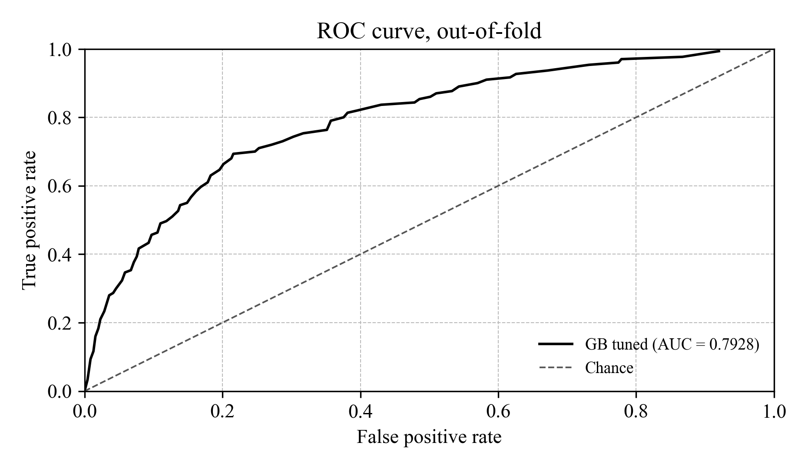

At the deployed 0.25 cutoff, the applicants split into the confusion matrix in Table 3.14, where a predicted default is a declined application.

<p class="table-caption">Table 3.14 Confusion matrix at the 0.25 cutoff</p>

|  | Predicted: Decline | Predicted: Approve |
| --- | --- | --- |
| Actual: Default | TP = 233 | FN = 67 |
| Actual: No default | FP = 250 | TN = 450 |

This gives an accuracy of 0.683, a precision of 0.482, a recall of 0.777 and a specificity of 0.643 at a cost (five per missed default, one per wrongful decline) of 585, or 0.585 per applicant. checking_status, monthly_income and loan_amount drive most of this discrimination, as Figure 3.13's feature importance bars show, and the model's rank ordering holds up decile by decile: the top decile's observed default rate is 10.9 times the bottom decile's, as Figure 3.14 shows.

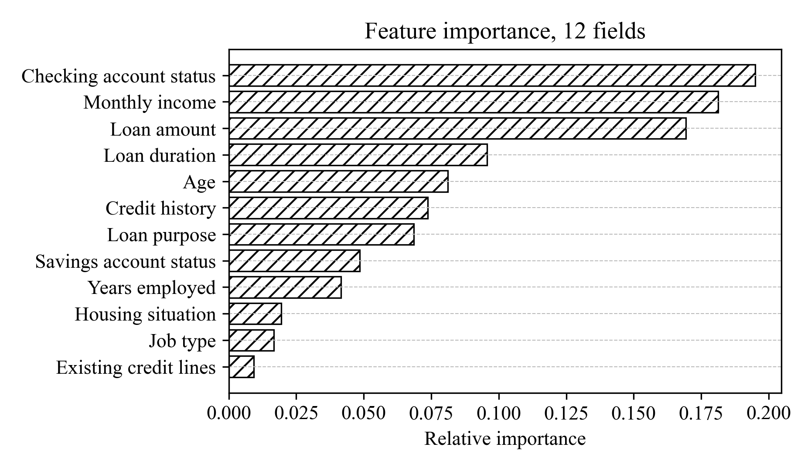

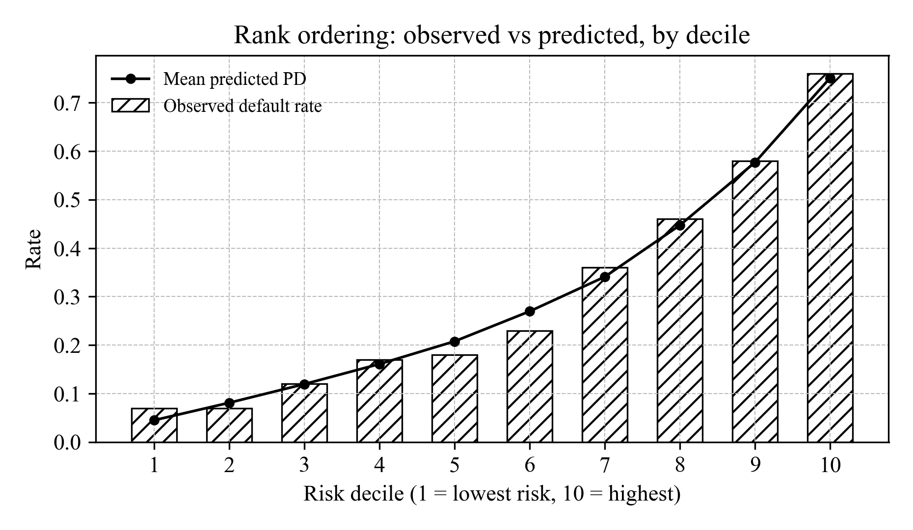

### 3.6.6 Cutoff Selection

The approval cutoff is a business decision, not a modelling one, so it was chosen by minimising a cost function rather than by maximising a classification metric. The UCI-documented cost matrix charges five units for an approved bad account and one unit for a wrongfully declined good account. Table 3.15 gives the approval rate, the bad rate among approved applicants, and the resulting cost at every grid point of the cutoff curve, and Figure 3.15 plots the same trade-off.

<p class="table-caption">Table 3.15 Approval, bad rate and cost by cutoff</p>

<div class="table-wrap">
<table class="dense">
<colgroup><col style="width:9%"><col style="width:13%"><col style="width:16%"><col style="width:12%"><col style="width:12%"><col style="width:13%"><col style="width:10%"><col style="width:15%"></colgroup>
<thead>
<tr><th>Cutoff</th><th>Approval rate</th><th>Bad rate among approved</th><th>Approved</th><th>Bads approved</th><th>Goods declined</th><th>Cost</th><th>Cost / applicant</th></tr>
</thead>
<tbody>
<tr><td>0.05</td><td>6.3%</td><td>4.8%</td><td>63</td><td>3</td><td>640</td><td>655</td><td>0.655</td></tr>
<tr><td>0.10</td><td>20.8%</td><td>8.2%</td><td>208</td><td>17</td><td>509</td><td>594</td><td>0.594</td></tr>
<tr><td>0.15</td><td>32.7%</td><td>8.9%</td><td>327</td><td>29</td><td>402</td><td>547</td><td>0.547</td></tr>
<tr><td>0.20</td><td>43.4%</td><td>11.1%</td><td>434</td><td>48</td><td>314</td><td>554</td><td>0.554</td></tr>
<tr><td>0.25</td><td>51.7%</td><td>13.0%</td><td>517</td><td>67</td><td>250</td><td>585</td><td>0.585</td></tr>
<tr><td>0.30</td><td>59.8%</td><td>14.0%</td><td>598</td><td>84</td><td>186</td><td>606</td><td>0.606</td></tr>
<tr><td>0.35</td><td>66.3%</td><td>15.5%</td><td>663</td><td>103</td><td>140</td><td>655</td><td>0.655</td></tr>
<tr><td>0.40</td><td>71.2%</td><td>17.6%</td><td>712</td><td>125</td><td>113</td><td>738</td><td>0.738</td></tr>
<tr><td>0.45</td><td>75.1%</td><td>19.3%</td><td>751</td><td>145</td><td>94</td><td>819</td><td>0.819</td></tr>
<tr><td>0.50</td><td>79.1%</td><td>20.5%</td><td>791</td><td>162</td><td>71</td><td>881</td><td>0.881</td></tr>
<tr><td>0.55</td><td>82.6%</td><td>21.7%</td><td>826</td><td>179</td><td>53</td><td>948</td><td>0.948</td></tr>
<tr><td>0.60</td><td>86.7%</td><td>23.4%</td><td>867</td><td>203</td><td>36</td><td>1,051</td><td>1.051</td></tr>
</tbody>
</table>
</div>

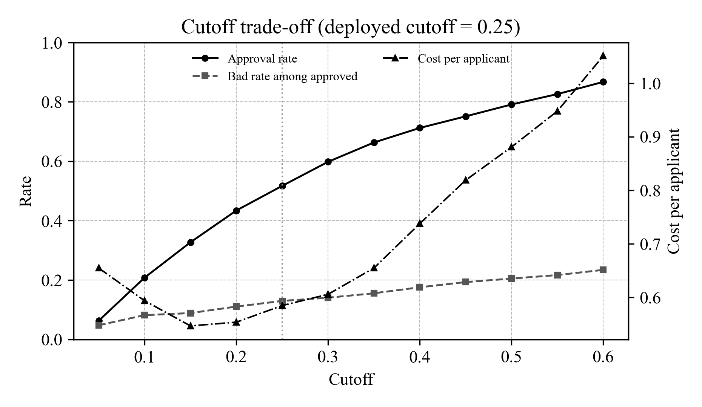

The grid's cost minimum is at a cutoff of 0.15, not 0.25. The 0.25 cutoff was kept as the deployed default even so, because it approves half the book rather than a third of it, and the grid is coarse enough (0.05 steps) that the true minimum could sit anywhere between 0.10 and 0.25; the what-if control on the Assess page exists precisely so that an officer is not locked into either choice.

### 3.6.7 Explaining Individual Scores

Every prediction carries its own explanation rather than relying on a separate, dataset-wide importance ranking. The method is a Saabas decomposition of the boosted ensemble: for each tree, the path an applicant's vector takes from the root to its leaf is walked, and the change in the tree's output at every split along that path is attributed to the feature that split tested, starting from a virtual value of 0 rather than the tree's actual root value. Summed across all 250 trees and scaled by the learning rate, these per-tree, per-feature deltas add up to exactly `raw_margin - base_value` in log-odds space. They are then rescaled into probability space so that they sum to `probability - base_probability`, which the notebook's additivity test confirms to within 5.77e-15.

A worked example from the documentation illustrates the method. An applicant aged 35, employed 4 years, in a skilled job, owning their home, with a monthly income of 2,500 DM, asking for a 5,000 DM loan over 24 months for a new car, with a record of paying debts duly, a checking balance of 0–200 DM and under 100 DM in savings, and one existing credit line, scores a probability of default of 0.5718: a high-risk band, a score of 536, and a decline at the 0.25 cutoff. The largest single driver of this score is the loan amount, contributing +0.0746 to the probability, followed by the applicant's low savings balance and modest income; the contributions across all twelve fields sum to exactly the 0.2591-point difference between this probability and the model's own baseline (0.5718 − 0.3126), so the officer sees the whole explanation accounted for, not an approximation of it.
