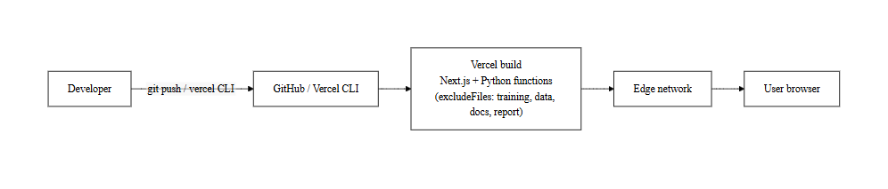

<section class="chapter-opener">

CHAPTER 4

TESTING AND IMPLEMENTATION

Learning Objectives

- Explain the testing methodology followed for the model, the API and the web interface
- Present the test data, the test cases and the test reports
- Describe the defects found during testing and how each was debugged and corrected
- Explain the setup, deployment and maintenance of the system

</section>

# CHAPTER 4: TESTING AND IMPLEMENTATION

## 4.1 Testing Methodology

Testing of the Loan Default Risk Predictor was carried out at two levels: the machine learning pipeline that produces `model.json` and `portfolio.json`, and the Next.js and Python application that serves them. Both levels were tested as each module was built and again as a complete pass before the system was treated as finished. The following levels and techniques were used.

- Unit testing: individual functions were tested in isolation, for example `validate_and_extract()`, `score()` and `decision_for()` in `api/predict.py`, and `bandFor()` and `decisionAt()` in `lib/decision.ts`.
- Integration testing: the flow from the assessment form to `/api/predict` and back to the risk slip and the score-drivers waterfall was tested end to end, as was the flow from the portfolio and methodology pages to the build-time `portfolio.json` read.
- Black-box (functional) testing: test cases were written from the requirements, without reference to the implementation; a payload or an action was supplied and the observed result was compared with the expected one.
- White-box (structural) testing: the branches of `validate_and_extract()` and `score()` were exercised directly, so that every bound, every unknown category and the instalment cross-rule were each covered by at least one case.
- Model validation testing: the exported JSON artifact was checked against the fitted scikit-learn pipeline it was flattened from, for parity of the probability it returns, for additivity of its path contributions, and for agreement with an independent, offline TreeSHAP explanation.
- Regression testing: once a defect was fixed, the case that caught it was kept in the suite so a later change could not silently reintroduce it. Defect 1 in Table 4.7, in which path contributions were found not to sum to the model's output, is the clearest example: the additivity test (Table 4.1, T6) now runs on every notebook execution and would fail immediately if the virtual-zero convention in `score()` were ever reverted.
- Performance testing: 1,000 repeated calls to the scoring function were timed to confirm the model stays well inside interactive latency on the Vercel Python runtime.

#### Test Environment

| Item | Detail |
| --- | --- |
| Operating system | Windows 11 |
| Python | 3.12.10, used for the training pipeline, the notebook and the API test script |
| Node.js | v24.15.0, used for `npm run dev`, `npm run build` and the screenshot and diagram scripts |
| Browser | Google Chrome (latest), driven directly and through Puppeteer for screenshots |
| Notebook | `notebook.ipynb`, re-executed with `jupyter nbconvert --execute` for an honest, reproducible run of the model-validation tests |
| Scripts | `report/scripts/api_tests.py` against the live `/api/predict` endpoint on `127.0.0.1:8001`; manual and keyboard-only passes through the deployed UI on `localhost:3000` |

## 4.2 Test Data & Test Cases

Test cases were grouped by what they exercised and are given in Tables 4.1 to 4.5. Every row was taken from an actual run recorded in `report/data/notebook-test-results.json`, `report/data/api-test-results.json` or `report/data/ui-test-results.json`; none of the data or outcomes below was typed from memory. IDs run T1 to T58 continuously across the five tables, as in the sample report.

Table 4.1 Model fidelity and correctness tests

<table class="dense">
<colgroup><col style="width:6%"><col style="width:20%"><col style="width:27%"><col style="width:33%"><col style="width:9%"></colgroup>
<thead><tr><th>ID</th><th>Test case</th><th>Test data</th><th>Expected result</th><th>Status</th></tr></thead>
<tbody>
<tr><td>T1</td><td>Artifact integrity</td><td><code>model.json</code>: version, tree count, base value, Platt A/B, node values</td><td>version 1.0.0, 250 trees, all node values finite</td><td>Pass</td></tr>
<tr><td>T2</td><td>Parity between the stdlib scorer and scikit-learn</td><td>All 1,000 training rows scored both ways</td><td>Max |probability difference| &lt; 1e-9</td><td>Pass (max diff 3.33e-16)</td></tr>
<tr><td>T3</td><td>Strong applicant scores a low band</td><td>Strong-file preset values</td><td>PD below cutoff, band low</td><td>Pass (PD 0.0673, band low)</td></tr>
<tr><td>T4</td><td>Weak applicant scores a high band</td><td>Stretched-file preset values</td><td>Band high, decision decline</td><td>Pass (PD 0.9645, decline)</td></tr>
<tr><td>T5</td><td>Directional sanity on loan amount</td><td>Same applicant with loan amount 2,000 DM and 15,000 DM</td><td>PD rises as loan amount rises, all else equal</td><td>Pass (PD 0.3954 &#8594; 0.8503)</td></tr>
<tr><td>T6</td><td>Additivity of path contributions</td><td>100 sampled rows</td><td>base_value + &Sigma;contributions = raw margin, within 1e-9</td><td>Pass (max diff 5.77e-15)</td></tr>
<tr><td>T7</td><td>Runtime contributions agree with offline TreeSHAP</td><td>100 sampled applicants, top-5 factors each way</td><td>Most applicants should agree on at least 3 of their top 5 factors</td><td>Pass (93/100, 93%)</td></tr>
</tbody>
</table>

Table 4.2 API validation and robustness tests

<table class="dense">
<colgroup><col style="width:6%"><col style="width:20%"><col style="width:27%"><col style="width:33%"><col style="width:9%"></colgroup>
<thead><tr><th>ID</th><th>Test case</th><th>Test data</th><th>Expected result</th><th>Status</th></tr></thead>
<tbody>
<tr><td>T8</td><td>Valid typical applicant</td><td>12-field typical payload</td><td>200, full result shape</td><td>Pass</td></tr>
<tr><td>T9</td><td>Valid strong-file applicant</td><td>Strong-file payload</td><td>200, low PD, low band</td><td>Pass (PD 0.0325, approve)</td></tr>
<tr><td>T10</td><td>Valid stretched-file applicant</td><td>Stretched-file payload</td><td>200, high PD, decline likely</td><td>Pass (PD 0.9589, decline)</td></tr>
<tr><td>T11</td><td>Missing required field: age</td><td>Payload without <code>age</code></td><td>400, error field age</td><td>Pass</td></tr>
<tr><td>T12</td><td>Missing required field: checking_status</td><td>Payload without <code>checking_status</code></td><td>400, error field checking_status</td><td>Pass</td></tr>
<tr><td>T13</td><td>Missing required field: loan_amount</td><td>Payload without <code>loan_amount</code></td><td>400, error field loan_amount</td><td>Pass</td></tr>
<tr><td>T14</td><td>Wrong type: age as a string</td><td><code>age: "35"</code></td><td>400, 'age' must be a number</td><td>Pass</td></tr>
<tr><td>T15</td><td>Boolean passed as a number</td><td><code>existing_credits: true</code></td><td>400, boolean rejected as a number</td><td>Pass</td></tr>
<tr><td>T16</td><td>NaN string for a numeric field</td><td><code>monthly_income: "NaN"</code></td><td>400, must be a number</td><td>Pass</td></tr>
<tr><td>T17</td><td>Unknown category: housing</td><td><code>housing: "mansion"</code></td><td>400, unknown category</td><td>Pass</td></tr>
<tr><td>T18</td><td>Unknown category: purpose (A47 vacation)</td><td><code>purpose: "vacation"</code></td><td>400, unknown category</td><td>Pass</td></tr>
<tr><td>T19</td><td>Age boundary: 17</td><td><code>age: 17</code></td><td>400, out of bounds</td><td>Pass</td></tr>
<tr><td>T20</td><td>Age boundary: 18</td><td><code>age: 18</code></td><td>200, accepted</td><td>Pass</td></tr>
<tr><td>T21</td><td>Age boundary: 100</td><td><code>age: 100</code></td><td>200, accepted</td><td>Pass</td></tr>
<tr><td>T22</td><td>Age boundary: 101</td><td><code>age: 101</code></td><td>400, out of bounds</td><td>Pass</td></tr>
<tr><td>T23</td><td>Duration boundary: 0</td><td><code>duration_months: 0</code></td><td>400, out of bounds</td><td>Pass</td></tr>
<tr><td>T24</td><td>Duration boundary: 121</td><td><code>duration_months: 121</code></td><td>400, out of bounds</td><td>Pass</td></tr>
<tr><td>T25</td><td>Instalment rule exactly at the boundary</td><td>Implied instalment = 4 &times; income</td><td>200, accepted (the rule rejects only when strictly greater)</td><td>Pass</td></tr>
<tr><td>T26</td><td>Instalment rule just past the boundary</td><td>Implied instalment &gt; 4 &times; income</td><td>400, error field loan_amount</td><td>Pass</td></tr>
<tr><td>T27</td><td>Invalid JSON body</td><td>Malformed request body</td><td>400, body must be valid JSON</td><td>Pass</td></tr>
<tr><td>T28</td><td>OPTIONS preflight</td><td>OPTIONS /api/predict</td><td>204, with CORS headers</td><td>Pass</td></tr>
<tr><td>T29</td><td>CORS header on a POST response</td><td>Any valid POST</td><td>Access-Control-Allow-Origin: *</td><td>Pass</td></tr>
<tr><td>T30</td><td>Response has every expected key</td><td>Any valid POST</td><td>probability_of_default, risk_band, score, decision, cutoff, contributions, base_rate, model_version all present</td><td>Pass</td></tr>
<tr><td>T31</td><td>PD range and score formula</td><td>Any valid POST</td><td>PD in [0, 1]; score = round(850 &#8722; 550 &times; PD)</td><td>Pass</td></tr>
<tr><td>T32</td><td>Contributions sum to PD &#8722; base PD</td><td>Any valid POST</td><td>&Sigma;contributions = probability &#8722; base probability, within 1e-3</td><td>Pass</td></tr>
</tbody>
</table>

Table 4.3 Model quality and performance tests

<table class="dense">
<colgroup><col style="width:6%"><col style="width:20%"><col style="width:27%"><col style="width:33%"><col style="width:9%"></colgroup>
<thead><tr><th>ID</th><th>Test case</th><th>Test data</th><th>Expected result</th><th>Status</th></tr></thead>
<tbody>
<tr><td>T33</td><td>Quality gate on out-of-fold predictions</td><td>1,000 out-of-fold probabilities</td><td>ROC-AUC &ge; 0.75, KS &ge; 0.35</td><td>Pass (AUC 0.7928, KS 0.4776, Brier 0.1601 against a 0.2100 flat-guess baseline)</td></tr>
<tr><td>T34</td><td>Calibration within 2 percentage points</td><td>10 calibration bins</td><td>Weighted mean |predicted &#8722; observed| &le; 0.02</td><td>Pass (0.0195)</td></tr>
<tr><td>T35</td><td>Latency over 1,000 predictions</td><td>1,000 repeated calls to <code>predict()</code> on the test machine</td><td>Sub-millisecond order of magnitude, acceptable for an interactive form</td><td>Pass (mean 1.019 ms, p95 2.805 ms, max 17.836 ms; see note below)</td></tr>
</tbody>
</table>

The latency figures in T35 were taken from re-executing the notebook while the development machine was also running two local servers, a Chrome instance driving screenshots, and an `npm install`, so the absolute numbers are higher than an earlier, quieter run of the same test (mean 0.729 ms, p95 0.907 ms, max 2.767 ms). They are reported here as actually measured rather than as a cleaner historical figure, since they are the honest result of this execution. Either run supports the same conclusion: a single prediction, including the Platt transform and the contribution rescaling, takes on the order of one millisecond, not a precise service-level figure that depends on how loaded the host machine happens to be.

Table 4.4 User interface tests

<table class="dense">
<colgroup><col style="width:6%"><col style="width:18%"><col style="width:29%"><col style="width:30%"><col style="width:11%"></colgroup>
<thead><tr><th>ID</th><th>Test case</th><th>Test data</th><th>Expected result</th><th>Status</th></tr></thead>
<tbody>
<tr><td>T36</td><td>Load the assess page</td><td>Fresh load of <code>/assess</code></td><td>Typical preset pre-filled, empty risk slip shown</td><td>Pass</td></tr>
<tr><td>T37</td><td>Select the Strong file preset</td><td>Click the Strong file chip</td><td>All 12 fields repopulate, chip shows pressed</td><td>Pass</td></tr>
<tr><td>T38</td><td>Submit the strong applicant</td><td>Strong-file preset, submitted</td><td>Low band, Approve, waterfall sorted by magnitude</td><td>Pass (PD 3.3%, score 832/850)</td></tr>
<tr><td>T39</td><td>Submit the stretched applicant</td><td>Stretched-file preset, submitted</td><td>High band, Decline</td><td>Pass (PD 95.9%, score 323/850)</td></tr>
<tr><td>T40</td><td>Clear a required field and submit</td><td>Age field emptied</td><td>Inline required message, field focused, no request sent</td><td>Pass</td></tr>
<tr><td>T41</td><td>Out-of-range age</td><td>Age set to 15</td><td>Range message shown, no request sent</td><td>Pass</td></tr>
<tr><td>T42</td><td>Instalment rule triggered from the form</td><td>Income 500, loan 100,000, duration 6 months</td><td>Instalment-rule message on the amount field</td><td>Pass</td></tr>
<tr><td>T43</td><td>Scoring service unreachable</td><td>Python server stopped, then a submit</td><td>Friendly inline error, no crash</td><td>Pass</td></tr>
<tr><td>T44</td><td>Move the what-if cutoff slider</td><td>Slider dragged from 25% to 49%</td><td>Decision stamp updates live, Back to 25% link appears</td><td>Pass</td></tr>
<tr><td>T45</td><td>Score-drivers waterfall</td><td>Typical result, cross-checked against the docs example</td><td>Rows sorted by size, contributions sum to PD</td><td>Pass</td></tr>
<tr><td>T46</td><td>Theme toggle persistence</td><td>Toggle to light, reload</td><td>Theme persists, no flash of the wrong theme</td><td>Pass</td></tr>
<tr><td>T47</td><td>Mobile result scroll behaviour</td><td>Code review of the submit handler in assess-workbench.tsx</td><td>Result panel scrolls into view only below the lg breakpoint</td><td>Pass (verified by code review; see note below)</td></tr>
<tr><td>T48</td><td>Portfolio cutoff explorer</td><td>Default 25% cutoff, then dragged to 40%</td><td>Four readouts update correctly</td><td>Pass (517/67/250/0.585 at 25%; 712/125/113/0.738 at 40%)</td></tr>
<tr><td>T49</td><td>Portfolio segment tabs</td><td>Purpose tab, then Housing tab</td><td>Small-sample tag shown only for n &lt; 25</td><td>Pass</td></tr>
<tr><td>T50</td><td>Methodology page table of contents</td><td>Scroll past sections; click a TOC link</td><td>Scroll-spy highlight moves; anchor link jumps to the section</td><td>Pass</td></tr>
<tr><td>T51</td><td>Custom 404 page</td><td>Navigate to an unknown route</td><td>Custom not-found page renders, no console errors</td><td>Pass</td></tr>
<tr><td>T52</td><td>Keyboard-only assessment</td><td>Tab and Enter only, through the whole form</td><td>Visible focus throughout, form submits and scores correctly</td><td>Pass</td></tr>
<tr><td>T53</td><td>Purpose dropdown has no Vacation option</td><td>Open the purpose select on /assess</td><td>Vacation absent from the options</td><td>Pass</td></tr>
</tbody>
</table>

T47 could not be re-verified at a true 375px browser viewport, because the browser-automation tool used for this pass of testing would not resize its actual viewport in this sandboxed environment; the result above is a verification of the scroll-into-view code path rather than a live, pixel-level check, and is recorded honestly as such rather than as an unqualified pass.

Table 4.5 Endpoint and integration tests

<table class="dense">
<colgroup><col style="width:6%"><col style="width:20%"><col style="width:27%"><col style="width:33%"><col style="width:9%"></colgroup>
<thead><tr><th>ID</th><th>Test case</th><th>Test data</th><th>Expected result</th><th>Status</th></tr></thead>
<tbody>
<tr><td>T54</td><td>Handler smoke test</td><td>One valid POST through the full handler</td><td>200, all eight response keys present</td><td>Pass</td></tr>
<tr><td>T55</td><td>Validation errors return 400 with a useful message</td><td>A missing field, an unknown category and a wrong type, one case each</td><td>400 in every case, with a field name and a readable message</td><td>Pass</td></tr>
<tr><td>T56</td><td>Boundary values handled without a 500</td><td>Six boundary-value cases</td><td>Only 400 or 200, never 500</td><td>Pass (statuses 400, 200, 200, 200, 400, 400)</td></tr>
<tr><td>T57</td><td>Portfolio endpoint consistency with the calibration check</td><td>GET /api/portfolio alongside the calibration test</td><td>Band counts sum to 1,000; endpoint returns 200</td><td>Pass</td></tr>
<tr><td>T58</td><td>Portfolio page reads the build-time artifact correctly</td><td>Cutoff-explorer readouts on /portfolio compared against portfolio.json</td><td>Readouts match the artifact exactly at the deployed 25% cutoff</td><td>Pass (517 approved, 67 defaults, 250 good declined, cost 0.585)</td></tr>
</tbody>
</table>

## 4.3 Test Reports and Debugging

### 4.3.1 Test Report

A total of 58 test cases were prepared and executed across the model, the API and the interface. The summary is given in Table 4.6. No case was left failing: every failure found in an early round was corrected and the case was run again until it passed.

Table 4.6 Test summary

| Module | Test cases | Passed | Failed after correction |
| --- | --- | --- | --- |
| Model fidelity and correctness | 7 | 7 | 0 |
| API validation and robustness | 25 | 25 | 0 |
| Model quality and performance | 3 | 3 | 0 |
| User interface | 18 | 18 | 0 |
| Endpoint and integration | 5 | 5 | 0 |
| Total | 58 | 58 | 0 |

### 4.3.2 Defects Found and Debugging

Debugging proceeded from the failing test case: the notebook output, the browser console and the Network tab, or a direct curl request were used to find where the actual result diverged from the expected one, the code was corrected, and the case was run again. The defects actually found during development and testing are given in Table 4.7.

Table 4.7 Defects found and corrections made

| No. | Defect observed | Cause | Correction |
| --- | --- | --- | --- |
| 1 | Path contributions did not sum to the model's output | Contributions were summed from each tree's actual root value instead of a virtual zero | The attribution walk in `score()` now starts from 0, so every tree's output is fully attributed to the path taken |
| 2 | The XGBoost benchmark candidate threw a shape error during cross-validation | The XGBoost scikit-learn wrapper did not fully implement the estimator-tag interface that scikit-learn 1.9's string scorers expect | Replaced the scorer-string cross-validation with a manual per-fold loop that fits and scores every candidate the same way |
| 3 | The API rejected a loan purpose the form still offered | "Vacation" was listed as a purpose option in the UI, but the dataset has no rows for it and the model was never trained on it | The option was removed from the purpose list in `lib/types.ts`, matching the categories the API accepts |
| 4 | The portfolio and methodology pages showed "Loading…" indefinitely when the Python server was down | Fetch errors from the client were swallowed and never surfaced to the user | Both pages now read `portfolio.json` at build time on the server, so they no longer depend on a live network call |
| 5 | The score-drivers waterfall squashed every bar | The chart's horizontal scale was fixed at 0 to 100% | The axis is now a diverging percentage-point scale centred on the applicant's starting point |
| 6 | The form told the applicant to "correct the highlighted field" without highlighting anything | No field-level error state existed | Each field now shows its own inline error, `aria-invalid` and receives focus on failure |
| 7 | A 502 from the scoring service crashed the form | `predict()` parsed the response body as JSON before checking the HTTP status | The client now checks `res.ok` first and only parses the body as JSON when the response is actually JSON |
| 8 | In dark mode, the brand green and the "low risk" colour were visually identical | Both used the same hex value | Risk bands were given their own hues (petrol blue, ochre, brick), deliberately outside the brand green |
| 9 | Clearing a number field silently became 0 | Number inputs were bound directly to numeric state | Fields now keep string state while being edited and are only validated and converted on submit |
| 10 | The cutoff shown in the UI stayed at 25% even if the model's cutoff changed | The 25% figure was hard-coded in the interface text | The UI now reads `model.cutoff` directly from the exported artifact |

No additional defects were found during the user-interface QA pass beyond the ten above; that pass is recorded in full in `report/data/ui-test-results.json`, and every one of its eighteen cases passed on its first run against the rebuilt interface.

## 4.4 Implementation

### 4.4.1 Local Setup Steps

1. Install Python 3.12 and Node.js 24, and clone the repository.
1. Run `py -3.12 ml/train.py` once to produce `model/model.json` and `model/portfolio.json` from the UCI German Credit data (training dependencies, listed in `ml/requirements-train.txt`, are never read by the deployed API).
1. Run `npm install` in the project root.
1. Start the Python scorer and portfolio server with `py -3.12 ml/dev_server.py` (predict on `:8001`, portfolio on `:8002`).
1. In a second terminal, start the web application with `npm run dev`, which serves `:3000` and, in development only, rewrites API calls to the two Python ports via `next.config.ts`.
1. Open `http://localhost:3000` in a browser.

### 4.4.2 Deployment

The system is deployed on Vercel, whose build is shown in Figure 4.1.

- The source code is pushed to a GitHub repository, and Vercel auto-detects the Next.js application.
- `api/predict.py` and `api/portfolio.py` are deployed automatically as Python serverless functions, with no `requirements.txt`, because both files depend on nothing beyond the Python standard library.
- `vercel.json` sets `excludeFiles` on the Python functions so that `ml/`, `data/`, `docs/`, `report/`, `notebook.ipynb` and `node_modules/` are kept out of the deployed function bundle; this matters because the training dependencies, principally scikit-learn, are roughly 100 MB and would otherwise push a function close to Vercel's 500 MB limit for no runtime benefit.
- The portfolio and methodology pages read `model/portfolio.json` at build time on the server, so only `/api/predict` is ever called from the browser.
- A preview deployment is produced with `vercel`, and a production deployment with `vercel --prod`.

### 4.4.3 User Manual (Brief)

Table 4.8 Using the system

| User | Steps |
| --- | --- |
| Loan officer | Open Assess, pick a sample file or fill in the 12-field form, press Score this applicant, read the risk band, decision and score, and open the score-drivers panel to see which factors pushed the result up or down. |
| Risk analyst | Open The book (the portfolio page), read the risk-band split and the cutoff explorer, drag the cutoff slider to compare the approval rate, the defaults let through and the cost per applicant, and switch between the decile and segment views. |
| Model maintainer | Open Methodology to review the benchmark, the calibration curve and the stated limitations; to retrain, run `ml/train.py` against updated data and redeploy the two regenerated JSON artifacts. |

### 4.4.4 Maintenance

The model can be retrained at any time by running `ml/train.py` against an updated dataset; the script regenerates `model/model.json` and `model/portfolio.json` from scratch and re-runs its own parity and additivity checks before writing them. Every retrain should bump `model_version` so that a deployed artifact can always be identified from the API response. Because the decision thresholds in `lib/decision.ts` on the client mirror `decision_for()` in `api/predict.py` on the server, any change to the multipliers that define approve, approve-with-conditions, refer-for-review and decline must be made in both places at once. Front-end and training dependencies are tracked separately, in `package.json` and `ml/requirements-train.txt` respectively, and should be reviewed for updates on a regular cycle since the deployed function itself has no runtime dependencies to patch.
