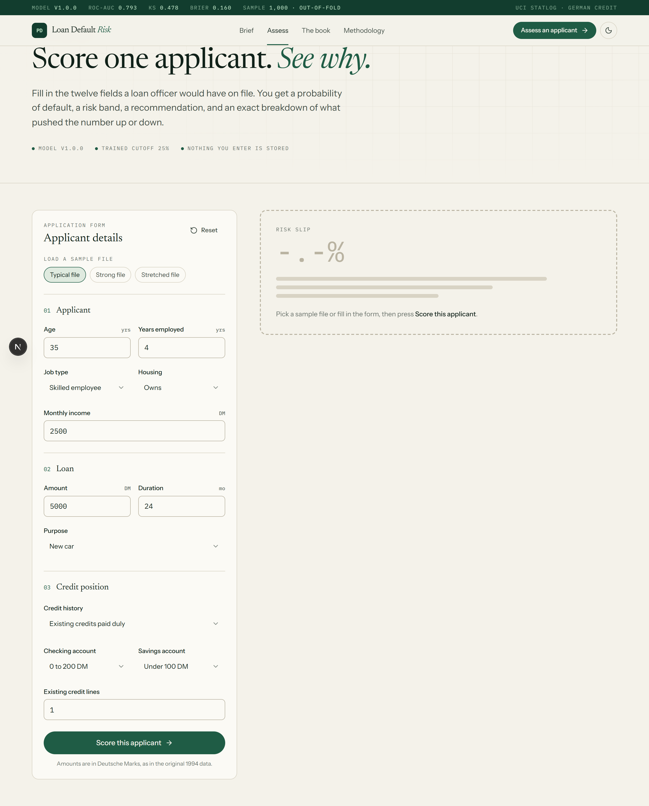
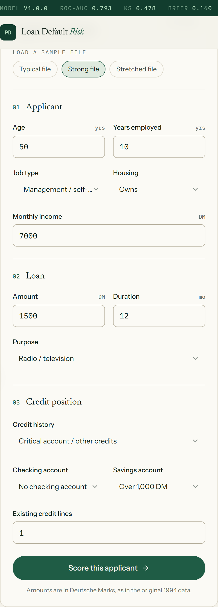
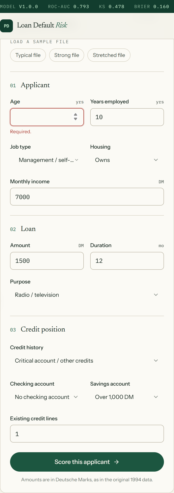
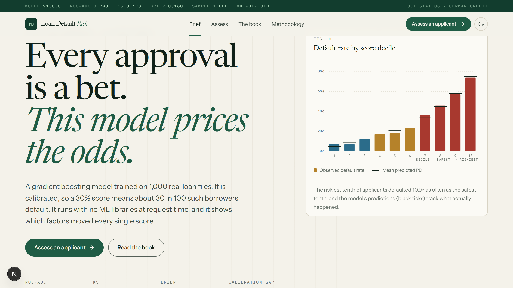
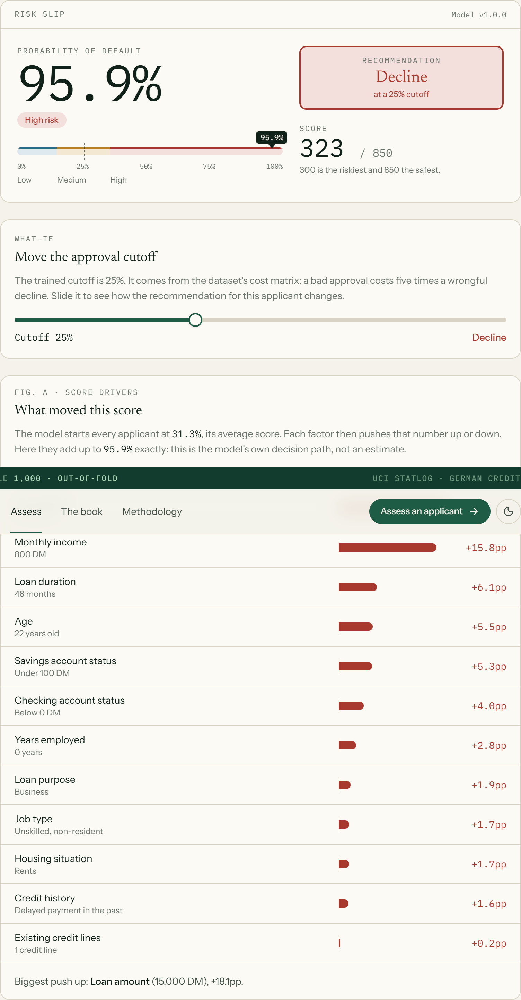
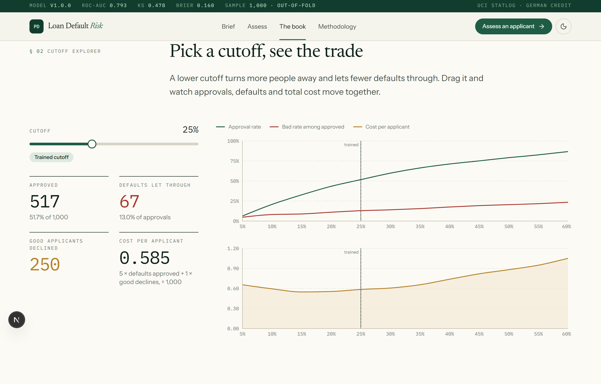
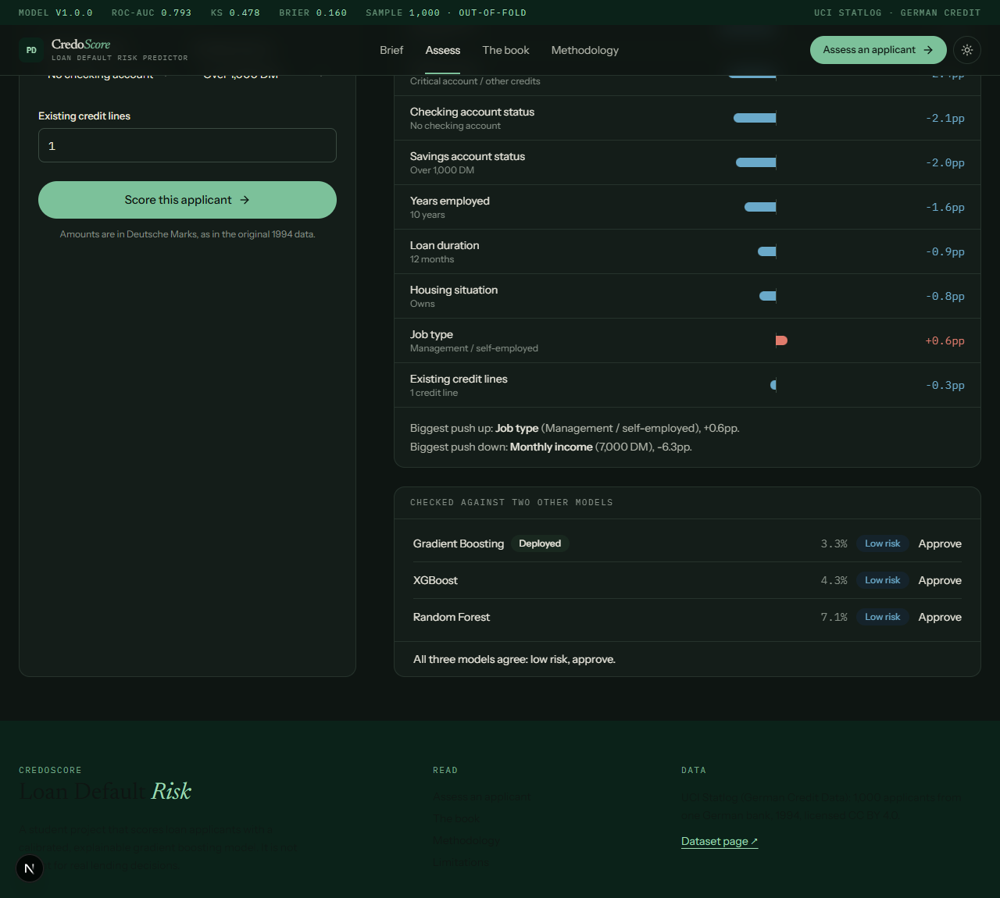
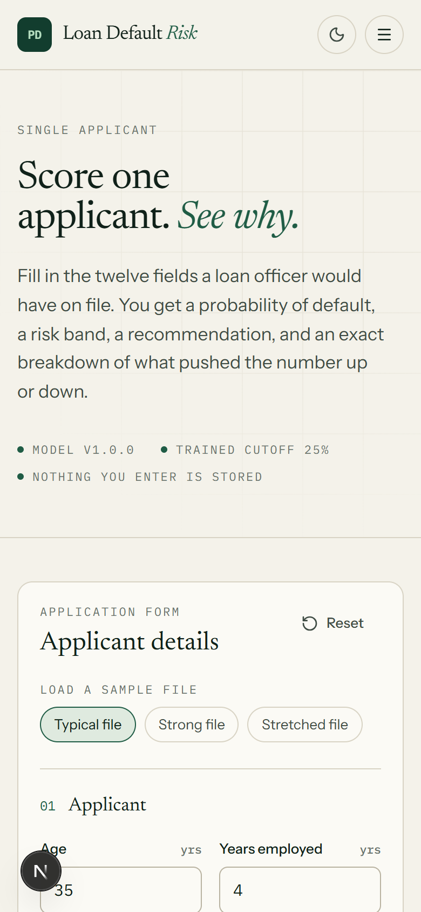

<section class="chapter-opener">
<p class="op-num">CHAPTER 6</p>
<p class="op-title">ANNEXURES</p>
<p class="op-lo">Learning Objectives</p>

- Attach sample inputs and screen snapshots
- Attach sample outputs and screen snapshots
- Attach important source code

</section>

# CHAPTER 6: ANNEXURES

## A-1 Sample Inputs

The following screens show the sample inputs given to the system, from the live, deployed interface.

<div class="annexure-shot">



</div>

<div class="annexure-shot">



</div>

<div class="annexure-shot">



</div>

## A-2 Sample Outputs

A representative selection of six screens is given below, from the landing page through to the new three-model comparison panel; the full screen set was exercised during testing (Chapter 4, Table 4.4) even where not every screen is reproduced here.

<div class="annexure-shot">



</div>

<div class="annexure-shot">



</div>

<div class="annexure-shot">



</div>

<div class="annexure-shot">



</div>

<div class="annexure-shot">



</div>

Selected source code of the model, the scoring API and the front end is given below.

## A-3 Coding

#### A-3.1 api/predict.py (validate_and_extract)

Every field is checked before a vector is ever built. Numeric fields are checked for type, for being finite and for their stated bounds; categorical fields are checked against the exact category list the model was trained on; and a cross-field rule rejects a loan whose implied monthly instalment is more than four times the applicant's income.

```python
def validate_and_extract(payload: dict[str, Any], model: dict[str, Any]) -> dict[str, Any]:
    if not isinstance(payload, dict):
        raise ValidationError("_body", "Request body must be a JSON object.")

    cleaned: dict[str, Any] = {}

    for field in model["numeric_features"]:
        if field not in payload:
            raise ValidationError(field, f"'{field}' is required.")
        raw = payload[field]
        if isinstance(raw, bool) or not isinstance(raw, (int, float)):
            raise ValidationError(field, f"'{field}' must be a number.")
        value = float(raw)
        if math.isnan(value) or math.isinf(value):
            raise ValidationError(field, f"'{field}' must be a finite number.")
        lo, hi = NUMERIC_BOUNDS.get(field, (float("-inf"), float("inf")))
        if value < lo or value > hi:
            raise ValidationError(field, f"'{field}' must be between {lo} and {hi}.")
        cleaned[field] = value

    for field in model["categorical_features"]:
        if field not in payload:
            raise ValidationError(field, f"'{field}' is required.")
        raw = payload[field]
        if not isinstance(raw, str):
            raise ValidationError(field, f"'{field}' must be a string.")
        allowed = model["categories"][field]
        if raw not in allowed:
            raise ValidationError(
                field, f"'{field}' must be one of {allowed}, got '{raw}'."
            )
        cleaned[field] = raw

    if cleaned["duration_months"] > 0:
        implied_installment = cleaned["loan_amount"] / cleaned["duration_months"]
        if implied_installment > cleaned["monthly_income"] * 4:
            raise ValidationError(
                "loan_amount",
                "This loan amount and duration imply a monthly installment "
                "many times the applicant's income. Lower the amount, extend "
                "the duration, or raise the income.",
            )

    return cleaned
```

#### A-3.2 api/predict.py (handler)

The HTTP entry point is a plain `BaseHTTPRequestHandler`, the form Vercel's Python runtime supports with no framework at all. It answers CORS preflights, reads the body, and guarantees every failure comes back as a 400 with a field and a message rather than as a 500.

```python
class handler(BaseHTTPRequestHandler):
    def _send_json(self, status: int, body: dict[str, Any]) -> None:
        payload = json.dumps(body).encode("utf-8")
        self.send_response(status)
        self.send_header("Content-Type", "application/json")
        self.send_header("Access-Control-Allow-Origin", "*")
        self.send_header("Content-Length", str(len(payload)))
        self.end_headers()
        self.wfile.write(payload)

    def do_OPTIONS(self) -> None:
        self.send_response(204)
        self.send_header("Access-Control-Allow-Origin", "*")
        self.send_header("Access-Control-Allow-Methods", "POST, OPTIONS")
        self.send_header("Access-Control-Allow-Headers", "Content-Type")
        self.end_headers()

    def do_POST(self) -> None:
        try:
            length = int(self.headers.get("Content-Length", 0))
            raw_body = self.rfile.read(length) if length > 0 else b"{}"
            try:
                payload = json.loads(raw_body.decode("utf-8"))
            except (json.JSONDecodeError, UnicodeDecodeError):
                self._send_json(400, {"error": "body", "message": "Request body must be valid JSON."})
                return

            result = predict(payload)
            self._send_json(200, result)
        except ValidationError as exc:
            self._send_json(400, {"error": exc.field, "message": exc.message})
        except Exception as exc:  # noqa: BLE001: last-resort guard, never a 500 for bad input
            self._send_json(400, {"error": "unknown", "message": str(exc)})

    def log_message(self, format: str, *args: Any) -> None:  # noqa: A002
        pass  # keep Vercel's function logs quiet for a request this small
```

#### A-3.3 lib/decision.ts

The band and decision rules on the client are kept deliberately simple so they can be read at a glance, and are commented as needing to stay in step with the equivalent Python logic on the server.

```typescript
import type { Decision, RiskBand } from "./types";

export const BAND_EDGES = { low: 0.15, medium: 0.35 } as const;

export function bandFor(pd: number): RiskBand {
  if (pd < BAND_EDGES.low) return "low";
  if (pd < BAND_EDGES.medium) return "medium";
  return "high";
}

// Mirrors decision_for() in api/predict.py; keep the multipliers in sync.
export function decisionAt(pd: number, cutoff: number): Decision {
  if (pd < cutoff * 0.6) return "approve";
  if (pd < cutoff) return "approve_with_conditions";
  if (pd < cutoff * 1.6) return "refer_for_review";
  return "decline";
}

export const DECISION_TONE: Record<Decision, "low" | "medium" | "high"> = {
  approve: "low",
  approve_with_conditions: "low",
  refer_for_review: "medium",
  decline: "high",
};
```

#### A-3.4 components/assess/contribution-waterfall.tsx (core)

Each row's bar is drawn out from a centre line, growing right for a risk-raising factor and left for a risk-lowering one, with its width scaled against the single largest contribution in the list so the chart stays legible regardless of how big or small an individual applicant's drivers are.

```tsx
      <ol className="divide-y divide-hairline">
        {rows.map((r) => {
          const w = (Math.abs(r.contribution) / max) * 50;
          const pos = r.contribution >= 0;
          return (
            <li key={r.feature} className="grid grid-cols-[minmax(0,1fr)_minmax(0,1.1fr)_4.25rem] items-center gap-3 px-5 py-2.5">
              <div className="min-w-0">
                <p className="truncate text-sm">{featureLabel(r.feature)}</p>
                <p className="truncate text-xs text-muted-foreground">{formatFeatureValue(r.feature, r.value)}</p>
              </div>
              <div className="relative h-5" aria-hidden>
                <div className="absolute inset-y-0 left-1/2 w-px bg-hairline-strong" />
                <div
                  className={pos ? "absolute inset-y-1 left-1/2 rounded-r-sm bg-band-high" : "absolute inset-y-1 right-1/2 rounded-l-sm bg-band-low"}
                  style={{ width: `${Math.max(w, 0.6)}%` }}
                />
              </div>
              <p className={`num text-right text-sm ${pos ? "text-band-high" : "text-band-low"}`}>{formatSigned(r.contribution)}</p>
            </li>
          );
        })}
      </ol>
```

