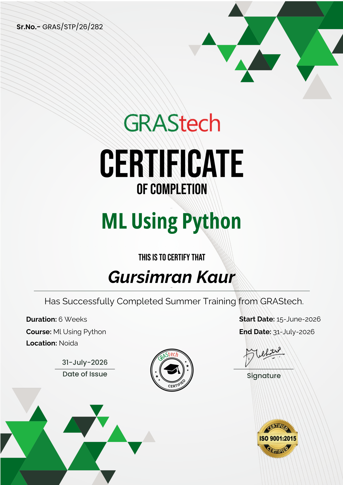
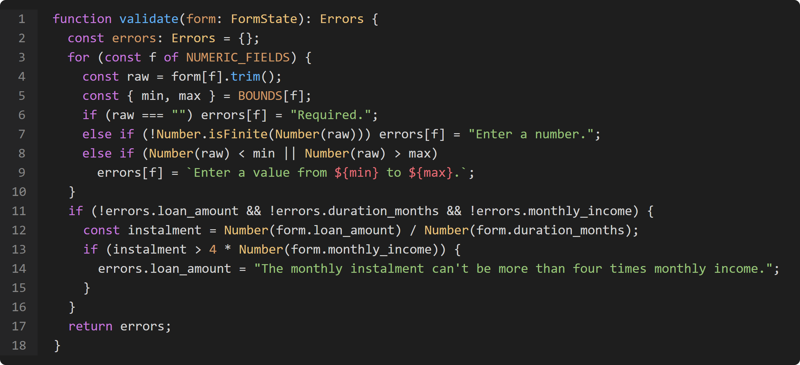
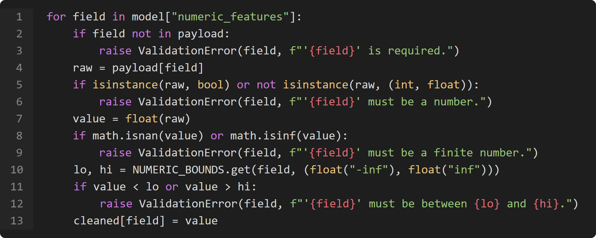

<section class="front-page synopsis-cover">

SRI GURU TEG BAHADUR INSTITUTE OF MANAGEMENT AND INFORMATION TECHNOLOGY

Department of BCA

SYNOPSIS REPORT

ON

CREDOSCORE

&ldquo;LOAN DEFAULT RISK PREDICTOR&rdquo;

Submitted in partial fulfilment of the requirement for Software Training Report (STR), BCA &ndash; Vth Semester

Submitted by:

GURSIMRAN KAUR

Roll No.: 02490202024

Section: BCA 5A

Under the Guidance of:

Coordinator: Ms. Nehu Gumber

HOD (BCA): Dr. Raj Kumar

</section>

<section class="synopsis-body page-start">

CERTIFICATE

Certificate of Completion issued by GRAStech to GURSIMRAN KAUR for successfully completing the six-week online internship program in Machine Learning Using Python. Date of issue: 31 July 2026. Signed by Mohammad Qayam Ali, Founder and Program Head.

<figure class="cert-figure"></figure>

</section>

<section class="synopsis-body page-start">

## A. Title of the Project

**Loan Default Risk Predictor: An Explainable Machine Learning Web Application for Credit Risk Assessment.**

Loan default is a common problem for any lender that extends unsecured credit, and the decision to approve, decline or place conditions on an application has to be made from the information on hand, at the time of application, in a way that is consistent across officers and defensible afterwards. The Loan Default Risk Predictor is a web application that scores a loan applicant's probability of default with a calibrated gradient boosting model, explains the score factor by factor, and lets the lender see how moving the approval cutoff changes the approval rate, the bad rate and the expected cost. The project was undertaken to study whether historical application data can be used to replace an inconsistent, unexplained decision with a consistent, calibrated and explainable one.

## B. Statement about the Problem

A lender approving an unsecured loan cannot know, at the time of the decision, whether the applicant will eventually repay or default; that outcome is settled only months or years later. Left to individual judgement, two applicants with a similar credit history can receive different outcomes depending on who reviews the file, and the reasoning behind a decline is rarely written down in a form the applicant can be shown. A missed default and a wrongly declined applicant also carry different costs to the lender, and few manual or automated processes make that difference explicit. The problem addressed by this project is therefore whether an applicant's loan, employment and credit-history details can be used to compute a calibrated probability of default, a lending recommendation and a factor-by-factor reason for that recommendation, in a way a loan officer can defend and an applicant can understand.

## C. Why the Particular Topic is Chosen? (Present State of the Art)

The topic was chosen for the following reasons:

- Credit risk assessment is a practical, widely studied problem across lending and fintech, and a well-documented public dataset (the UCI Statlog German Credit data) exists to build and benchmark a real model against.
- Machine learning models can capture interactions between an applicant's attributes, such as a short employment history combined with a long loan duration, that a simple weighted scorecard cannot.
- Gradient boosting was chosen over a plain logistic-regression scorecard because it reached a higher ROC-AUC and PR-AUC under identical cross-validation folds, while still allowing an exact, additive explanation of every prediction, which a black-box ensemble normally does not offer.
- The project exercises the complete life cycle of an applied machine learning product: data understanding, preprocessing and feature engineering, model benchmarking and tuning, probability calibration, per-applicant explanation, a dependency-free production API, a front end, and testing, giving broad practical exposure within a single six-week internship.

## D. Objective and Scope of the Project

### Objectives

1. To collect the twelve applicant, loan and credit-position fields needed to score a loan application, with client-side and server-side validation.
2. To benchmark four candidate models, deploy three of them to production (gradient boosting, XGBoost and random forest), score them together on every request so an officer sees cross-verified agreement rather than one model's self-reported accuracy, and calibrate every deployed model's output into a genuine probability of default.
3. To return, for every scored applicant, a probability of default, a risk band, a credit-style score and a lending recommendation.
4. To explain every prediction with a factor-by-factor contribution that sums exactly to the predicted probability.
5. To let a user move the approval cutoff and see the resulting approval rate, bad rate and expected cost change in real time.
6. To deploy the system on a free hosting platform so that it can be accessed publicly through a web link, without a heavy machine learning runtime at request time.

### Scope

The project covers capturing the twelve fields used by the model and validating them on both the browser and the server, scoring an applicant and returning a probability of default together with a risk band (low, medium or high), a 300-to-850 score and a lending decision (approve, approve with conditions, refer for review or decline), explaining the score with a factor-by-factor waterfall, a what-if cutoff control, and portfolio-level analytics such as the band split, the cutoff trade-off and the decile-wise lift. Using the tool for real lending decisions, a formal fairness audit, user accounts and retraining the model from within the interface are outside the present scope and are listed as future scope below.

## E. Analysis, Design, Development &amp; Testing Methodology

### 1. Analysis

The dataset used is the UCI Statlog German Credit Data (Prof. Dr. Hans Hofmann, Universit&auml;t Hamburg, 1994): 1,000 applicants, 700 good and 300 bad, described by 20 original attributes (7 numeric, 13 categorical). Twelve of these were retained for the project: six numeric fields (age, employment years, monthly income, loan amount, duration in months, existing credits) and six categorical fields (job type, housing, purpose, credit history, checking status, savings status). The personal-status-and-sex attribute was excluded as a protected attribute, and several other original attributes were dropped to keep the application form short.

### 2. Design &ndash; Data Preprocessing

The six categorical fields were one-hot encoded and the six numeric fields were passed through unscaled, since tree-based models do not require feature scaling; together this expands the twelve input fields to 37 columns. Two engineered features were added: the employment-duration buckets in the source data (coded A71&ndash;A75) were mapped to representative years of 0, 0.5, 2.5, 5.5 and 10, and monthly income was derived from the loan amount, the duration and the instalment rate, since the source data does not record income directly. The data was split for evaluation using a stratified 5-fold cross-validation with a fixed random seed, so every candidate model was benchmarked on identical folds.

### 3. Development &ndash; Model Building

Four candidate models were benchmarked under the same five-fold cross-validation: logistic regression (ROC-AUC 0.7737), a random forest of 300 trees (ROC-AUC 0.7883), an untuned gradient boosting model (ROC-AUC 0.7859) and XGBoost (ROC-AUC 0.7893). Gradient boosting was selected for further tuning because it combined competitive ranking performance with an exact, additive per-prediction explanation. A randomized search over 40 parameter combinations, scored on ROC-AUC, selected 250 trees, a maximum depth of 3, a learning rate of 0.05, a subsample ratio of 0.8 and a minimum leaf size of 20, raising the cross-validated ROC-AUC to 0.7965. The tuned model's raw margins were then calibrated into true probabilities with Platt scaling fitted on out-of-fold predictions, so the number returned to a user can be read as an actual probability of default rather than only used to rank applicants.

Rather than deploying only the winning model, XGBoost and random forest were refit on the full dataset and exported alongside gradient boosting, so that every scored applicant is checked against three independently trained models at once (`POST /api/predict-compare`). XGBoost reuses the same additive tree-walking function as gradient boosting, since both are log-odds boosting; the only real engineering wrinkle was that XGBoost's histogram splitter places thresholds exactly on real data values, so it needs a strict "less than" comparison where gradient boosting uses "less than or equal to", a genuine bug found and fixed during development. Random forest combines its 300 trees by averaging predicted leaf probabilities instead of additive boosting, so it runs its own scoring function, Platt-calibrated on the averaged probability rather than a margin. The deployed out-of-fold metrics are 0.7928 / 0.7869 / 0.7833 ROC-AUC for gradient boosting, XGBoost and random forest respectively, and all three models agreed on both the risk band and the lending decision for every sample applicant tested.

### 4. Testing

The finished system was verified with 13 notebook tests covering the training pipeline and the calibration, 4 further tests covering the XGBoost and random forest artifacts and the /api/predict-compare endpoint, 25 API tests covering request validation and scoring correctness, and 18 interface tests covering the web application, all of which passed (62 cases in total). The notebook tests included a parity check between the hand-written scoring function and the original scikit-learn model (maximum difference 3.33 &times; 10&#8315;&sup1;&#8310;), an additivity check confirming that every prediction's factor contributions sum exactly to the predicted probability, and a quality gate requiring an out-of-fold ROC-AUC of at least 0.75 and a KS statistic of at least 0.35, both comfortably met.

### f. Hardware and Software to be Used

Table 1 Hardware and software used

| Category | Details |
| --- | --- |
| Operating System | Windows |
| Programming Languages | TypeScript, Python |
| Front-End Framework | Next.js, React, Tailwind CSS |
| Back-End Runtime | Python standard library (dependency-free serverless function) |
| IDE / Platform | Visual Studio Code |
| Model Training Libraries | pandas, numpy, scikit-learn, XGBoost, SHAP, matplotlib, Jupyter |
| Deployment Platform | Vercel (serverless functions) |
| Hardware | Standard personal computer; no specialised or GPU hardware required |

## G. Testing Technologies to be Used

- Stratified 5-fold cross-validation, applying identical folds to every candidate model so the benchmark is fair.
- An automated quality gate requiring an out-of-fold ROC-AUC of at least 0.75 and a KS statistic of at least 0.35 before a model is accepted.
- Parity and additivity checks confirming the hand-written scoring function reproduces the trained model and that its factor contributions sum exactly to the predicted probability.
- An API validation and robustness test suite covering missing fields, out-of-range values, unknown categories and the cross-field instalment rule.
- Manual testing of the web interface across the assessment workbench, the portfolio analytics page and the methodology page.

## H. What Contribution / Value Addition Would the Project Make

- It explains every score factor by factor, rather than returning only a yes-or-no decision, so a loan officer can see exactly why an applicant was scored the way they were.
- It lets a user see the cost trade-off of moving the approval cutoff, instead of fixing a single threshold that cannot be inspected or adjusted.
- It returns a calibrated probability of default rather than an uninterpreted black-box score, so the number can be trusted as an actual likelihood.
- It exports the fitted model as a single reusable JSON artifact that a dependency-free function can score without the original training libraries.
- It demonstrates a deployment pattern that needs no heavy machine learning runtime at request time, keeping the production function well within a serverless platform's size limit.

## I. Limitations / Constraints of the Project

- The dataset is small and dated: 1,000 applicants from a single German bank in 1994, so the model's behaviour should not be assumed to generalise to current lending conditions.
- No formal fairness audit or proxy-discrimination analysis was carried out beyond excluding the personal-status-and-sex attribute directly.
- The approval cutoff can only be explored at the twelve values actually computed during training (0.05 to 0.60 in steps of 0.05), not at an arbitrary cutoff.
- Loan and income amounts are stated in Deutsche Mark, the currency used in the original dataset, and are not converted to a current currency.
- The deployed function carries no machine learning runtime, so the model cannot be retrained or monitored for drift from the production environment itself.

## J. Conclusion, Future Scope for Modification

The Loan Default Risk Predictor meets the objectives it set out to achieve. The tuned gradient boosting model reached an out-of-fold ROC-AUC of 0.7928 and a KS statistic of 0.4776, ahead of the logistic-regression baseline, with a Brier score of 0.1601 against a flat-guess baseline of 0.2100, and top-decile applicants defaulted 10.9 times more often than bottom-decile applicants. Every prediction is explained by factor contributions that are exactly additive by construction. The project demonstrates that a small, well-studied dataset can be turned into a calibrated, explainable and cheaply deployable credit-scoring tool.

Future scope for modification includes:

- A formal fairness audit, including a proxy-discrimination analysis of fields such as housing and employment history.
- Retraining on more recent lending data, together with reject inference to correct for the fact that a historical dataset only records outcomes for applicants who were approved.
- Richer explanations using full SHAP interaction values, to surface how pairs of factors jointly move a score.
- Monotonic constraints on the gradient boosting trees, so increasing income can never raise the predicted probability of default.
- Model monitoring in production, with drift detection on incoming feature distributions and on the gap between predicted and observed default rates.
- Batch scoring through a CSV upload, so a lender could score a whole book of applicants in one pass.

## K. References and Bibliography

1. Hofmann, H. Statlog (German Credit Data). UCI Machine Learning Repository, 1994. https://archive.ics.uci.edu/dataset/144/statlog+german+credit+data
1. Friedman, J. H. Greedy function approximation: a gradient boosting machine. *Annals of Statistics*, 29(5), 2001.
1. Platt, J. Probabilistic outputs for support vector machines and comparisons to regularized likelihood methods. *Advances in Large Margin Classifiers*, MIT Press, 1999.
1. Lundberg, S. M. and Lee, S.-I. A unified approach to interpreting model predictions. *Advances in Neural Information Processing Systems* (NeurIPS), 2017.
1. Saabas, A. Interpreting random forests. *treeinterpreter* blog post, 2014.
1. Pedregosa, F. et al. Scikit-learn: Machine Learning in Python. *Journal of Machine Learning Research*, 12, 2011.
1. Siddiqi, N. *Credit Risk Scorecards: Developing and Implementing Intelligent Credit Scoring*. Wiley, 2006.
1. Vercel Inc. Next.js Documentation. https://nextjs.org/docs

</section>

<section class="synopsis-body page-start">

## FRONTEND CODE

components/assess/assess-form.tsx &ndash; client-side field validation before a request is sent to the scoring API

## BACKEND CODE

api/predict.py &ndash; server-side validation of the twelve required fields before the model is scored

</section>
